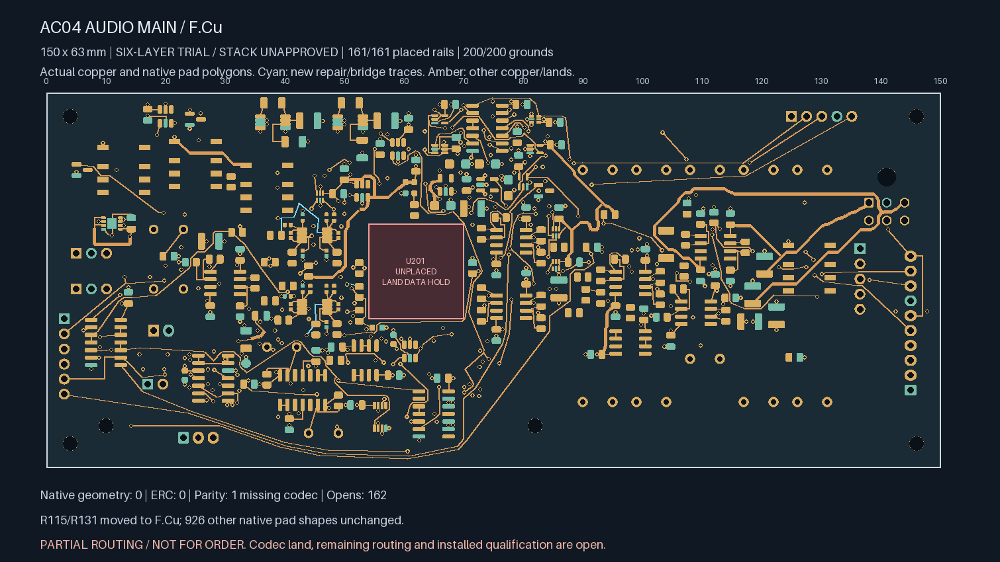
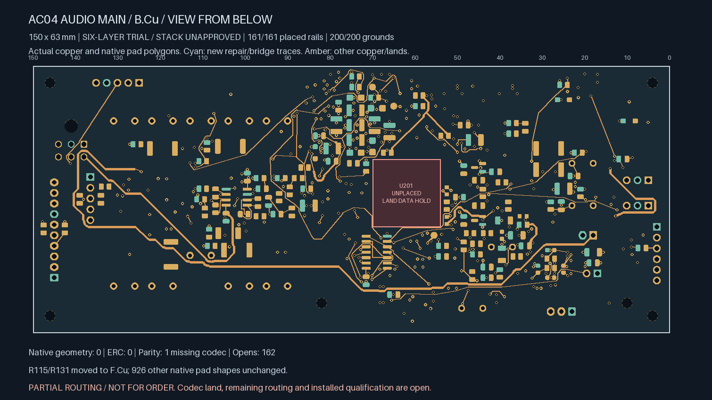
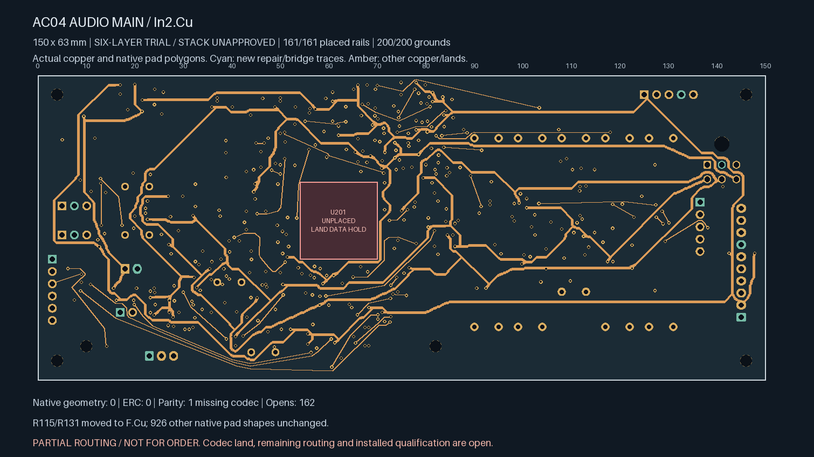
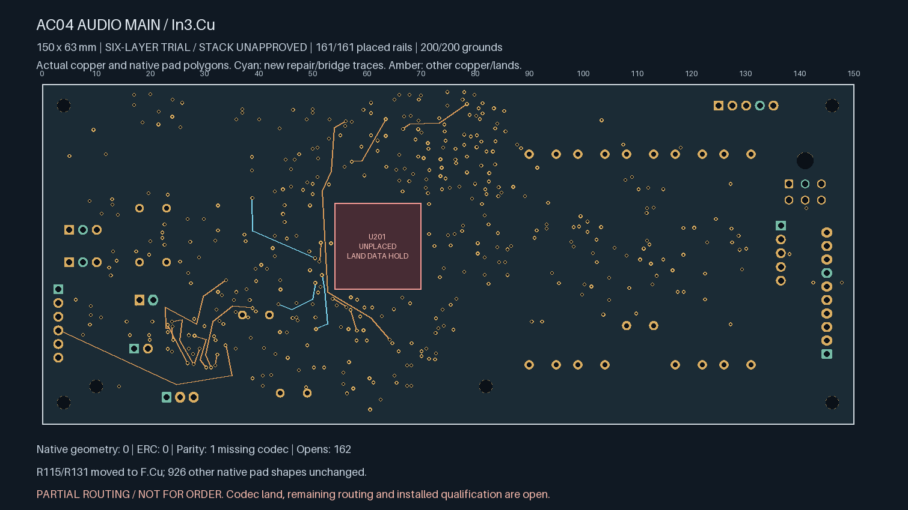
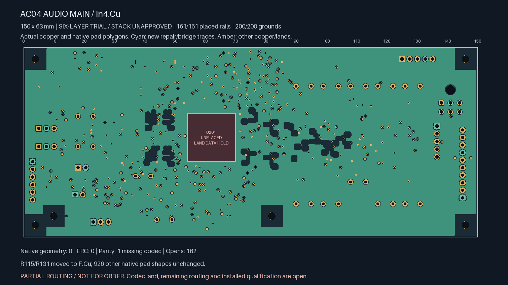

# Unselected amplifier power-down routing repair

**Partial routing; not ready for fabrication.** This continues the 165-open
six-layer trial and reaches **162 opens**. The selected four-layer readiness
checkpoint remains unchanged at 208 opens.

All placed terminals on PD_L, PD_R, PD_GATED and ADC_BIAS_WINDOW_OK now share their
respective native connection islands. The four comparator-input nets also remain
connected. This completes routing of the PD control nets; negative-bias power
branches and the wider audio circuitry remain unfinished.

Two existing 68 kΩ pull resistors move to front-side receiving locations. Their
values, package identifiers, footprint identities and native land geometry are
preserved through native KiCad flip/rotation templates.

| Reference | Previous pose | New pose |
| --- | --- | --- |
| R115 | B.Cu, (41, 31.5), 0° | F.Cu, (38.5, 24), 180° |
| R131 | B.Cu, (51, 39.5), 0° | F.Cu, (45.2, 39.8), 270° |

Fourteen old segments and one obsolete divider via are retired. Five routing
records add the three remaining PD connections and restore two interrupted
connections. Removing those connections temporarily gives 167 opens; the five
verified joins bring that to 162. There are 21 new 0.20 mm segments and three
0.60/0.30 mm vias.

| Path | Planar length | Construction limit |
| --- | ---: | ---: |
| U101.7 → R115.1 | 15.516 mm | 21.414 mm |
| U102.7 → R131.1 | 5.355 mm | 13.477 mm |
| Renewed right divider, including its retained source neck | 14.538 mm | 21.307 mm |
| Left divider connection | 24.843 mm | 37.307 mm |
| Complete renewed legacy ADC bias-control path | 29.290 mm | Original 42.560 mm |

The left divider connection shares one segment of its amplifier-entry trace.
That segment is emitted once; the connection length includes the shared copper.
Surface necks using new vias remain within 3.5 mm. The renewed ADC control path
reuses existing vias and has four physical transitions, within its original
four-via limit. No fresh via is added for that control repair.

The routing screen permits only each declared PD net's exact F.Cu entry through
its own amplifier region. Other layers, via masks, comparator spacing and all
authored plane openings remain unchanged. Unrelated supervisor routing remains
excluded. Native rules are unchanged and no check category is disabled.

Linux KiCad 10.0.7 reports zero geometry and ERC findings. The sole parity warning
remains the missing U201 / ES9292QPRO footprint. All 138 local pairs, 17 earlier
control pairs, 200 grounds, 161 rail pads, 108 inherited witness rows and two
private timing pairs remain connected. Witness rows include repeated repairs;
they are not a count of unique global joins.

The [independent repair review](PD-pin-repack-review.json) verifies the exact
retired copper, both native footprint templates, all new/reused segments, complete
path limits, native islands, two refilled planes and earlier connections. Of 930
native pad shapes, 926 remain unchanged and four match the declared native
flip/rotation templates. Nine regression tests reject unrelated power/placement
changes, incorrect pin-entry permissions, relaxed control limits, false source
islands, undeclared shared copper and larger drills.

The minimum new drill-edge-to-SMD gap is 0.385710479 mm. Each ground fill contains
8001.912747 mm² of copper. Exhaustive measurement of 15,996 same-layer pairs across
44 comparator-input tracks finds no violation of the 0.71 mm centreline-to-noisy-
copper policy, including the PD conductors. The four minimum distances remain
0.825 / 0.941893371 / 0.949882025 / 1.116353255 mm for BIAS_SHIFT_L / BIAS_SHIFT_R /
THRESH_LOWER / THRESH_UPPER respectively.

These are geometric/connectivity results. PD timing, coupling, partial-power
behavior and analog isolation are not qualified. Remaining fabrication work
includes 162 gaps, the approved codec land, accepted stack/material/process inputs
and electrical/mechanical release review. Hardware qualification requires later
measurements on assembled boards.

Actual copper views (bottom mirrored as viewed from below):

| Top | Bottom |
| --- | --- |
|  |  |
| In2 supplies | In3 signals |
|  |  |
| In1 ground | In4 ground |
|  |  |
