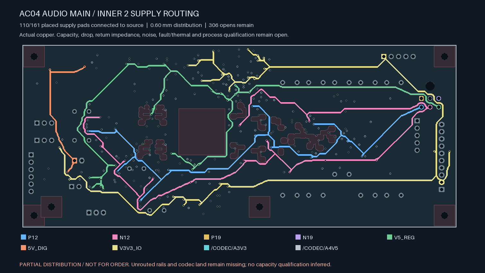
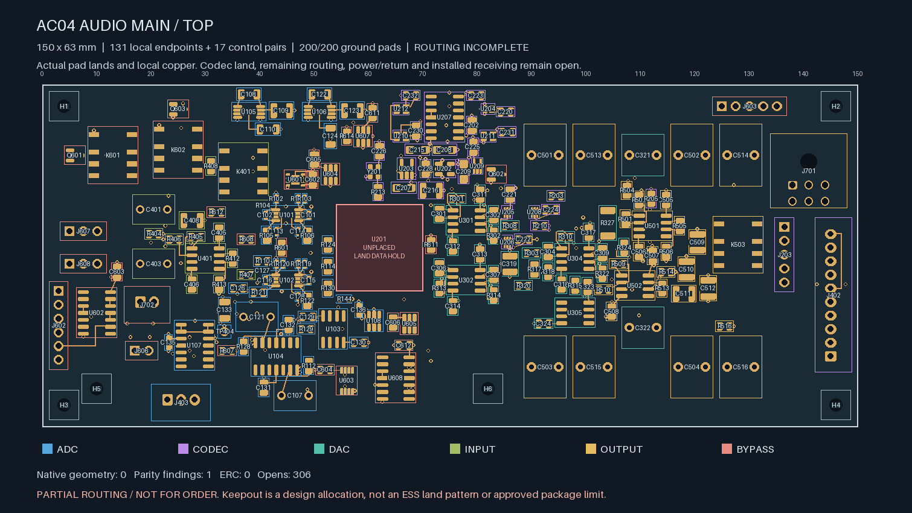
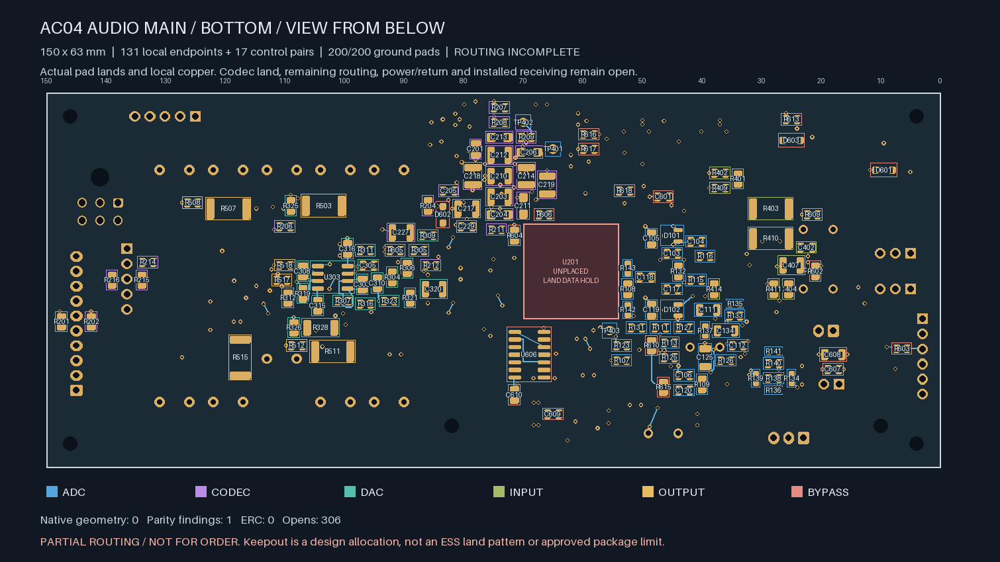
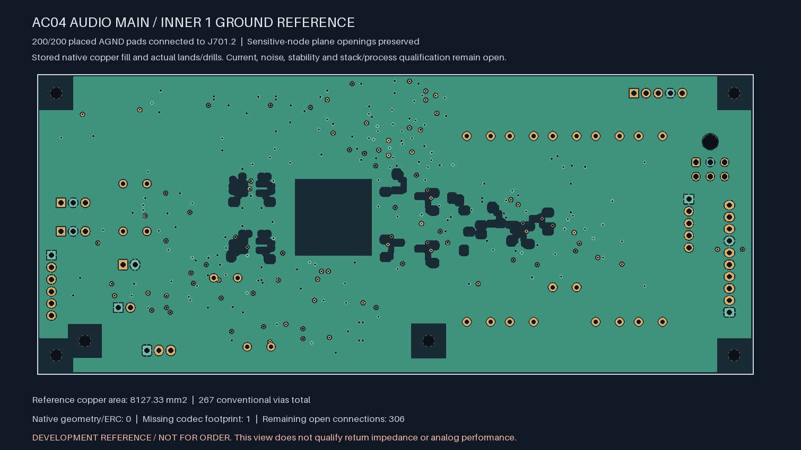

# AC04 — partial inner-layer supply distribution

**Not ready for fabrication.** This successor to the
[control-routing candidate](../audio-main-controls-01/README.md) reduces the
audio board from **376 to 306 open connections**. The codec land and remaining
signal/supply routes are still missing.

| Top copper | Bottom copper, viewed from below |
| --- | --- |
|  |  |

| Isolated Linux KiCad 10.0.7 check | Result |
| --- | --- |
| Geometry findings / ERC findings | **0 / 0** |
| Schematic parity | **1: missing U201/ES9292QPRO footprint** |
| Native open connections, uncapped | **306** |
| Ignored DRC / ERC categories | **0 / 0** |
| Tracks / conventional vias | **1,300 / 267** |
| Retained explicit local pairs | **138 / 138** |
| Retained added control pairs | **17 / 17** |
| Ground pads connected to J701.2 | **200 / 200** |
| Supply pads connected to designated source | **110 / 161** |

| Rail | Pads connected to source / placed pads | Source |
| --- | --- | --- |
| P12 | 21 / 23 | J701.4 |
| N12 | 21 / 23 | J701.5 |
| P19 | 1 / 4 | J701.1 |
| N19 | 1 / 4 | J701.3 |
| V5_REG | 23 / 28 | J701.6 |
| 5V_DIG | 4 / 7 | J702.1 |
| V3V3_IO | 37 / 63 | J402.2 |
| /CODEC/A3V3 | 1 / 5 | U202.5 |
| /CODEC/A4V5 | 1 / 4 | U203.5 |

The 825 new segments use **0.60 mm on In2** and **0.20 mm on the two surfaces**.
There are 68 new conventional 0.60/0.30 mm vias. Every new surface escape stays
within 3.5 mm; those lengths exclude via barrels. The minimum new drill-edge to
actual SMD copper gap is **0.170 mm**, including opposite-face and same-net
solder lands. Widths are construction choices, not a current-capacity rating.
Copper thickness, plating, mask/stencil, DC loss, transients, heating, coupling,
ground impedance, analog stability and installed fault behaviour remain open.

No footprints, component poses, existing analog/control copper, old vias,
mounts or authored keepouts change. The distribution also avoids the twelve
reserved sensitive-node inner-plane regions. The In1 AGND plane is refilled
by native KiCad around the new vias; its actual stored area is **8,127.33 mm²**.
The stored polygons independently match the retained native refill export.
All 200 placed grounds remain connected to input J701.2. This establishes
connectivity, not reference impedance or analog performance.

The [source-bound replay](routing-handoff.json) verifies original geometry,
actual new widths/drills/clearance screens, native findings and every retained
terminal witness. All pads on each newly joined supply island must reach their
declared source. The other 51 supply pads remain explicitly disconnected in
the native witness; they are not treated as powered merely because they share
a net name. The failed initial planning draft is retained separately; it was
never selected or native-accepted. The corrected planner uses branch targets
that lie on emitted copper and keeps adequate space around plated centres.

The 150 × 63 × 1.6 mm allocation and conditional receiving remain unchanged.
Remaining release work includes all 306 connections, approved ESS land and
interface data, physical ADC stars, final parts/mates/harness/supports, complete
power/return/fault/thermal/noise/stability qualification, supplier acceptance,
inspected manufacturing outputs and the first-article plan. No native Mac CAD,
supplier request, upload or board order was made.
