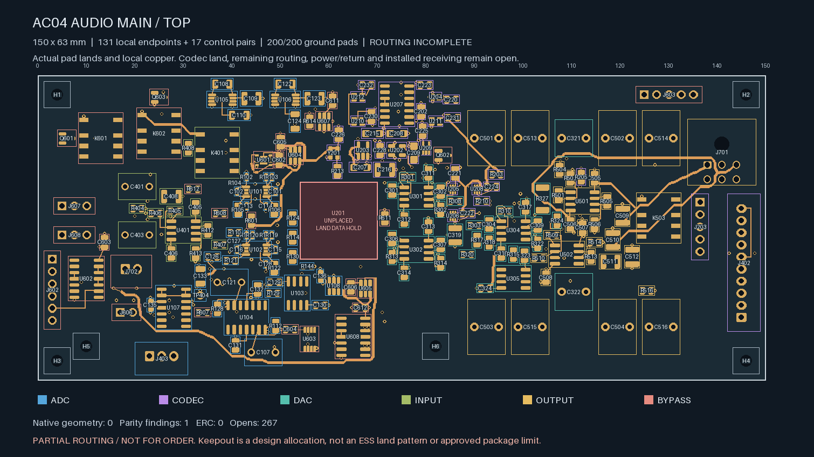
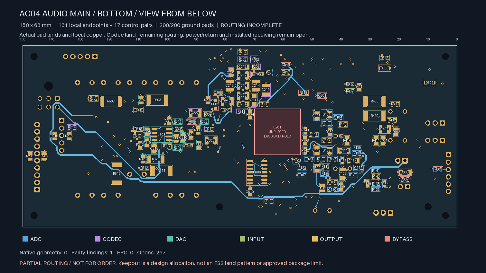
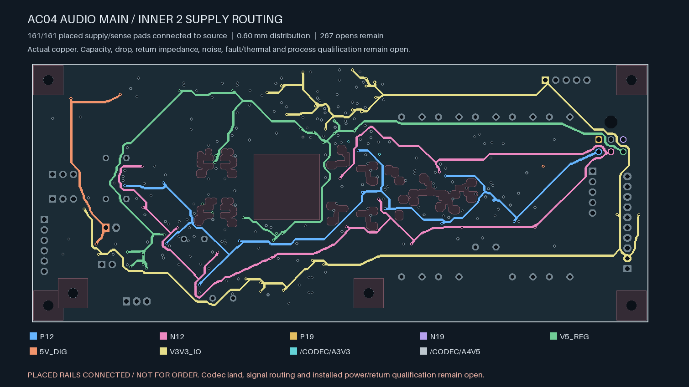
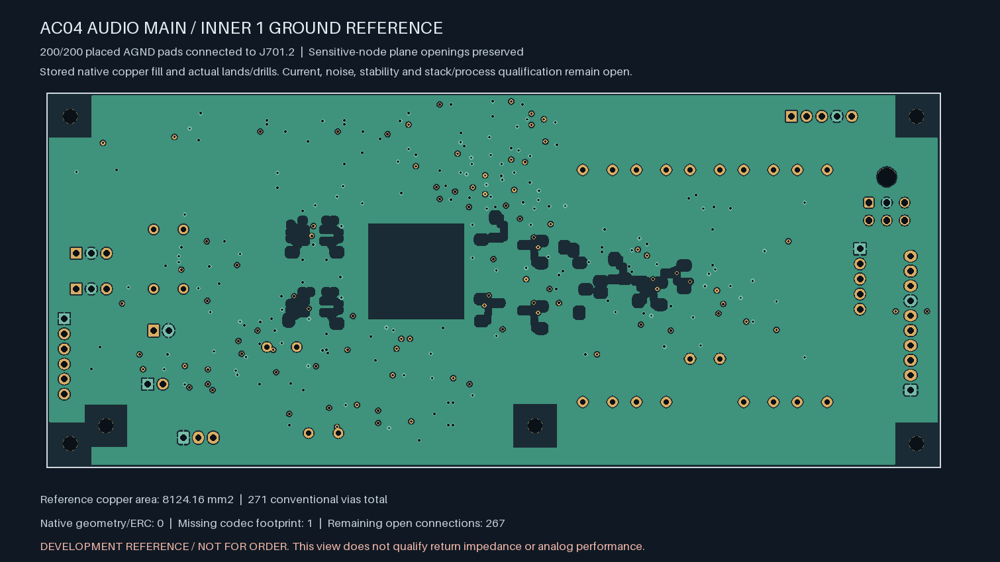

# AC04 — every placed supply and sense pad connected to source

**The board is not ready for fabrication.** All **161 placed supply/sense pads**
now reach their designated source, including all four ±12/±19 V rails, protected
5 V, logic I/O power and both codec-regulator outputs. U201/ES9292QPRO still has
no approved footprint. Its missing lands and the other **267 open connections**
remain unresolved.

| Actual top copper | Actual bottom copper, viewed from below |
| --- | --- |
|  |  |

| Actual retained In2 supply trunks | Actual refilled In1 reference |
| --- | --- |
|  |  |

| Isolated Linux KiCad 10.0.7 check | Result |
| --- | --- |
| Geometry findings / ERC findings | **0 / 0** |
| Schematic parity | **1: missing U201 footprint** |
| Native open connections, uncapped | **267** |
| Ignored DRC / ERC categories | **0 / 0** |
| Tracks / conventional vias | **1,729 / 271** |
| Placed supply/sense pads connected to declared source | **161 / 161** |
| Placed ground pads connected to J701.2 | **200 / 200** |
| Retained explicit local pairs / added control pairs | **138 / 17**, all connected |

The [inner distribution predecessor](../audio-main-supplies-02/README.md)
has 306 opens and 110/161 source-connected rail pads. The retained
[outer-layer checkpoint](../audio-main-supplies-03/README.md) adds 28 joins
and 248 tracks. This final step adds eleven joins, 181 tracks and four
conventional 0.60/0.30 mm vias. No component, old trace, existing drill,
mounting exclusion, sensitive-node opening or codec reserve changes. The
150 × 63 × 1.6 mm allocation and its conditional receiving remain unchanged.
All 131 declared local signal/supply endpoints and twenty local ground pairs
remain connected, as do the seventeen earlier control pairs.

Wide new distribution uses 0.60 mm on the outer layers. Short 0.20 mm exits
from fine-pitch terminals and plated centres retain a **3.5 mm limit each**.
Routes to existing powered vias terminate at their actual centres. The
source-bound audit accounts for every new segment, each width and short exit,
all actual drills and the native per-terminal witnesses. All actual drill
edges remain at least **0.170 mm** from SMD solder copper on both faces,
including same-net lands. Plane refill reduces stored reference area to
**8,124.16 mm²**; its stored polygons match the retained native export and all
200 grounds remain connected. Reference impedance is still unqualified.

The **R211.1 regulator-divider feed** is a separate 0.20 mm global branch,
**9.736 mm** long, within a declared 12 mm limit. It feeds 27.7 kΩ / 10 kΩ,
nominally about 119 µA at 4.5 V. It powers the adjustable supervisor's resistor
divider. The [TI TPS3890 datasheet](https://www.ti.com/lit/ds/symlink/tps3890.pdf)
identifies SENSE separately from VDD and specifies 100 nA maximum input current
for TPS389001 at the stated 5 V test condition. The construction calculation
uses a larger 1 µA sense allowance, 4.65 V rail bound, 0.1% resistors, 18 µm
copper and 105 °C copper temperature. Under those unapproved assumptions,
the 12 mm trace-only drop is below 10 µV. This allowance applies only to
R211.1; no analog feedback or local bypass length limit changes. Installed
rail bounds, copper, via loss, sensing accuracy, noise and fault behaviour
still need qualification.

The longest new wide relay feed is about **164.6 mm**; its current/return loop
and switching transients need review with the still-unrouted relay return.
Other rail drops, output loading and regulator/decoupling stability also remain
open. Connectivity alone does not rate a trace, validate analog performance
or establish installed thermal/fault behaviour.

The [combined replay](routing-handoff.json) binds the adopted copper, frozen
executed sources, complete native reports, refill and all real terminal keys.
Rejected bridge-search duplicates were removed; their executed sources and
diagnostic summaries are retained in `diagnostics/`. They were never selected,
native-accepted or used for manufacturing outputs.

Remaining release work includes the codec package/interface data and physical
ADC stars, all 267 other routes, complete PDN/noise/stability/fault/thermal
review, actual parts/mates/harness/supports/case receiving, supplier stack and
assembly acceptance, inspected Gerber/drill/BOM/placement outputs and the
first-article plan. No supplier message, upload, board order or native Mac CAD
launch was made.
