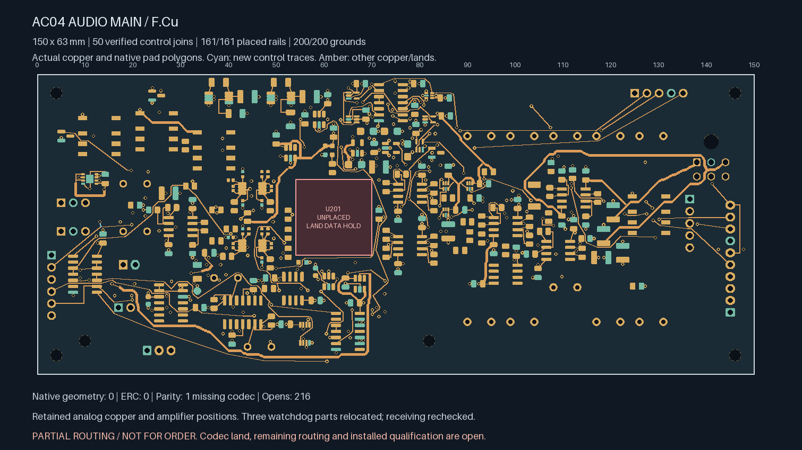
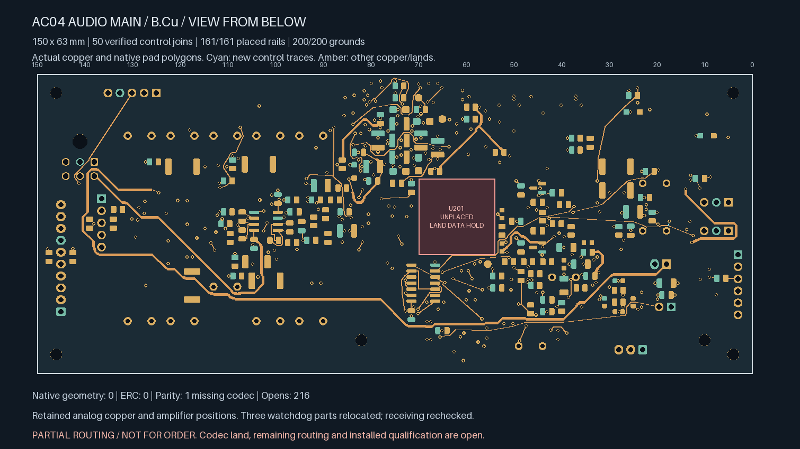
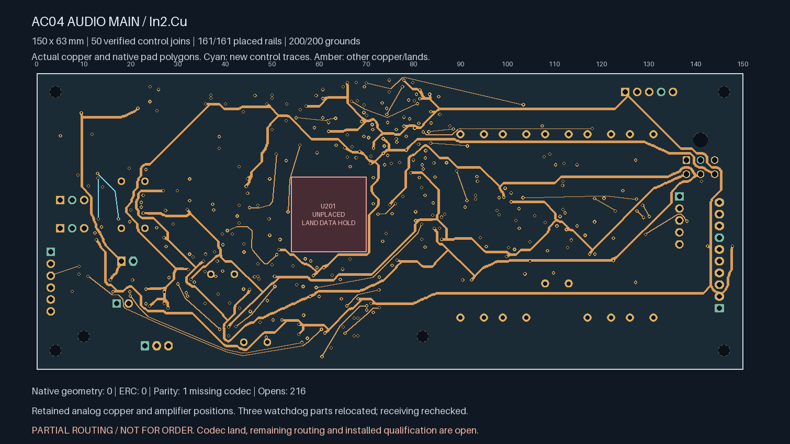
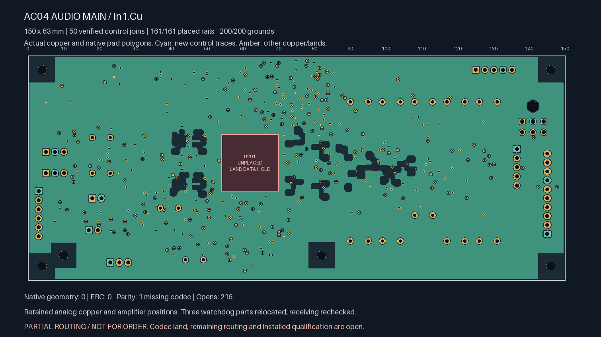

# AC04 — watchdog placement renewed and three connections completed

**Partial routing; not ready for fabrication.** The watchdog U601 and its two
capacitors C601/C602 move together into clear space within the unchanged
150 × 63 × 1.6 mm allocation. Both control connections and its private timing
capacitor path are now native-connected. Open connections fall from **219 to
216**, with **14 targeted control connections** still open. U201/ES9292QPRO
still lacks an approved footprint.

| Actual top copper | Actual bottom copper, viewed from below |
| --- | --- |
|  |  |

| Actual In2 copper | Actual refilled In1 reference |
| --- | --- |
|  |  |

| Isolated Linux KiCad 10.0.7 check | Result |
| --- | --- |
| Geometry / ERC findings | **0 / 0**, no ignored categories |
| Schematic parity | **1: missing U201 footprint** |
| Open connections | **216** |
| Tracks / conventional 0.60/0.30 mm vias | **2,291 / 360** |
| Earlier explicit local / earlier control / earlier global-control joins retained | **138 / 17 / 48**, all connected |
| New global control joins / private timing pair | **2 / 1**, connected |
| Placed rail/sense pads connected to designated source | **161 / 161** |
| Placed AGND pads connected to J701.2 | **200 / 200** |

The [predecessor](../audio-main-controls-02/README.md) had no usable short
watchdog GPIO escapes: its nearby ground via and power routing boxed in the
pins. The three-part rigid translation preserves the local capacitor spacing.
Receiving is checked again against actual courtyards, support exclusions,
opposite-face through-hole regions, the upper monitor, the floor and the panel.
Height, connector-mating and process limits remain conditional requirements.

The watchdog's replacement ground paths and 0.20 mm power entries are short.
Two 0.60 mm supply branches, **26.59 mm on B.Cu and 9.90 mm on F.Cu**, reconnect
the cell to the existing V3V3 source. The **2.141 mm** private timing route uses
one conventional via and a declared 3.5 mm construction limit. Timing accuracy,
coupling, loop impedance and installed fault behaviour remain unqualified.
Both GPIO vias are connected on a second layer and join real remote terminals;
they are not dangling placeholder escapes.

Only the declared support-copper changes and seven abandoned V3V3 leaf segments
are removed. The independent replay confirms that each pruned segment has a
free end without a real terminal or continuing track. All other component
positions, amplifier lands, analog/compensation copper, board edges, mounts,
sensitive-node openings and codec reserve remain exact. Native pad geometry
and the complete inherited terminal witnesses are checked separately.

Every actual drill edge clears actual SMD copper on both faces by at least
**0.16998 mm**, including same-net lands. Stored native In1 ground area is
**8,051.51 mm²** and all 200 ground pads remain connected. Drill/stack tolerances,
mask/tenting, stencil, two-sided assembly and reference impedance still need
acceptance. The [source-bound handoff](routing-handoff.json) retains the actual
refill, native reports, executed sources, copper delta and terminal witnesses.

The first placement trial exposed a relocated ground-via collision and
obsolete/dangling ends. Those were corrected; only the zero-geometry-finding
candidate above is selected. Compact rejected-trial diagnostics are retained
without duplicate board exports. Native Mac CAD remains disabled.

Release still requires the remaining routing, ESS land/interface information
and physical ADC stars, full power/return/noise/stability/fault/thermal review,
actual parts/mates/harness/support/case receiving, supplier stack and assembly
acceptance, inspected manufacturing outputs and a first-article plan. The
earlier long relay feed and its unrouted return remain open review items.
No supplier message, upload or board order has been made.
