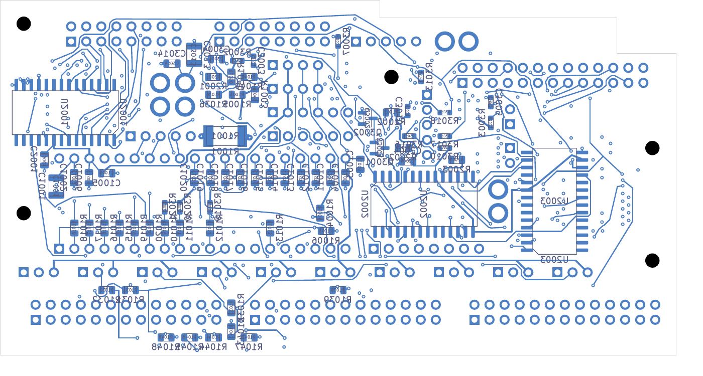

# Digital clock-source rework

This six-layer development candidate has **74 open connections across 65 nets**,
with zero native geometry, schematic-parity or ERC findings and every rule
category enabled. It completes one previously open level-shifter clock-source
net without losing any connected net. The selected DC04/AP04 sources remain
unchanged; this is not a fabrication release.

The later [71-open additive routing checkpoint](../digital-native-spacing-native-01/README.md)
retains this exact copper and placement, closes SDA and LED_SCK, and joins one
latch branch. Its long clock detour still needs electrical qualification.

[KiCad project](digital_core.kicad_pro), [native review](review.json),
[exact change and connectivity proof](clock-repack-review.json),
[independent placement/drill/SD audit](corridor-audit.json),
[complete net connectivity](stage-connectivity-review.json),
[conditional assembly check](conditional-assembly-review.json),
[visual review](visual-review.json).

R3016 moves on the back from (75,21) to (69,23) mm. U3005 pin 20 now connects
to its first pad through 4.480 mm of planar copper and one 0.60/0.30 mm via.
Its second pad rejoins the existing CLOCK_5V distribution. The crossed 3.3 V
branch is restored with its original 0.30 mm width; its path grows from
5.161 to 6.503 mm. Routing the clock source before restoring that branch was
necessary to keep access open. Six obsolete clock leaf tracks are removed.
The exact parent comparison permits only this component move, eight removed
tracks, eleven new tracks and one new via. All other component poses, copper,
board outline, mounting and plane definitions remain exact.

The parent [75-open checkpoint](../digital-interface-clean-native-02/README.md)
remains available. This candidate has 2,125 tracks and 424 vias. All 201
power/ground pads, 39 local connections and 33 thermal connections remain
native-connected. All six SD carrier paths retain 5.999 mm spread and one via
each. The drill audit's minimum non-exempt SMD gap remains 0.154984 mm; the
21 retained mask-covered heat-spreader vias retain their separate process hold.
Each ground/power layer has one physical connected copper component. All
138 components and five mounts clear the retained conditional AP04 envelopes.
The six native copper plots were rendered and visually inspected.

Remaining open nets comprise 39 LED outputs, two controls and 24 others.
The processor-side LED_SCK input and latch/data paths still need work; a
connected buffer-output net does not establish a complete LED interface.
The targeted follow-up for LED_49 and LED_52 found no valid route within its
bound. Existing vias, the status header and supply/control copper constrain
that region, so further coordinated changes are needed.

The global rerouting comparison is rejected: its native result has 91 opens,
three clearance errors and no newly closed nets. Its
[comparison record](../digital-selective-six-native-02/comparison.json) retains
the evidence. A separate interchange correction maps unlocked KiCad DSN
`type route` objects to `type normal`; the examined
[Freerouting parser](https://github.com/freerouting/freerouting/blob/master/src/main/java/app/freerouting/io/specctra/parser/Wiring.java)
treats unknown type tokens as fixed. The pinned router log confirms that the
corrected export recognizes movable traces. The original experiment is retained
with an explicit rejection record; existing protected-copper snapshots were
not rewritten.

The six-layer stack, complete routing, signal/power/thermal behavior and
installed receiving remain unqualified. The [whole-unit inventory](../../README.md)
still records the incomplete audio PCB, missing ESS land, NF routing, process
acceptance, harness/support/case work, manufacturing outputs and current
first-article preparation. No supplier request, order or fabrication release
has occurred in this work.
