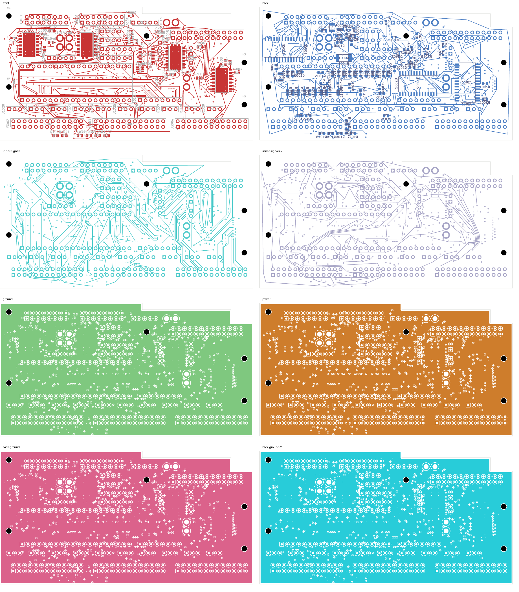

# CONTROL13 shortened: native-clean 28-open checkpoint

CONTROL13 now totals **40.498 mm with one via**, down from **107.197 mm and six
vias**. This removes the length penalty introduced while closing LED10 and is
also shorter than its 42.305 mm/four-via route before that repair.

The eight-layer digital comparison remains at **28 opens**, with zero native
layout, schematic-parity or ERC findings and every check category enabled.
Every native pad group is unchanged. LED10 remains connected and all unrelated
copper, footprints, authored zones and board geometry are exact relative to the
[28-open parent](../digital-led10-closed-native-01/README.md).

## Change and verification

The complete net was rerouted from J2001.14 to U2001.7, replacing the earlier
requirement to reconnect through both old stub endpoints. Its new via is at
(10.152, 6.726116) mm. Thirty-nine tracks and six vias are replaced by fifteen
tracks and one via, leaving **3,330 tracks and 534 vias**.

- [Native checks](review.json): 28 uncapped opens, zero other findings, all rules enabled.
- [Independent shortening audit](shortening-review.json): every pad group is exact;
  only CONTROL13 copper changes; native refill preserves authored geometry.
- [Physical audit](corridor-audit.json): all four actual plane unions remain connected;
  201 power/ground pads, 39 local, 33 thermal and 32 front-control connections remain intact.
- Minimum measured nearby foreign-copper clearance for the fifteen new tracks is
  **0.201248 mm**, above the unchanged 0.20 mm requirement. The new via was independently
  checked against captured native copper.
- Drill/SMD minimum remains 0.154984 mm; SD spread remains 5.999239 mm. Twenty-one
  exposed-pad via process holds remain unresolved.
- [Eleven focused tests pass](focused-tests.log), including rejection of changes to LED10.
- [Visual inspection](visual-review.json) covers eight layers and two regions on four
  signal layers. This is not silkscreen acceptance.
- [Recursive source audit](source-audit.json) includes the new proposal and remaining-net
  survey, current native evidence and unit records. The two historical NF test-hash
  mismatches remain disclosed.

## Continuation and limits

Continue from [this native PCB](digital_core.kicad_pcb) and its
[native capture](../digital-control13-shortened-inputs-28/capture.json).
The [retained-copper survey](../digital-remaining-region-survey-28-01/diagnosis.json)
now finds individual potential access for LED13, LED14 and LED16. Joint routing
and mutual new-via spacing still need to be established. SERIAL_0 and 27 LED
outputs remain open. Global shortest-route optimality and electrical performance
are not established.

Selected four-layer DC04 remains at 143 opens, audio at 208 and NF at 138, with two
isolated-ground warnings. Approved ESS package/land/stencil/interface data,
stack/process acceptance, harness/receiving, installed verification and first-article
qualification remain outstanding. No release, order, commit or external message
occurred. Full-unit work remains unfinished.
