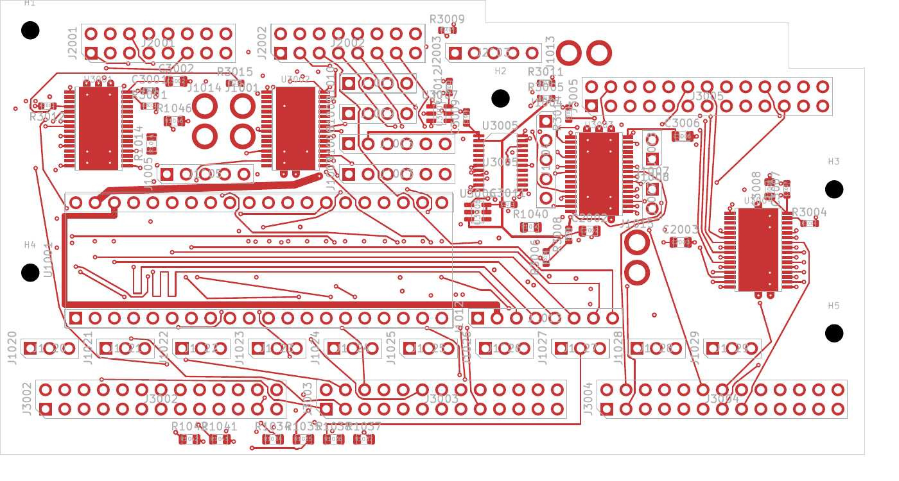
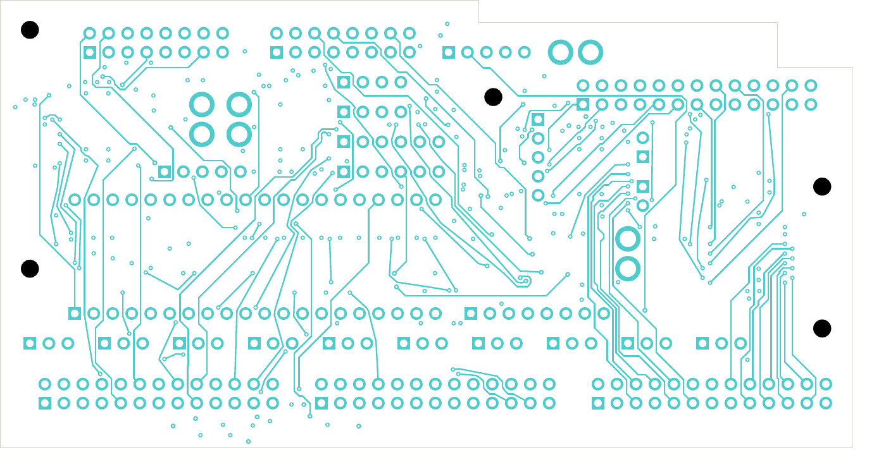

# Coordinated six-layer digital trial

This development comparison has **117 open connections across 91 nets**, with
zero native geometry findings, schematic-parity findings or ERC findings.
All native categories remain enabled. It is not the selected DC04 design and
is not released for fabrication.

The newer [interface completion checkpoint](../digital-interface-clean-native-02/README.md)
has 75 opens with the same SD matching and preserved power/local/thermal
connections. This 117-open checkpoint remains available as its reviewed parent.

[KiCad project](digital_core.kicad_pro), [native review](review.json),
[independent placement/drill/SD audit](corridor-audit.json),
[net-by-net connectivity](stage-connectivity-review.json).

| Checkpoint | Layers | Opens | Open LED nets | Open control nets | Other open nets |
| --- | ---: | ---: | ---: | ---: | ---: |
| Selected DC04 | 4 | 143 | 76 | 13 | 27 |
| Earlier six-layer trial | 6 | 113 | 72 | 13 | 18 |
| This coordinated trial | 6 | 117 | 39 | 12 | 40 |

The coordinated placement and exits substantially improve LED connectivity and
SD routing. The earlier six-layer trial still has four fewer total gaps because
it completed more other signals. Completion of those other interfaces is the
next routing priority; a lower airwire count alone is not qualification.

The [SD placement and routing review](../digital-coordinated-native-01/README.md)
records the fourteen moved resistors and revised supply/ground branches.
All six SD paths remain connected with one via each. Carrier planar lengths
span 66.720–72.719 mm, a 5.999 mm spread, compared with selected DC04's
36.703 mm spread. Module/socket/component/barrel/off-board paths, timing,
loading, reference transitions and impedance remain unqualified.

All 201 power/ground pads, 39 local connections and 33 thermal connections remain
native-connected. The board has 1,460 tracks and 298 vias. Every via drill was
screened against actual SMD copper on both faces, including same-net lands:
minimum non-exempt hole-edge gap is 0.154984 mm. The 21 unchanged vias in
mask-covered heat-spreader copper retain their separate assembly-process hold.
Placement checks retain the existing courtyard, THT solder, edge and mount
reserves. The coordinated four-layer geometry's conditional AP04 context check
also applies to these identical component poses; complete installed receiving
remains unfinished.

Cleanup removes 65 unused vias and 102 leaf tracks without losing a connection.
The two ground-zone fills each have a small lobe connected through J1007's
actual through-hole ground pad. An independent union of native zone, pad,
track and via copper proves one connected copper component on each of In1,
In2 and In4. This is a connectivity check, not a return-impedance, minimum-neck,
current-capacity or thermal qualification. All six native copper-layer PDFs
were rendered and visually inspected.

The source inventory continues to select four-layer DC04/AP04. This trial adds
In3 signal and In4 ground layers; the actual six-layer copper/dielectric stack,
impedance, process and assembly acceptance remain open. The complete unit also
retains the audio, ESS package, NF routing, mechanical/harness, electrical and
thermal, manufacturing-output and first-article gaps recorded in the
[whole-unit inventory](../../README.md).
