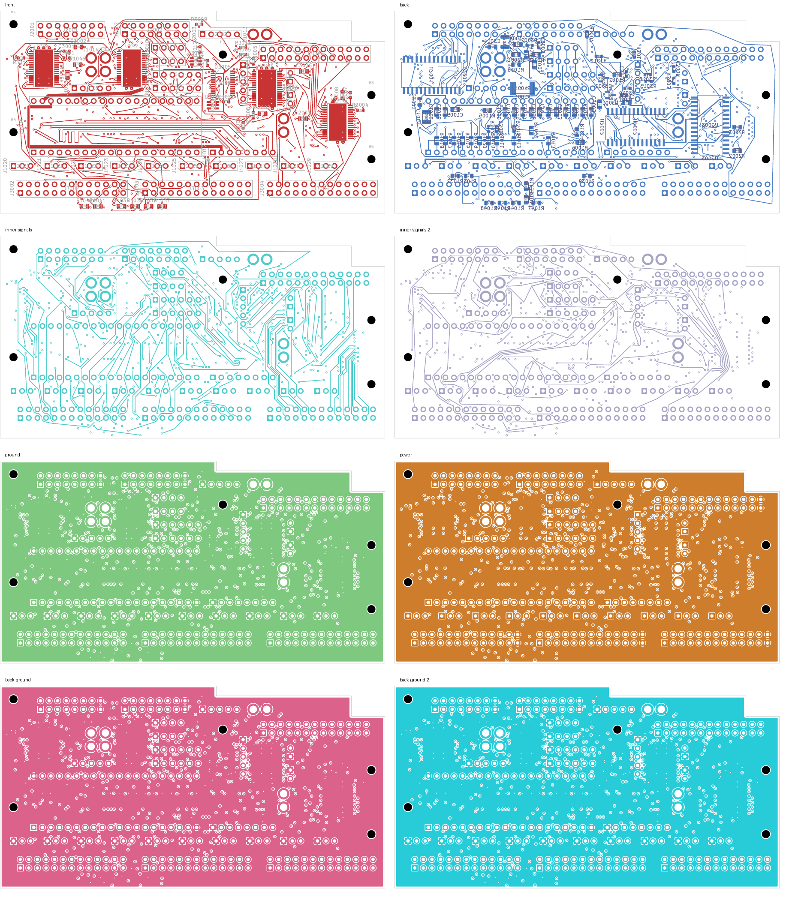
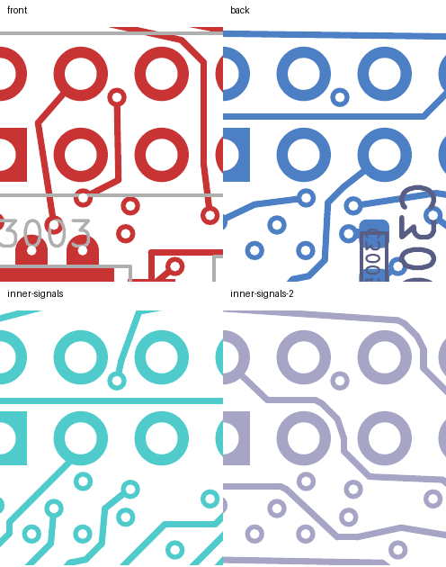

# Two-net shortening: native-clean 30-open checkpoint

SERIAL_1 and CONTROL30 are substantially shorter, with **every previous pad
connection preserved**. The eight-layer development comparison remains at
**30 open connections**, with zero native layout violations, zero schematic
parity findings and zero ERC findings. All rule categories remain enabled.

| Net | Previous 30-open checkpoint | Current planar copper | Previous/current vias |
| --- | ---: | ---: | ---: |
| SERIAL_1 | 340.912 mm | **129.919 mm** | 8 / 8 |
| CONTROL30 | 196.563 mm | **132.458 mm** | 2 / 0 |

This improves routing geometry; electrical performance remains unqualified.
CONTROL30 still takes a back-layer perimeter detour and remains longer than
its 53.336 mm route before SERIAL_1 was closed. Neither global minimum length
nor timing, coupling or EMC performance has been established.

## Final change

Only SERIAL_1 and CONTROL30 copper changes relative to the
[previous 30-open native PCB](../digital-serial1-closed-native-03/README.md).
All footprints, authored zones, board geometry and unrelated copper are exact.
The delta removes 91 tracks and eight vias, and adds 54 tracks and six vias:
the board now contains 3,276 tracks and 530 vias.

The planner measures real polygon-route lengths between sampled layer-change
positions, instead of considering only the number of layer transitions. It
retains complete screened proposals while comparing alternatives. The chosen
SERIAL_1 route keeps its established source and receiving escapes. CONTROL30
starts at through-hole J2003.4 and ends directly at U2003.3 on B.Cu, removing
the unused receiving via and return tail. Both proposals were replayed together
before generating the PCB. One intermediate SERIAL_1 vertex was centered on
its own via and checked again.

The search is bounded and uses a finite set of candidate positions; it does
not prove a globally optimal route. Supplying earlier native CONTROL30 via
positions did not improve its selected proposal in that trial. Two attempts
to restore its compact original branch failed to emit a candidate: the first
conflicted with a SERIAL_1 segment, and the second found no front-layer bypass
after one more old segment was removed. These results do not establish global
infeasibility.

## Verification

- [Strict native checks](review.json): 30 uncapped opens; zero violations,
  parity findings or ERC findings; all rule categories enabled.
- [Independent shortening audit](shortening-review.json): every native pad
  group matches the parent; both named nets are shorter and fully connected;
  every other per-net record is exact. Native refill preserves authored geometry.
- [Physical audit](corridor-audit.json): all four plane copper unions remain
  connected; 201 power/ground pads, 39 local connections, 33 thermal connections
  and all 32 front controls are preserved. Placement and mount checks pass.
- The 54 added tracks have no measured foreign-net copper gap below the unchanged
  0.20 mm requirement. The closest measured pair is **0.201397 mm**. All six new
  vias were rechecked against captured native copper.
- Minimum nonexempt drill-to-SMD gap remains **0.154984 mm**; 21 exposed-pad via
  process holds remain. SD planar spread remains **5.999239 mm**.
- [69 focused tests pass](focused-tests.log), including cost-graph, finite-budget
  candidate retention, via-seed screening and seven shortening-boundary checks.
- [Visual inspection](visual-review.json) covers all eight copper layers and
  four regions on all signal layers. This is not silkscreen acceptance.
- [Recursive source verification](source-audit.json) includes successful and
  failed searches, native evidence and current unit bindings. The same two
  historical NF test-hash mismatches remain explicitly disclosed.

## Continuation and unit status

Continue from [this native PCB](digital_core.kicad_pcb) and its
[absolute-path native capture](../digital-costed-shortening-inputs-30/capture.json).
The remaining digital connections are SERIAL_0 and 29 LED outputs. Further
length reduction and electrical qualification remain necessary before release.

The [current unit record](../../current-readiness.json) still selects four-layer
DC04 with 143 opens. Audio remains at 208 opens and NF at 138 with two isolated
ground warnings. Approved ESS inputs, stack and assembly processes, receiving,
installed-unit verification and first-article qualification remain outstanding.
No order, release, commit or external message was made. The full-unit goal
remains active.
