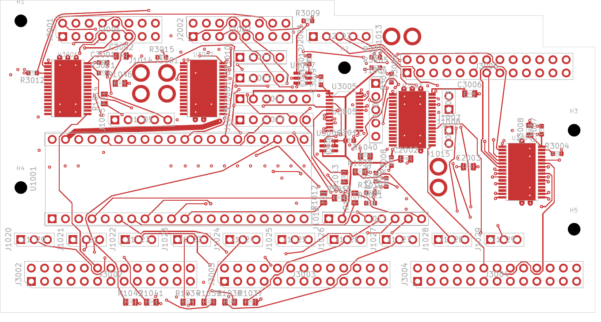
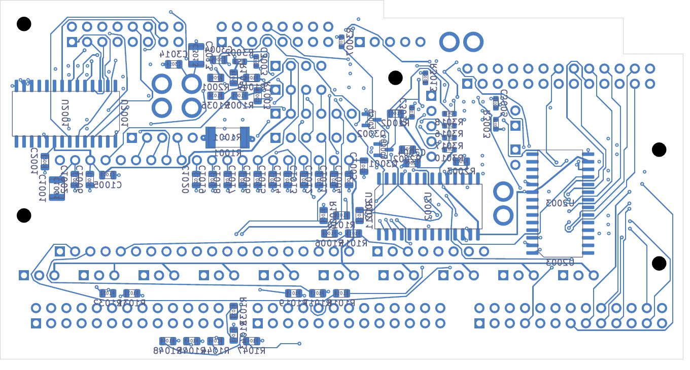

# DC04 partial digital signal routing — 2026-11-02

DC04 is the selected four-layer development checkpoint. It closes 112 of DC03's
255 remaining connections, leaving **143 opens across 116 nets**. Native KiCad
10.0.7 reports zero geometry findings, zero schematic-parity findings and zero
ERC findings with every category enabled. The unit is still unfinished and is
not released for fabrication.

[Open the project](digital_core.kicad_pro), [native results](review.json),
[independent handoff](handoff.json), [net-by-net witnesses](signal-connectivity-review.json).

## Preserved and checked

- All 138 electrical footprints, five mounts, board outline, layer declarations,
  original 245 tracks, 136 vias and two authored planes are unchanged from DC03.
- All 201 power/ground pads, 39 local connections and 33 thermal-via connections
  remain native-connected after zone refill.
- The candidate has 1,252 tracks and 243 vias. The 107 new drills clear SMD copper
  by a minimum 0.16998 mm, including same-net lands on either face. The 21 older
  vias within mask-covered heat-spreader copper retain their explicit process hold.
- Both native plane fills have one connected region. Exported contours include
  zero-area touching ring slits; geometric normalization preserves area within
  0.000001 mm² and produces one copper polygon. This does not establish return
  impedance, current capacity, minimum useful neck width or thermal performance.
- Thirteen focused integration/annotation tests pass. The independent digital
  audit, conditional assembly replay and full 15-role source inventory pass.

## Findings that still require design work

**LED/control escapes:** 76 LED-output nets, 13 control nets and 27 other nets
remain open. Shortest remaining-airwire count is insufficient to judge the layout:
the driver pin exits, opposite-face copper and through-via landing space need to
be planned together. Reserve local escapes before routing long connections.

**SD interface:** all twelve source/output SD nets are connected, but the sum of
carrier planar copper on each pair of nets is poorly matched:

| Signal | Carrier copper total, mm | Through vias |
| --- | ---: | ---: |
| CLK | 60.505 | 0 |
| CMD | 62.666 | 4 |
| D0 | 47.571 | 0 |
| D1 | 57.080 | 2 |
| D2 | 76.223 | 1 |
| D3 | 84.274 | 1 |

These are copper totals, not measured propagation delays or complete MCU-to-card
path lengths. They exclude the Seed module, socket, resistor bodies, via barrels
and off-board card connection. The 36.703 mm spread and unequal data via counts
require review against the complete interface. ST's
[AN4938 Rev 7, section 9.4.1](https://www.st.com/resource/en/application_note/an4938-getting-started-with-stm32h74xig-and-stm32h75xig-mcu-hardware-development-stmicroelectronics.pdf)
recommends less than 10 mm mismatch, equal data via counts, a controlled reference
plane and 50 Ω ±10% traces. This candidate has no accepted impedance stack or
complete interface timing budget. Revisit SD connector/series-resistor placement,
particularly the clock resistor's long source-side connection, before matching.

**Audio interface:** ADC_DATA, DAC_DATA, DAC_DATA_SRC, BCLK and WS are connected.
Clock and WS copper are approximately 4.186 mm each; ADC data is 3.825 mm.
This confirms connectivity only. Module and remote-board paths, loading, edge
rates and return transitions remain to be checked.

**Power and assembly:** the preserved power/thermal connections still need
source-to-load voltage-drop, transient, noise, current and thermal analysis.
[AP04](../assembly-layout-04/README.md) rechecks the unchanged digital component
poses against the existing conditional envelopes. Complete receiving, harness,
supports, mating parts, manufacturing tolerances and installed fit remain open.

## Six-layer comparison

The separate [six-layer trial](../digital-six-clean-native-01/digital_core.kicad_pro)
has 113 opens across 103 nets and zero native geometry/parity/ERC findings.
It adds an In3 signal layer and In4 ground plane while retaining DC03 component
poses and copper. Its [independent comparison](../digital-six-clean-native-01/comparison-review.json)
checks those changes and new drill locations. It still has 72 open LED-output
nets and 13 open control nets. The extra layers improve some global connections
but leave substantial pin-escape work. Neither bounded routing search proves
that its stack is unroutable.

The six-layer board remains unselected: its dielectric/copper stack, impedance,
process, cost and return-path behavior have not been accepted. Continue the
four-layer placement/escape revision unless a six-layer direction is chosen.

## Complete-unit assessment

| Area | Current evidence and remaining hold |
| --- | --- |
| Digital DC04 | 143 opens; SD matching, LED/control escapes and electrical qualification unfinished |
| Main audio, selected local-routing-02 | 588 opens; missing ESS footprint remains an explicit parity finding; local returns/global routing and codec receiving unfinished |
| NF negative-startup board | 138 opens and two explicit isolated-domain ground ERC warnings; timing cells, installed fit and power/fault integration unfinished |
| E28 rail disconnect | Native-clean; 311 retained drills intersect SMD copper, including 310 paste-target lands; location-specific fabrication/stencil treatment remains unresolved |
| P03 power | Native-clean; C50 stack/process hold includes five new SMD drill overlaps; installed PDN, thermal/fault and harness review unfinished |
| Unit assembly | Eight proposed functional PCB allocations plus panel/emitter boards and touch module; complete mechanical, harness, power and thermal receiving unfinished |

The next design pass should first correct SD placement/matching and reserve
LED/control escapes, then complete digital routing. Audio/ESS and NF work,
process receiving, complete-unit power/thermal analysis and inspected fabrication
and first-article outputs remain separate release requirements. No supplier
request, order or manufacturing release was made.
