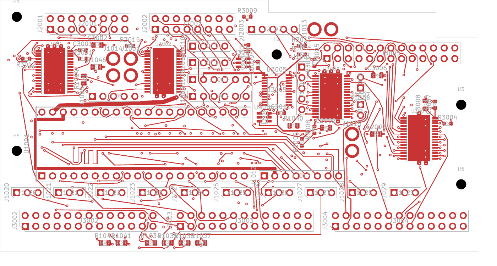
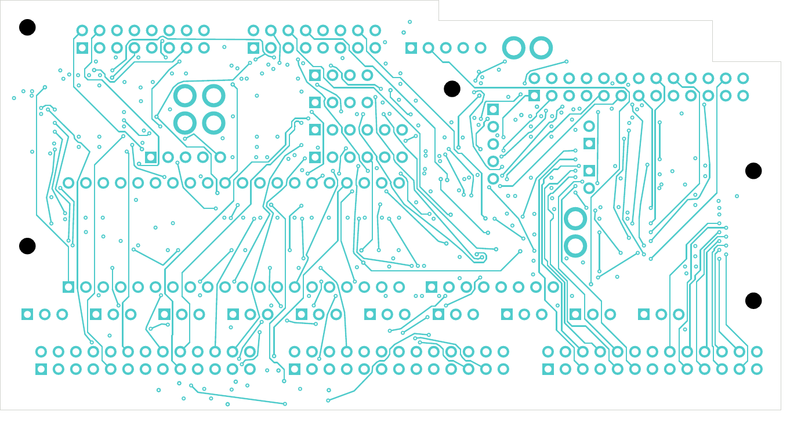

# Digital interface completion trial

This six-layer development candidate has **75 open connections across 66 nets**,
with zero native geometry findings, schematic-parity findings or ERC findings.
All native rule categories remain enabled. The selected four-layer DC04 source
is unchanged; this trial is not released for fabrication.

The newer [clock-source rework](../digital-clock-series-clean-native-01/README.md)
has 74 opens after moving R3016 and restoring its crossed supply branch. It
preserves every previously connected net and the SD/power/local/thermal checks.

[KiCad project](digital_core.kicad_pro), [native review](review.json),
[net-by-net connectivity](stage-connectivity-review.json),
[independent placement/drill/SD audit](corridor-audit.json),
[conditional assembly check](conditional-assembly-review.json),
[visual review](visual-review.json).

| Checkpoint | Layers | Open connections | Open LED-output nets | Open control nets | Other open nets |
| --- | ---: | ---: | ---: | ---: | ---: |
| Selected DC04 | 4 | 143 | 76 | 13 | 27 |
| Earlier six-layer trial | 6 | 113 | 72 | 13 | 18 |
| Coordinated SD/LED trial | 6 | 117 | 39 | 12 | 40 |
| This interface completion | 6 | 75 | 39 | 2 | 25 |

The interface pass completes 38 connections, followed by four additional joins:
POT_ADC_05 and branches of the LED blanking, clock and latch distribution.
The ADC data, DAC data (including its source segment), bit clock and word-select
nets are fully connected. BLANK_5V and CLOCK_5V distribution are connected, but
CLOCK_5V_SRC and both latch-related nets still have gaps. Connectivity does not
qualify timing, loading, noise, crosstalk or off-board interfaces.

J1001 moves 0.8 mm left, from (32, 14) to (31.2, 14) mm. Its two bulk-cap trace
ends follow the power pad. The retained connector footprint, pins, values and
nets are exact. The revised clock route would overlap the old connector pad;
the blanking route would have only 0.109 mm clearance there against the 0.20 mm
rule. The shifted connector retains the required 0.30 mm courtyard gap.
Fourteen experimental LED escapes did not complete additional output nets;
all fourteen unused vias and their 28 leaf tracks were removed. Native checks
confirm cleanup preserves the 75-open count and leaves no dangling warnings.

The candidate has 2,122 tracks and 423 vias. All 201 power/ground pads, 39 local
connections and 33 thermal connections remain native-connected. Every via drill
is checked against both faces' actual SMD copper, including same-net lands.
The minimum non-exempt hole-edge gap is 0.154984 mm. The 21 retained vias in
mask-covered heat-spreader copper retain their process hold. An independent
union of native zone, pad, via and track copper confirms one physical connected
component on each ground/power layer; return impedance and current capacity
remain unqualified.

The six SD carrier paths retain 66.720–72.719 mm planar lengths, 5.999 mm spread,
and one via each. The [coordinated routing review](../digital-coordinated-native-01/README.md)
records their construction and fourteen resistor moves. The measurements exclude
module/socket/component/barrel/off-board paths and are not a complete timing or
impedance budget. The six-layer copper/dielectric stack is not accepted.

All 138 electrical components and five mounts clear the retained conditional
AP04 floor/context envelopes. Courtyard, edge, mount and opposite-face THT
reserves pass. Actual parts, heights, mating connectors, wire paths, support
stack and complete installed receiving remain unfinished. All six native
copper-layer PDFs were rendered and visually inspected.

The next routing work needs coordinated changes around blocked LED exits and
remaining control/interface terminals. Merely increasing the search allowance
from 120,000 to 500,000 visited nodes completed four joins but no additional LED
output nets. The 39 remaining LED outputs, two control nets and 25 other nets
are listed explicitly in the connectivity evidence.

The [whole-unit inventory](../../README.md) still selects DC04/AP04 and audio
`audio-main-controls-01` with 376 opens and one missing ESS land. NF retains
138 opens and two isolated-domain ERC warnings. The ESS drawing, stack/process
acceptance, complete assembly/harness/supports, electrical/thermal review,
inspected manufacturing outputs and current first-article plan remain open.
The older E14/E25 executable bench plan does not qualify this configuration.
