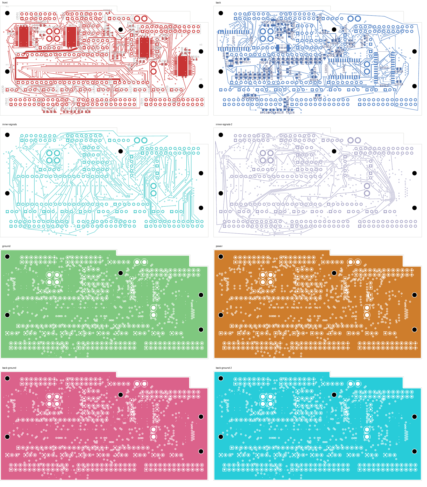
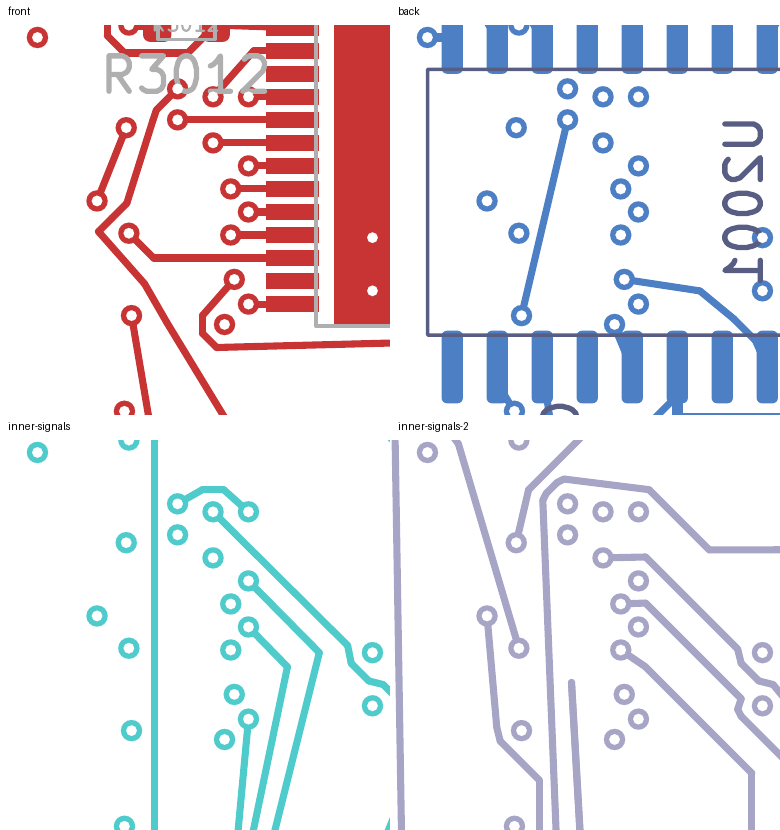

# LED09 closed: native-clean 29-open checkpoint

The eight-layer digital development comparison now has **29 open connections**,
down from 30. LED09 is connected, every previous pad connection is preserved,
and native KiCad reports **zero layout, schematic-parity or ERC findings** with
all rule categories enabled. This is a development checkpoint, not a fabrication
release or a completed unit.

## Changes and tradeoffs

LED09 escapes U3001.14 on F.Cu through a new via at (4.625, 19.875) mm and reaches
J3003.10 on In5.Cu. LED02, LED39 and CONTROL13 are explicitly restored around
the escape. All footprints, authored zones, board geometry and unrelated copper
remain exact relative to the [30-open parent](../digital-costed-shortening-native-01/README.md).

| Net | Before copper length | After copper length | Before / after vias |
| --- | ---: | ---: | ---: |
| LED09 | Unrouted | 195.907 mm | 0 / 1 |
| LED02 | 69.729 mm | 70.820 mm | 6 / 6 |
| LED39 | 133.676 mm | 133.826 mm | 5 / 7 |
| CONTROL13 | 42.316 mm | 42.305 mm | 4 / 4 |

LED09's long detour needs shortening and electrical qualification. LED39 gains
two vias. The prior SERIAL_1 and CONTROL30 shortening is preserved exactly.
The change removes four tracks and one via and adds 40 tracks and four vias,
leaving **3,312 tracks and 533 vias**.

## Verification

- [Native review](review.json): 29 uncapped opens, zero other findings, all checks enabled.
- [Independent closure audit](closure-review.json): only LED09's pad groups merge;
  all previous connections and all unrelated per-net records are exact. Authored
  geometry is unchanged by native refill.
- [Physical audit](corridor-audit.json): four connected plane copper unions;
  201 power/ground pads, 39 local, 33 thermal and 32 front-control connections
  preserved. Placement, mounting, drill/SMD and SD checks pass.
- The 40 added tracks have a minimum measured nearby foreign-copper gap of
  **0.202481 mm**, above the unchanged 0.20 mm requirement. Four new vias were
  independently rechecked against captured native copper.
- Nonexempt drill/SMD minimum remains 0.154984 mm; SD planar spread remains
  5.999239 mm. Twenty-one exposed-pad via process holds remain unresolved.
- [Seven new boundary tests pass](focused-tests.log), including rejection of
  unrelated geometry changes, wrong-net copper, drill changes and forged
  retirement inventories. The parent's 69-test record remains source-bound.
- [Visual review](visual-review.json) covers all eight layers and two detail
  regions on four signal layers. This is not silkscreen acceptance.
- [Recursive source audit](source-audit.json) covers this checkpoint, all eleven
  diagnostic/construction trials and the current unit record. The two previously
  disclosed historical NF test-hash mismatches remain visible.

## Search evidence and continuation

The retained-copper survey found no continuous multilayer path for any of the
30 previously open pad pairs under the planning constraints. Diagnostic removal
of neighbouring copper is not a solution unless every displaced net is restored.
LED70 fanout packing and coordinated SERIAL_2/LED71/BYPASS trials emitted no
candidate. LED30's two inner-track restorations were possible, but its tested
escape points still had no global path. The first LED09 trial was blocked by
retained LED39 copper; explicitly restoring that additional segment enabled
the complete candidate. These bounded searches do not prove global infeasibility
or global minimum route length.

Continue from [the native PCB](digital_core.kicad_pcb) and its
[native geometry capture](../digital-led09-closed-inputs-29/capture.json).
Next: shorten LED09 while preserving this connectivity, then complete SERIAL_0
and the remaining 28 LED outputs.

## Whole-unit status

The [current unit selection](../../current-readiness.json) remains unchanged:
four-layer DC04 has 143 opens, audio has 208 opens, and NF has 138 opens with two
isolated-domain ground warnings. Do not merge those isolated references into AGND.
Approved ESS package/land/stencil/interface inputs, stack and assembly-process
acceptance, harness/receiving work, installed-unit verification and first-article
electrical, thermal and EMC qualification remain outstanding. Zero native findings
on individual support boards do not establish whole-unit readiness.

No commit, order, release or external message occurred. The full-unit goal remains active.
