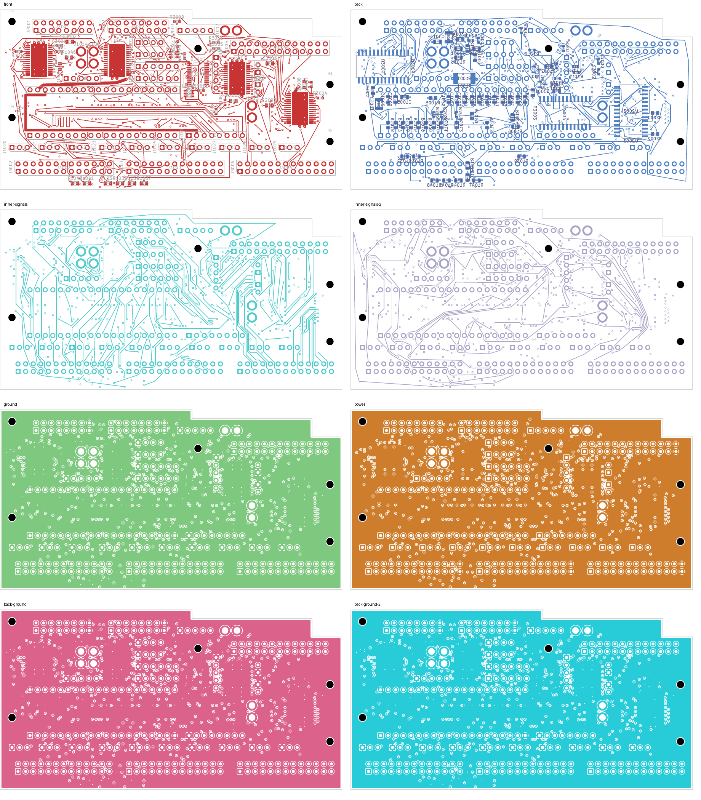
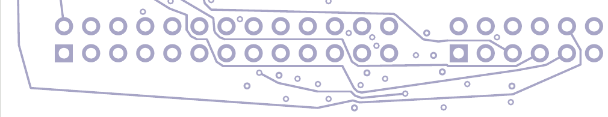

# LED09 shortened: native-clean 29-open checkpoint

LED09 is **124.070 mm**, down from **195.907 mm**, with its single via retained.
The 71.837 mm reduction preserves every native pad group. The eight-layer digital
comparison remains at **29 opens**, with zero layout, schematic-parity or ERC
findings and every check category enabled.

## Change and verification

Only LED09's In5.Cu chain changes. Its front-layer escape, via, every other net,
all footprints, authored zones and board geometry remain exact relative to the
[LED09 closure checkpoint](../digital-led09-closed-native-01/README.md).
Twenty-seven tracks are replaced by thirteen, leaving **3,298 tracks and 533 vias**.
No via is added, removed or changed.

The shortcut planner independently screens each proposed chord. The first candidate
preserved connectivity but produced one native copper-sliver warning. It remains
unadopted. Keeping the original upper-turn vertices produces the accepted geometry
with zero findings. Native rules were unchanged; the warning was not waived.

- [Native checks](review.json): 29 uncapped opens; zero other findings.
- [Independent shortening audit](shortening-review.json): every pad group is exact,
  only LED09 changes, and native refill preserves authored geometry.
- [Physical audit](corridor-audit.json): all four plane copper unions remain connected;
  201 power/ground pads, 39 local, 33 thermal and 32 front-control connections remain intact.
- Minimum measured nearby foreign-copper clearance for the thirteen replacement
  tracks is **0.202481 mm**, above the unchanged 0.20 mm requirement.
- Drill/SMD minimum remains 0.154984 mm; SD planar spread remains 5.999239 mm.
  Twenty-one exposed-pad via process holds remain.
- [Eleven focused tests pass](focused-tests.log): eight mutation-boundary checks
  and three shortcut-planner checks.
- [Visual review](visual-review.json): all eight copper layers and two detailed
  In5.Cu regions were inspected. This is not silkscreen acceptance.
- [Recursive source audit](source-audit.json) includes both proposals, the rejected
  native result, current evidence and the unit record. The two previously disclosed
  historical NF test-hash mismatches remain explicitly recorded.

## Continuation and limits

Continue from [this native PCB](digital_core.kicad_pcb) and its
[native copper capture](../digital-led09-shortened-inputs-29-02/capture.json).
SERIAL_0 and 28 LED outputs still need routing. LED09 still follows a perimeter
detour; this search does not establish globally minimum length or electrical,
timing, current/headroom, coupling or EMC performance.

The selected unit remains unchanged: four-layer DC04 has 143 opens, audio 208,
and NF 138 with two isolated-ground warnings. Approved ESS package/land/stencil
and interface inputs, stack/process acceptance, harness and receiving work,
installed verification and first-article qualification remain outstanding.
No release, order, commit or external message occurred. The full-unit goal remains active.
