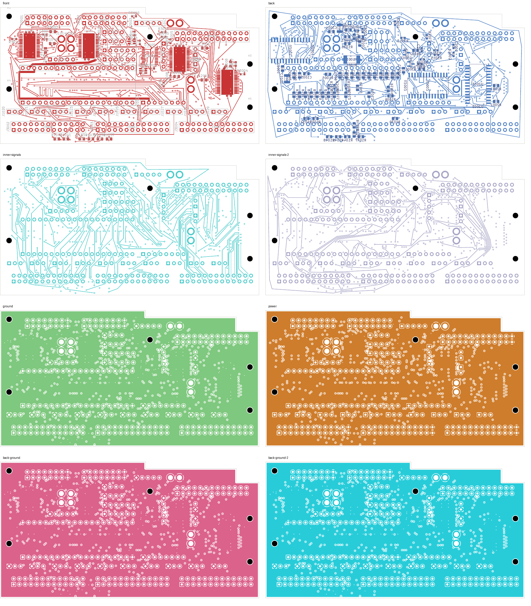
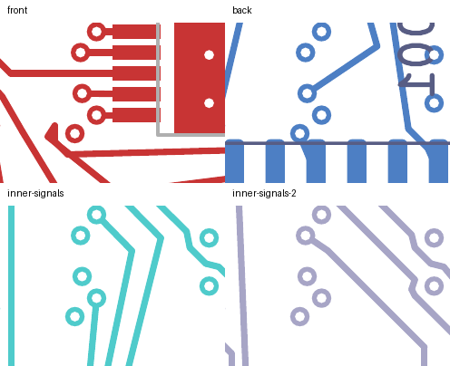

# LED10 closed: native-clean 28-open checkpoint

LED10 is connected and every previous pad connection is preserved. The eight-layer
digital development comparison has **28 open connections**, down from 29, with
**zero layout, schematic-parity or ERC findings** and every rule category enabled.

The significant tradeoff is CONTROL13: its total copper grows from **42.305 mm to
107.197 mm**, with four vias increasing to six. This is a connectivity checkpoint;
the longer control route requires optimization and electrical qualification.

## Change and comparison

LED10 connects U3001.15 to J3003.11 through **173.462 mm and four vias**. Its source
via occupies (7.55, 21.2) mm. Three CONTROL13 tracks and one via are retired and
their two retained endpoints are explicitly reconnected. CONTROL13's replacement
portion is 69.664 mm with three new vias. The new LED10 route changes layers through
the lower board area before reaching the connector on In5.Cu.

Only LED10 and CONTROL13 copper changes relative to the
[shortened LED09 parent](../digital-led09-shortened-native-02/README.md).
All footprints, authored zones, board geometry and unrelated copper remain exact.
The change removes three tracks and one via and adds 59 tracks and seven vias,
leaving **3,354 tracks and 539 vias**. LED09 remains 124.070 mm with one via; the
earlier SERIAL_1 and CONTROL30 shortening remains exact.

The first complete proposal routed LED10 through about 330 mm while keeping a
short CONTROL13 replacement. A longer bounded search found the present shorter
LED10 route, with the longer CONTROL13 replacement. Screened shortcut refinement
and complete mutual-copper replay preceded native validation. Neither proposal
establishes an electrically optimal design or globally minimum length.

## Verification

- [Native checks](review.json): 28 uncapped opens; zero other findings; all checks enabled.
- [Independent closure audit](closure-review.json): only LED10's pad groups merge;
  every previous connection and all unrelated per-net records remain exact.
  Native refill preserves authored geometry.
- [Physical audit](corridor-audit.json): all four actual plane copper unions remain
  connected; 201 power/ground pads, 39 local, 33 thermal and 32 front-control
  connections remain intact. Placement, mounting, drill/SMD and SD checks pass.
- Minimum measured nearby foreign-copper gap for the 59 new tracks is
  **0.201024 mm**, above the unchanged 0.20 mm requirement. All seven new vias were
  independently checked against the captured native board.
- Nonexempt drill/SMD minimum remains 0.154984 mm; SD planar spread remains
  5.999239 mm. Twenty-one exposed-pad via process holds remain.
- [Eleven focused tests pass](focused-tests.log): eight mutation-boundary checks
  and three shortcut-planner checks, including rejection of changes to the prior LED09 route.
- [Visual review](visual-review.json): eight layer overviews and four detail regions
  on all four signal layers were inspected. This is not silkscreen acceptance.
- [Recursive source audit](source-audit.json): both raw proposals, both refined
  proposals, local restoration searches, current native evidence and unit sources
  are checked. The two historical NF test-hash mismatches remain disclosed.

## Continuation and unit status

Local one-via restoration searches found no shared admissible region in three
windows, up to x=0.61–20 mm and y=10–32 mm. Multilayer searches confined to those
same windows also produced no complete route. These results do not prove global
infeasibility. Further CONTROL13 work should consider its entire route between
J2001.14 and U2001.7, rather than requiring reconnection through both old stub endpoints.

Continue from [this native PCB](digital_core.kicad_pcb) and its
[native copper capture](../digital-led10-closed-inputs-28/capture.json).
SERIAL_0 and 27 LED outputs remain open. LED10 and CONTROL13 need route optimization;
loading, settling, PWM coupling, timing, current/headroom and EMC remain unqualified.

Selected four-layer DC04 remains at 143 opens, audio at 208 and NF at 138, with two
isolated-ground warnings. Approved ESS package/land/stencil and interface inputs,
stack/process acceptance, harness/receiving work, installed verification and
first-article qualification remain outstanding. No release, order, commit or
external message occurred. The full-unit goal remains active.
