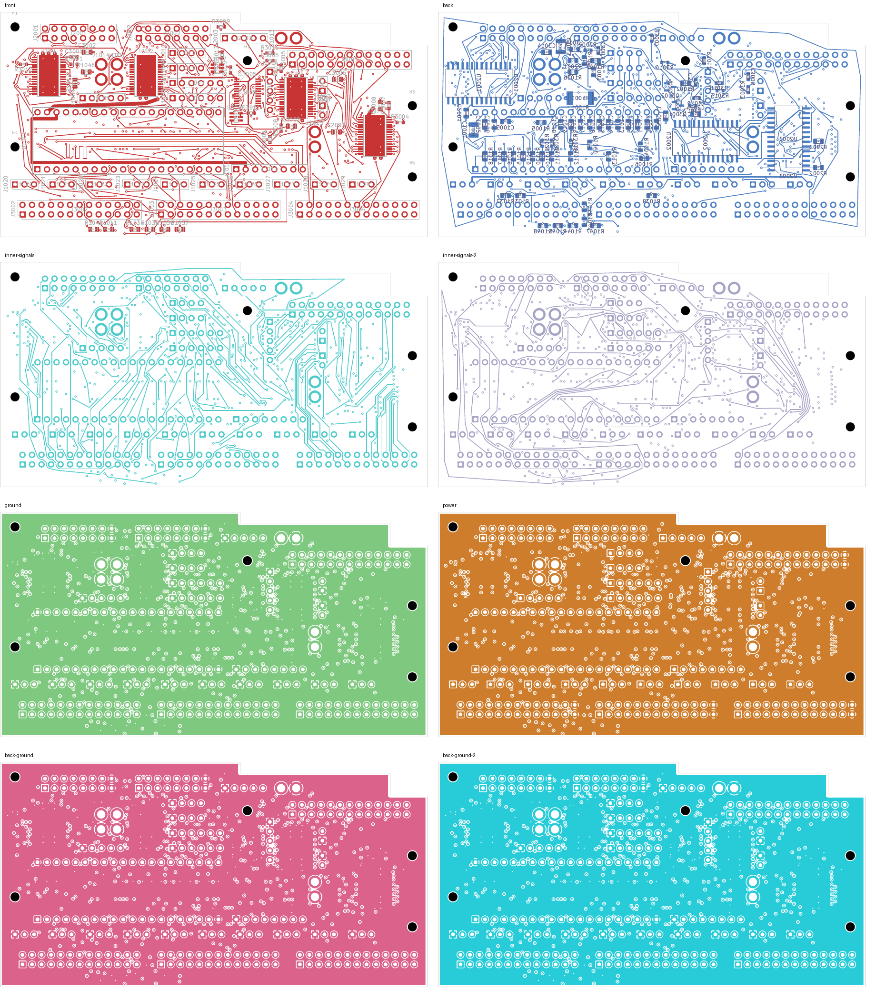
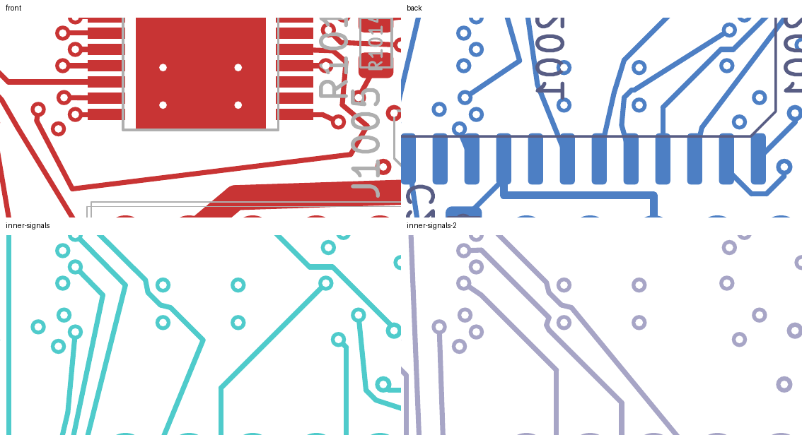

# LED16 closed: native-clean 27-open checkpoint

LED16 is connected through **53.962 mm and one via**. The eight-layer digital
comparison now has **27 open connections**, down from 28, with zero native layout,
schematic-parity or ERC findings and every rule category enabled.

Every previous pad connection and every existing copper object is preserved.
The preceding [CONTROL13 improvement](../digital-control13-shortened-native-01/README.md)
remains exact: **40.498 mm and one via**, down from 107.197 mm and six vias.
LED09, LED10, SERIAL_1 and CONTROL30 remain unchanged.

## Change and verification

Twelve tracks and one 0.60/0.30 mm via are added for LED16. It leaves U3001.21 on
F.Cu, passes around the lower side of the package, changes to In5.Cu through the
via near (6.521747, 21.670815) mm and reaches J3002.8. No old track or via is
removed or changed. All footprints, authored zones and board geometry are exact.
The board contains **3,342 tracks and 535 vias**.

- [Native checks](review.json): 27 uncapped opens, zero other findings, all checks enabled.
- [Independent closure audit](closure-review.json): only LED16's pad groups merge;
  every prior connection and every unrelated per-net record is preserved exactly.
  Native refill preserves authored geometry.
- [Physical audit](corridor-audit.json): four connected actual plane copper unions;
  201 power/ground pads, 39 local, 33 thermal and 32 front-control connections intact.
- Minimum measured nearby foreign-copper clearance for the twelve added tracks is
  **0.203657 mm**, above the unchanged 0.20 mm requirement. The new via was independently
  checked against captured native copper.
- Drill/SMD minimum remains 0.154984 mm; SD planar spread remains 5.999239 mm.
  Twenty-one exposed-pad via process holds remain unresolved.
- [Eleven focused tests pass](focused-tests.log), including rejection of undeclared
  retirement, unrelated geometry changes, incorrect-net copper and changed via drills.
- [Visual inspection](visual-review.json): eight layer overviews and two regions
  on four signal layers were reviewed. This is not silkscreen acceptance.
- [Recursive source audit](source-audit.json) checks this checkpoint, the six routing
  orders, the preceding CONTROL13 work and current unit sources. The two historical
  NF test-hash mismatches remain explicitly disclosed.

## Search limits and continuation

After CONTROL13 was shortened, the retained-copper survey found individual potential
access for LED13, LED14 and LED16. All six sequential routing orders were tried;
each produced only one completed connection. The shortest successful one was LED16.
This finite search does not prove that routing two or three together is impossible.
LED13 and LED14 remain open and need a different escape arrangement or further
rework of adjacent copper.

Continue from [this native PCB](digital_core.kicad_pcb) and its
[native copper capture](../digital-led16-closed-inputs-27/capture.json).
SERIAL_0 and 26 LED outputs remain open. Electrical, loading, PWM coupling,
current/headroom, thermal and EMC qualification remain unfinished.

The selected unit remains unchanged: four-layer DC04 has 143 opens, audio 208 and
NF 138 with two isolated-ground warnings. Approved ESS package/land/stencil and
interface inputs, stack/process acceptance, harness/receiving, installed verification
and first-article qualification remain outstanding. No release, order, commit or
external message occurred. Full-unit work remains unfinished.
