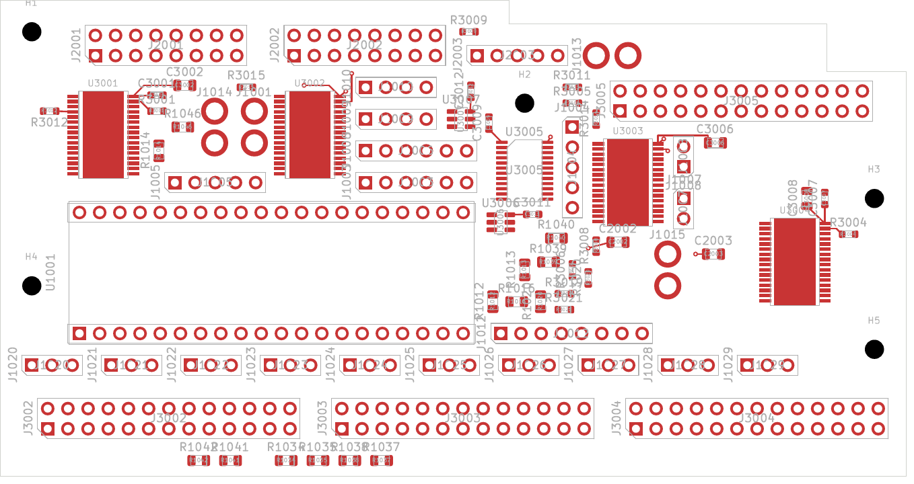
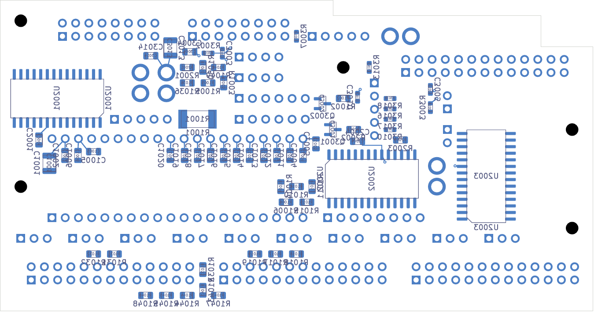

# DC02 — local power, filter and reference cells

This selected digital development candidate has **427 missing connections**, down
from 466, with zero native DRC geometry, schematic-parity and ERC findings. Every
native category remains enabled. **Not released for fabrication.**

The 138 electrical parts, five mounts, connector positions, notched 114 × 60 mm
outline and 1.6 mm declared thickness are retained. Three MCP23017 expanders and
39 capacitors/resistors have new explicit sites. The previous expander arrangement
between the Seed solder-pin rows left insufficient nearby space for decouplers.
The ten pot-input filter capacitors now have approximately 2.29 mm local traces
to their Seed pins, instead of 9.6–28.4 mm straight-line separations.

Thirty-nine local connections use 59 new segments and eight 0.60/0.30 mm through
vias. Signal copper remains on the outer faces; both inner layers remain available
for the unfinished power/return design. All eight drilled holes are independently
screened outside front/back SMD copper with at least 0.15 mm hole-edge separation.
This is a geometry screen, not mask-web, plating, registration or stencil approval.

Some local parts use the opposite board face. Their actual routes include the
necessary conventional dogbone vias. The longest current-reference route is
R3002 at 8.864 mm; its placement distance alone must not be used as the routed
length. Its return path and noise sensitivity still require review. The new
connections do not complete ground returns, bulk distribution, exposed-pad
thermal paths, LED current returns or the remaining control/audio/SD signals.

Native source-bound evidence includes [review.json](review.json),
[local-connectivity-review.json](local-connectivity-review.json), the
[additive geometry audit](independent-geometry-audit.json), and
[handoff.json](handoff.json). An independent inverse-transform audit restores all
electrical/mechanical geometry after undoing the 42 declared component changes;
only annotation half-turns are normalized. The full four-sheet schematic is
captured and hashed. The earlier placed-only file lacked persistent pad UUIDs;
the new native checkpoint supplies stable IDs for routing/connectivity evidence.

Both views were inspected at 300 dpi. Thirteen focused integration/audit tests
pass. The [AP02 arrangement](../assembly-layout-02/README.md) rechecks the actual
new poses under the existing conditional receiving limits. Complete installed
fit, actual parts/process acceptance, supply/return and thermal performance,
dynamic fault behavior and final manufacturing/assembly drawings remain open.

The earlier signal-router trial is retained as unselected evidence. Trial 02
incorrectly used reserved inner layers and was rejected. Trial 03 correctly
restricts signal tracks to the outer layers, but uses the superseded remote-cap
placement; its copper is not adopted into DC02.

Revalidate the selected candidate with `python -m hardware.fabrication.audit_scope`.
The next routing capture is `../digital-local-cell-inputs-427/capture.json`.
