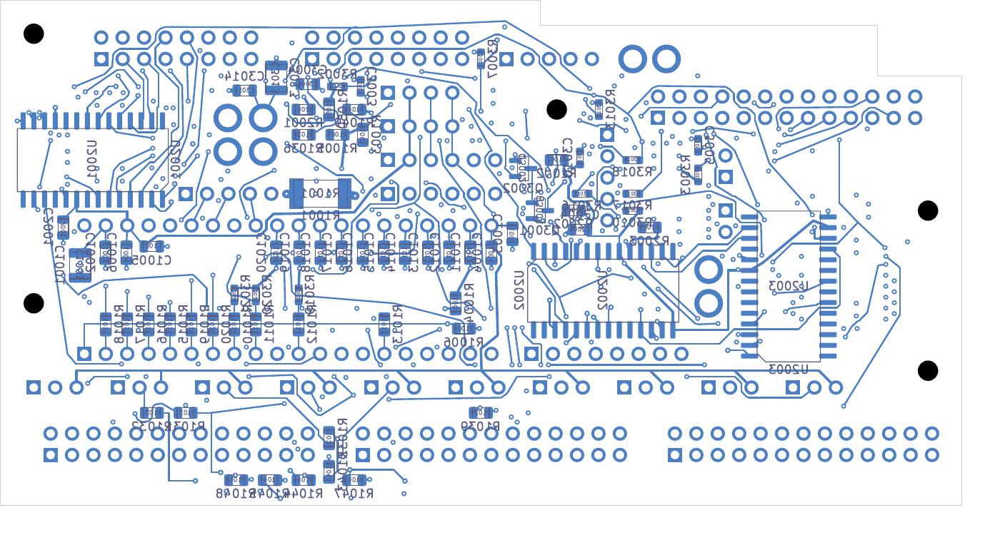

# Digital routing with native-sized via spacing

This six-layer development candidate has **71 open connections across 63 nets**,
with zero native geometry, schematic-parity or ERC findings and every rule
category enabled. It improves the [74-open parent](../digital-clock-series-clean-native-01/README.md)
by adding three joins. Selected DC04/AP04 remain unchanged; this is not a
fabrication release.

[KiCad project](digital_core.kicad_pro), [native review](review.json),
[exact additive change and pad-group proof](additive-route-review.json),
[new drill-gap and corrected-planner recheck](new-via-gap-review.json),
[placement/drill/SD audit](corridor-audit.json),
[complete connectivity](stage-connectivity-review.json),
[conditional assembly check](conditional-assembly-review.json),
[visual review](visual-review.json).

| Net | Connected pad groups before → after | Added planar copper | New vias |
| --- | --- | --- | --- |
| LATCH_5V | 3 → 2 | 85.046 mm | 4 |
| LED_SCK | 2 → 1 | 94.415 mm | 9 |
| SDA | 2 → 1 | 58.979 mm | 4 |

These are connectivity improvements. **The LED clock detour needs rework or
signal-integrity qualification**: LED_SCK now totals 96.178 mm and nine vias.
The still-incomplete latch net totals 175.379 mm and ten vias. SDA totals
164.559 mm and fourteen vias across its branches. Total copper lengths are
not point-to-point delay or loading budgets. Stack, edge rates, impedance,
reference transitions, pull-up/loading and complete installed interfaces remain
unqualified. Native clearance checks do not establish those properties.

The new additive planning screen distinguishes actual copper diameters from
drill diameters and same-net from foreign-net vias. It retains 0.20 mm
foreign-net copper clearance, 0.25 mm drill-to-drill clearance, 0.16 mm planned
drill-edge/SMD spacing and the routing margin. It replaces a blanket 0.86 mm
via-centre exclusion; it does not lower native acceptance rules. Six focused
boundary/data-contract tests and the thirteen existing digital tests pass. The resulting
109 tracks and seventeen 0.60/0.30 mm vias pass independent native checks.

Final validation found that the native capture omits via drill dimensions.
The corrected v2 planner reads these from the hash-checked paired PCB. All
three added paths and seventeen vias pass that corrected screen. Independently,
the smallest new-drill-to-other-drill edge gap is 0.524621 mm, above the native
0.25 mm requirement. Two new vias have another via within the former blanket
0.86 mm centre exclusion. The original sealed planner evidence is retained;
future routing uses `digital_native_spacing_routes_v2`.

The [remaining-net follow-up](../digital-native-spacing-routes-02/outcome.json)
tries 56 other nets through 71 bounded searches and adds no copper. Further
placement or coordinated routing work is required.

The board has 2,234 tracks and 441 vias. Every parent copper object, component
pose, outline, mount and authored plane definition remains exact. Every parent
pad group remains connected, including groups on unfinished nets. All 201
power/ground pads, 39 local connections and 33 thermal connections are preserved.
Each ground/power layer has one physical connected copper component. SD paths
retain 5.999 mm spread and one via each. The minimum non-exempt drill-edge/SMD
gap remains 0.154984 mm; the 21 original mask-covered heat-spreader vias retain
their process hold. All 138 components and five mounts clear the conditional
AP04 context; complete installed receiving remains unverified. All six native
copper PDFs were rendered and visually inspected.

The [whole-unit inventory](../../README.md) records the unfinished audio/NF
routing, ESS land, stack/process acceptance, actual parts/mating/harness/supports,
power/noise/thermal qualification, manufacturing outputs and first-article work.
No supplier request, order or fabrication release has occurred.
