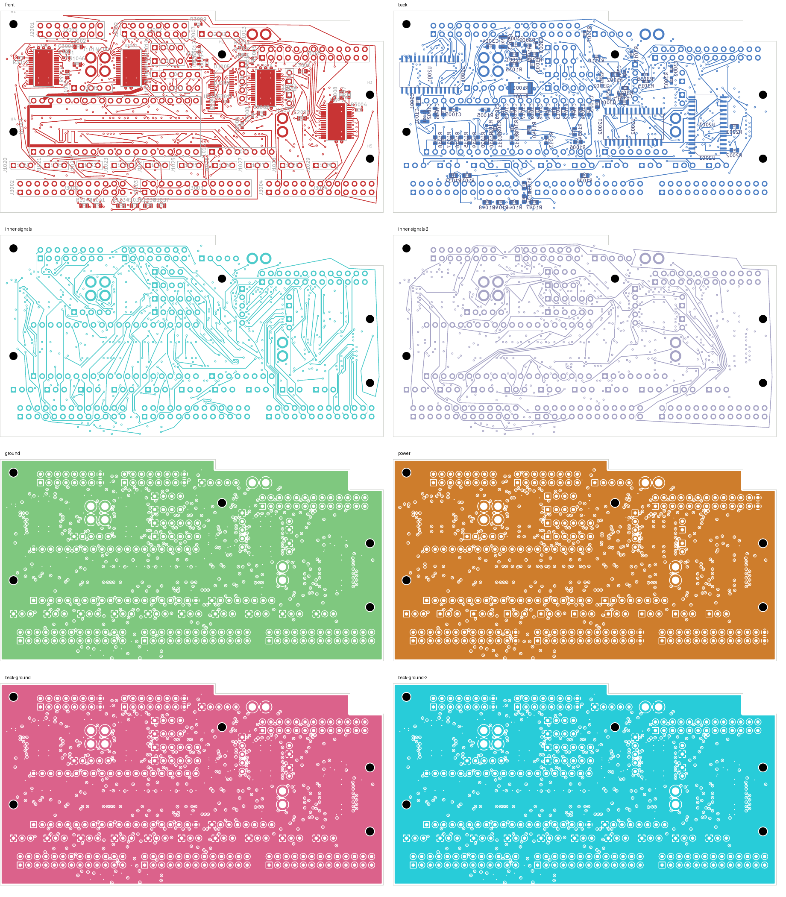
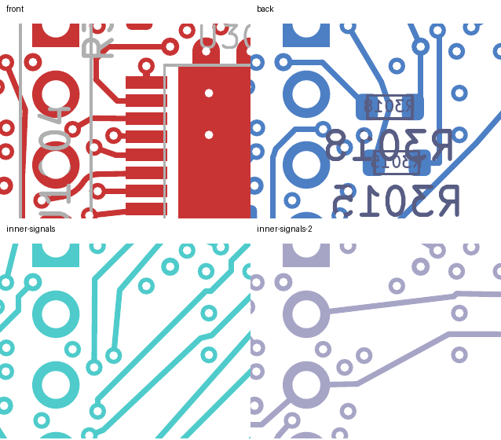

# SERIAL_1 closed: native-clean connectivity checkpoint

The eight-layer development comparison now has **30 open connections, down
from 31**. SERIAL_1 is connected, every previous pad connection is preserved,
and strict native checks report **zero layout violations, zero schematic-parity
findings and zero ERC findings**, with all rule categories enabled.

This is a connectivity checkpoint. **SERIAL_1 and CONTROL30 need route-length
optimization and electrical qualification.** The selected four-layer DC04
design remains unchanged at 143 opens; this comparison is not a fabrication
release or a qualified replacement.

## Final layout changes

R3015 moves 0.25 mm right, from (75.00, 21.00) to (75.25, 21.00), on B.Cu with
the same orientation, footprint, pad identities and net assignments. Its two
DATA branches are restored. CLOCK leaves its existing receiving via on B.Cu;
LED48 leaves on In3.Cu. Avoiding an unnecessary additional CLOCK via allows
both LED48 and SERIAL_1 to pass through the receiving area.

SERIAL_1, CLOCK, LED48, LED50, CONTROL30 and both DATA nets are fully connected.
A redundant SERIAL_1 source via and the unused CONTROL30 branch are removed.
Relative to the [31-open source checkpoint](../digital-serial1-source-preparation-native-01/README.md),
29 tracks and five vias are replaced by 94 tracks and eleven vias. The result
has 3,313 tracks and 532 vias. Only R3015 and these seven nets change; all other
footprints, copper, authored zones and board geometry remain exact.

| Net with changed native totals | Previous planar copper | Current planar copper | Previous/current vias |
| --- | ---: | ---: | ---: |
| SERIAL_1 | 0 mm; open | 340.912 mm; connected | 0 / 8 |
| CONTROL30 | 53.336 mm | 196.563 mm | 4 / 2 |
| DATA_5V_SRC | 16.753 mm | 16.680 mm | 2 / 2 |
| DATA_5V | 103.539 mm | 103.289 mm | 2 / 2 |
| LED48 | 10.822 mm | 11.057 mm | 1 / 1 |

CLOCK and LED50 retain their previous native length and via totals. The large
SERIAL_1 perimeter detour and approximately 143.2 mm CONTROL30 increase are
explicit limitations. Timing, coupling, EMC and installed performance have not
been demonstrated. The earlier MCU_PERMIT source rework also remains unqualified.

## Verification

- [Native results](review.json): 30 uncapped opens, zero violations/parity/ERC.
- [Independent closure audit](serial1-closure-review.json): SERIAL_1 is the only
  newly closed net; every previous pad connection is retained. All unrelated
  per-net records match the parent exactly. Native refill preserves the authored
  candidate geometry.
- [Physical audit](corridor-audit.json): 201 power/ground pads, 39 local and 33
  thermal connections retained; all 32 front controls connected. All four plane
  copper unions remain connected. Placement, mount and opposite-face checks pass.
- The 94 added tracks have no measured foreign-net gap below the unchanged
  0.20 mm requirement; the closest measured pair is **0.201543 mm**. All eleven
  added vias pass a fresh check against captured native copper.
- Minimum nonexempt drill-to-SMD gap remains **0.154984 mm**. The 21 exposed-pad
  via process holds remain. SD planar spread remains **5.999239 mm**.
- [53 focused tests pass](focused-tests.log), including seven closure mutation
  checks and four native-footprint serialization checks.
- [Visual inspection](visual-review.json) covers all eight layers and four-layer
  details at both source and receiver. Dense fabrication reference text remains;
  this is not silkscreen acceptance.
- [Recursive source verification](source-audit.json) binds the final evidence,
  preserves the two disclosed historical NF test-hash mismatches, and checks all
  213 current unit-source bindings.

## Continuation and unit status

Continue from [this native PCB](digital_core.kicad_pcb) and its
[absolute-path native capture](../digital-serial1-closed-inputs-30/capture.json).
First shorten SERIAL_1 and CONTROL30 while retaining the verified connections
and design rules. Digital then still needs SERIAL_0 and 29 LED outputs.

The [unit readiness record](../../current-readiness.json) remains unreleased:
selected digital has 143 opens, audio has 208, and NF has 138 with two isolated
ground warnings. Approved ESS package/interface inputs, stack and assembly
processes, installed receiving, and first-article electrical, thermal and EMC
qualification remain outstanding. No order, release, commit or external message
was made. The full-unit goal remains active.
