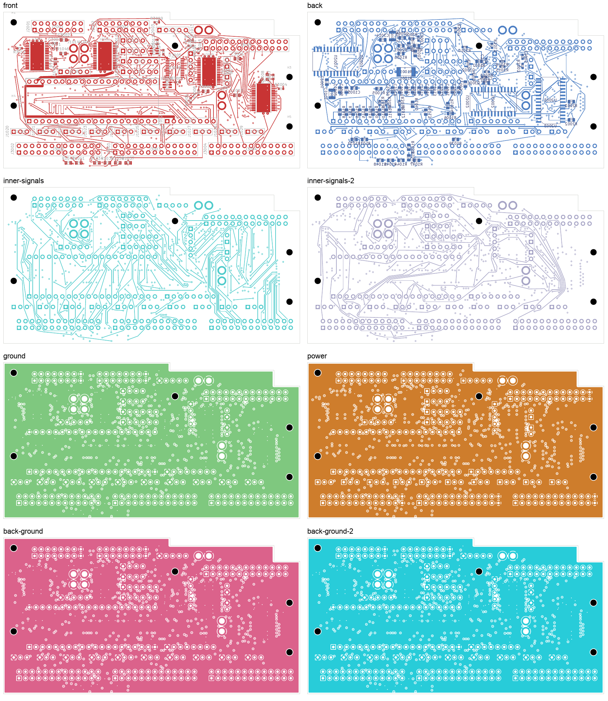
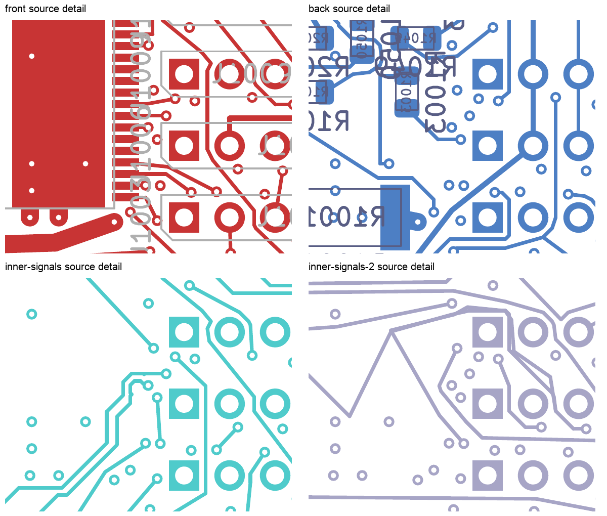

# SERIAL_1 source preparation: native-checked development checkpoint

This eight-layer comparison remains at **31 open connections**. MCU_PERMIT
and LED_37 have been rerouted together to leave a screened SERIAL_1 source
escape available. The full serial connection remains unfinished. This is a
preparatory checkpoint, not a fabrication release or replacement for the
selected four-layer DC04 design.

## What changed

Only MCU_PERMIT and LED_37 copper changed relative to the
[previous 31-open board](../digital-bypass-ground-signal-native-02/README.md).
Six tracks and two vias were replaced by eighteen tracks and three vias.
All footprints, authored zones, other copper and board geometry are unchanged.
The new board contains 3,248 tracks and 526 vias.

LED_37's source via moved from (44.000, 21.225) to (43.850, 21.200) mm. Its
front and In3 connections were rebuilt together with both MCU_PERMIT branches.
The reserved SERIAL_1 escape at (44.100, 14.650) mm passes a fresh replay against
the native-captured finished preparation board. That escape is **not installed**
as a dangling via; it is an input to subsequent complete routing.

| Changed net | Previous planar copper | Current planar copper | Previous/current vias |
| --- | ---: | ---: | ---: |
| MCU_PERMIT | 53.190 mm | 77.919 mm | 2 / 3 |
| LED_37 | 40.804 mm | 40.593 mm | 4 / 4 |

The approximately 24.7 mm MCU_PERMIT increase and additional via are an explicit
routing trade-off. Timing, coupling, EMC and installed electrical performance
have not been qualified.

## Verification

- Strict native checks: **0 geometry violations, 31 unconnected items,
  0 schematic-parity findings and 0 ERC findings**, with all rule categories enabled.
- Independent delta audit: only the declared two nets changed; native refill
  preserved all authored geometry. Every native pad group matches the parent.
- Power/ground: 201 pads, 39 local connections and 33 thermal connections retained.
  All 32 front controls remain connected. All four plane copper unions remain connected.
- Actual captured new-track copper: minimum measured nearby foreign-net gap
  **0.201383 mm**, against the unchanged 0.20 mm requirement. New via positions
  were separately rechecked against native geometry.
- Placement, opposite-face through-hole, mount and drill checks pass. Minimum
  nonexempt drill-to-SMD gap remains **0.154984 mm**; 21 exposed-pad via process
  holds remain. SD planar spread remains **5.999239 mm**.
- [38 focused tests](focused-tests.log) pass, including seven joint-packing
  tests and six source-preparation boundary tests.
- All eight layer plots and four source-area detail views were inspected;
  see the [visual receipt](visual-review.json). Native fabrication reference text
  remains dense; this is not a silkscreen or fabrication-output acceptance.

Evidence: [native results](review.json), [per-net witnesses](stage-connectivity-review.json),
[independent source audit](source-preparation-review.json),
[physical audit](corridor-audit.json), [recursive source bindings](source-audit.json).

## Routing continuation

Use [this native PCB](digital_core.kicad_pcb) and the
[absolute-path native capture](../digital-serial1-source-preparation-inputs-31-02/capture.json)
for subsequent work. An earlier capture with relative source paths is preserved
as history; the independent physical auditor uses the absolute-path capture.

The original source-side investigation found three compatible, fully restored
MCU/LED37 proposals. The receiving-end investigation still requires SERIAL_1,
CLOCK_5V, LED_48, DATA_5V_SRC and all displaced connections to coexist. Local
escape compatibility and individual region access do not establish that a
complete routed solution exists.

The remaining digital connections are 29 LED outputs, SERIAL_0 and SERIAL_1.
The [unit readiness record](../../current-readiness.json) continues to select
four-layer DC04 with 143 opens; the audio layout has 208 opens and NF has 138.
Approved ESS package/interface inputs, stack and assembly processes, installed
receiving and first-article qualification remain outstanding. No board order,
release, commit or external message was made.
