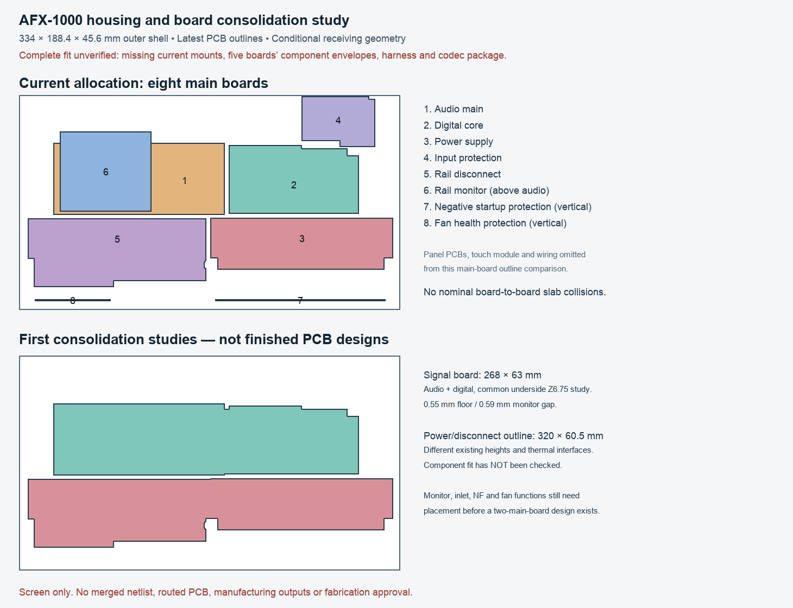

# HC01 — current housing and PCB consolidation review

The eight-main-board partition is not a demonstrated minimum. A single main PCB
is not ruled out, but the current layouts cannot be joined without changing
component placement, mounting heights, power/thermal interfaces and routing.
The complete latest unit still has no verified installed fit.

The most concrete consolidation candidate is a **268 × 63 mm combined audio and
digital PCB**. Its actual existing outlines plus a 4 × 57 mm joining strip form
one valid polygon. A common underside height of **Z6.75 mm** raises audio by
0.25 mm and lowers digital by 0.25 mm. Under the existing declared receiving
requirements, the checked parts/tails leave **0.55 mm above the Z2.8 floor** and
**0.59 mm below the monitor PCB's minimum Z23.8**. No checked context or
cross-board receiving envelopes intersect at an additional 0.25 mm margin.
These are conditional design clearances, not measured or supplier-guaranteed
clearances. No merged schematic, PCB or mounting system has been created.
The audio THT tail projection of 3.2 mm is a **new provisional screening
assumption**, borrowed from the digital tail allocation; the audio plan did not
establish a supplier-approved tail maximum. It must be replaced or accepted
against the actual assembly process. The source comment describing all tail
limits as existing AP/AC requirements is too broad; this explicit qualification
governs the audio result.

## What was checked

- Fresh outline, nominal thickness and footprint counts from all eight main
  PCBs: latest audio controls-06, accepted eight-layer digital LED16 checkpoint,
  and the six AP04 support/power selections. There are 1,578 native footprints,
  including mechanical footprints; U201 is still absent from the audio PCB.
- All 28 pairs of nominal PCB slabs: no intersections. This is not a check of
  every component against the housing, duct, support or wire geometry.
- 656 declared component/mount-head envelopes and 348 actual-pad-derived THT
  tail receivers on audio, digital and monitor. Audio's 328 electrical poses
  match its saved plan exactly. The other five boards do not yet have complete
  current component/mate/tail coverage in this new screen.
- Existing AP04 controls and ports, plus a separately identified scenario with
  the eight audio jacks raised by EI02's 0.8 mm repair. Both scenarios have zero
  checked receiving intersections.
- Common signal-board Z6.5, Z6.75 and Z7.0 scenarios. All listed checks pass;
  Z6.75 balances the floor and monitor clearances. Deliberately lowering the
  monitor underside to Z22 triggers component intrusions in every scenario.
- Exact source/geometry replay of HC01 and source hashes. The final figure was
  inspected for legibility. This work ran no native CAD or full assembly Boolean
  check and changed no selected PCB or release flag.

The first plotting attempt lacked matplotlib. The JSON geometry screen was
already complete; the separate PIL renderer generated the review image. The
first image remains; v2 moves the audio label out from under the monitor overlay.

## Why there are eight, and what can be combined

The current partition groups 15 functional roles into eight boards: six audio
roles already share one board and three digital roles already share one board.
The remaining six are separate power, inlet and protection/monitoring designs.
The present geometry uses those separations for stacked and vertical mounting;
that does not establish a need for separate PCBs electrically.

| Option | Concrete state | Work required |
| --- | --- | --- |
| Eight main boards | Current development allocation | Current full assembly, harness and mounts remain incomplete |
| Audio + digital combined | 268 × 63 mm outline and conditional Z6.75 receiving screen | Merge netlists with explicit net/ref mapping; preserve converter, power and ground contracts; renew placement, supports, routing and noise/thermal checks |
| Power + disconnect combined | 320 × 60.5 mm planar outline study only | Resolve Z6.5 versus Z5 board datums, unequal stack constructions, terminals, current paths and external thermal hardware; component fit has not been screened |
| Two main boards plus panel/modules | Design target worth evaluating, not an established layout | Place monitor, inlet, NF and fan functions into the signal/power boards; preserve isolated returns, fault paths and case-facing interfaces |
| One main board plus panel/modules | Not ruled out; no complete layout exists | Repack stacked monitor and both vertical cards, choose a common fabrication stack, redesign power/thermal/support interfaces and reroute the complete unit |

Combining only the two studied pairs would reduce eight main boards to six, not
two. A two-board drawing that omits the other four boards' functions is not a
complete design. The eight existing flat PCB areas total 48,481.77 mm² versus
62,925.6 mm² of outer enclosure footprint; that ratio is **not** a fit test or a
minimum board-area requirement. The inner walls, posts, ducting, touch bay,
component heights and service clearances consume space, while removing
inter-board connectors and re-placing components could recover space.

Analog and digital circuitry can share a PCB. Physical partition, supply and
return paths, decoupling and the converter manufacturer's requirements determine
performance; a board split alone does not prove low noise. See Analog Devices'
[mixed-signal layout guidance](https://www.analog.com/en/resources/analog-dialogue/articles/what-are-the-basic-guidelines-for-layout-design-of-mixed-signal-pcbs.html).
This general guidance does not approve AFX's grounding or replace the ESS inputs.
Consolidation must preserve the NF isolated references and all intended fault
and enable paths; similarly named grounds must not be automatically merged.

## Mechanical work still required

1. Choose the intended partition using component-level placement studies before
   investing further in the old eight-board routing. First develop the screened
   audio/digital merger; retain the current verified boards as references.
2. Capture complete current component, mated-connector and solder-tail envelopes
   for P03, inlet, E28, NF and fan boards. Old native trials used different PCB
   sources and cannot validate the latest poses. Confirm exact parts and receiving
   limits rather than shrinking generic envelopes to obtain a pass.
3. Obtain the missing ESS package/land/stencil information and finish the panel
   emitter/sensor allocations. The earlier 12-board tally covers eight main plus
   four named panel allocations; an angle-sensor board reserve, touch and processor
   modules, and unresolved emitter partition mean it is not a final unit total.
4. Rebuild actual floor bosses, upper monitor supports, both-side mounting
   clearances, front-card keepers and the common-board support pattern from the
   chosen current PCB holes. Select hardware and account for tolerances. Neither
   Z6.75 nor the board joining strip is an approved support design.
5. Add all mated plugs, complete harnesses, strain relief, bends, lid/guide removal
   and tool access. Renew the power links, returns, heat path and airflow geometry
   with the same coherent source capture.
6. Run the complete native assembly collision/clearance checks on that capture,
   inspect the generated assembly and then freeze PCB outlines and mounting
   interfaces. Keep physical first-article checks distinct from design fit checks.

The old EI01 three-clash result is **historical**. EI02 separately repaired the
Trill mounting, J29 position and rear jack height and passed its 45 declared
geometry cases. UA01/FR01/NR01 subsequently studied other captured combinations
with explicit access/receiving limitations. None is a full latest-PCB fit receipt.

## Evidence

- [Current geometry and receiving screen](review.json)
- [Common-height scenarios and intrusion controls](height-study.json)
- [Final comparison figure](comparison-v2.png)
- [Existing AP04 allocation](../assembly-layout-04/README.md)
- [Historical repaired EI02 trial](../../../cad/a12/enclosure_growth/integration_repaired/README.md)

Read-only replay: import `hardware.fabrication.assess_housing_consolidation`, call
`calculate()`, normalize its tuples through JSON and compare to `review.json`.
The command-line builders refuse existing output. Source-bound files must not be
edited in place. Complete-fit, production-adoption and fabrication-release
claims remain false.
