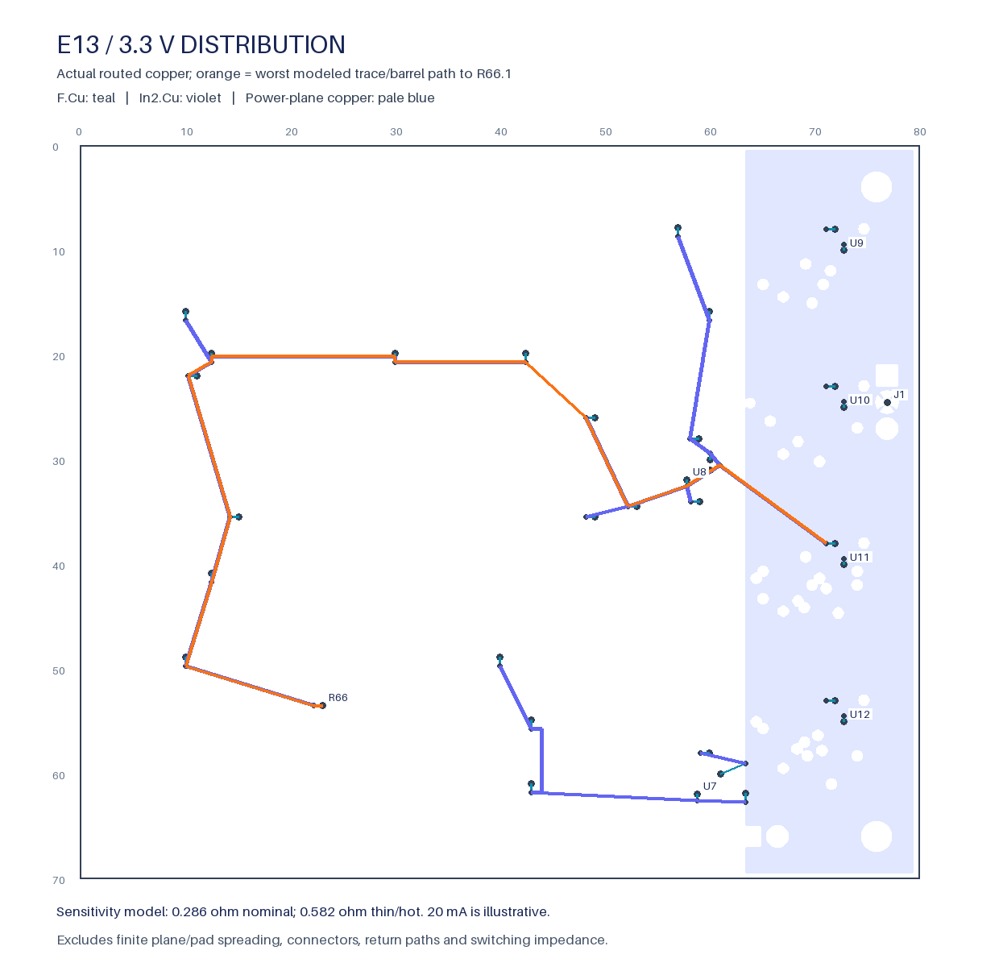

# E13 3.3 V trace and via sensitivity



This read-only review uses the selected
`rail-monitor-reserved-closed-native-02` PCB. The current native receipt has
zero DRC findings, opens, ERC or parity findings. No placement, copper, rule,
schematic, zone fill or project setting was changed for this analysis.

[dc-paths.json](dc-paths.json) binds the PCB, native review, capture and applied
analysis recipe hashes. [capture.json](capture.json) was made with the approved,
pinned Linux KiCad 10.0.7 image: 2,843 objects, 185 footprints and zero uncapped
opens. It contains all nets for context; this model uses only V3V3_IO.

There are 62 routed 3.3 V segments: 27.8194 mm on F.Cu at 0.2 mm width and
188.6888 mm on In2.Cu at 0.4 mm width, plus 34 vias. The graph reaches all 35
power-net pads. It splits tracks at contact points and centerline intersections,
retains the supplied widths, and charges a full-board barrel resistance for
each modeled via transition. Paths choose the lowest summed modeled resistance;
they are not a solved current distribution.

| Planning scenario | Outer / inner copper | Via plating / board thickness | Worst trace/barrel path | Contribution at an assumed total 20 mA |
| --- | --- | --- | --- | --- |
| 20 °C, 100% IACS | 35 / 17.5 µm | 20 µm / 1.6 mm | 0.28607 Ω, R66.1 | 5.721 mV |
| 85 °C, 90% IACS | 25 / 12 µm | 15 µm / 1.8 mm | 0.58243 Ω, R66.1 | 11.649 mV |

These are **planning inputs**, not accepted fabricator limits or the product's
specified temperature range. The 20 mA figure is illustrative, not a measured
or established maximum load. Resistivity uses the standard-copper value and
volume-temperature correction in [NBS Circular 31](https://nvlpubs.nist.gov/nistpubs/Legacy/circ/nbscircular31.pdf).
Track resistance uses length, width and copper thickness; barrel resistance
uses the annular copper area around the actual finished drill diameter.

The reference is an **ideal equipotential 3.3 V plane**, not J1's external
contact. Pads and annuli are ideal junctions. The model excludes finite plane,
thermal-spoke and pad spreading, inlet barrel/contact resistance, harness/source
impedance, AGND return resistance, inductance, capacitance and switching loads.
The sum therefore **does not establish an upper bound on the complete PDN**.
The report preserves all of those holds. Do not use the table to approve a
voltage-drop, thermal, noise, fabrication or power-up gate.

## Native hole geometry

KiCad's stored filled contours use artificial seams around holes, which are
self-intersecting rings to a generic geometry library. No generic buffer or
silent polygon repair was applied. A copied native `SHAPE_POLY_SET` was passed
through KiCad's `Unfracture` API, without refilling or saving the board.
[unfractured-planes.json](unfractured-planes.json) retains one valid polygon per
plane and **523 hole contours**: AGND 258, V5_REG 228 and V3V3_IO 37. The SDK's
integer-grid rejoining changes reported areas by at most 0.00001893 mm²;
before/after areas, actual deltas and the explicit numerical comparison
tolerances are recorded. This is not a claim of identical contour coordinates.
The unchanged PCB hash remains the native design authority.

The object capture approximates pad/track boundaries on the outside by 1 µm.
Together with the ideal-junction assumptions, that is another reason this is a
sensitivity model rather than a manufacturing or worst-case PDN proof.

## Verification and next receiving checks

Six focused tests compare trace and barrel resistance against analytic fixtures,
require a source-to-load path, reject broken tracks or absent supplies, and
prove a native plane hole cannot supply a pad inside the void. Both scenarios
reproduce against the current source hashes. The generated map was visually
inspected and shows the actual worst modeled path.

Next: obtain the fabricator's finished-copper/plating/stackup limits; bound the
actual current envelope; include finite plane and ground-return paths plus
connector/harness drops; then test decoupling, switching noise and thresholds.
These are receiving requirements, not completed tests.

```sh
python -m hardware.fabrication.rail_monitor_dc_paths \
  --output hardware/fabrication/staging/rail-monitor-dc-inputs-01/dc-paths.json --check
python -m unittest tests.tooling.test_rail_monitor_dc_paths
```

Fresh native capture is Linux-only through the pinned approved image and the
`capture_board` / `capture_rail_monitor_planes` modules. Each writes only a new
capture artifact and checks the source hash. Mac CAD remains disabled.
