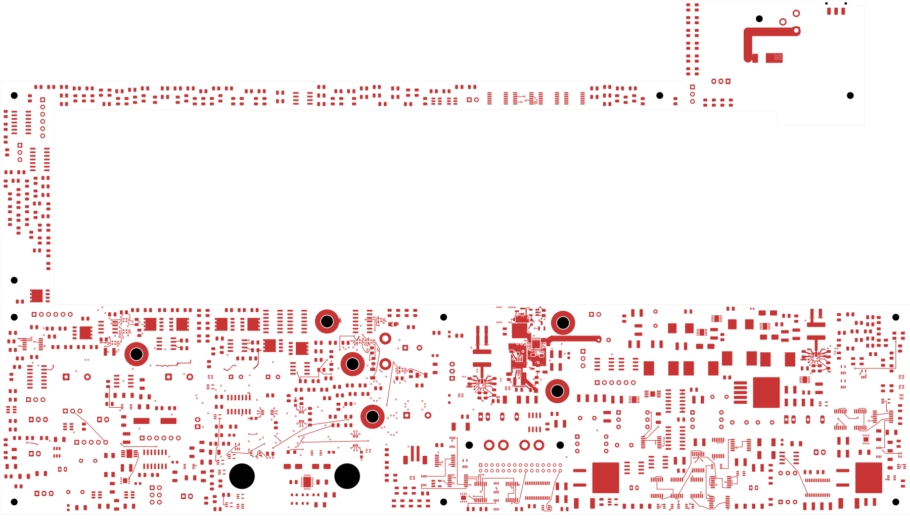

# TBP45 analog control and quiet-return checkpoint

This is the checked power/protection development revision selected by
[status 45](../two-board-fabrication-status-45/status.json). It is **not ready
for fabrication**. The schematic title retains its development-candidate label.

Three analog eFuse cells (U13/U14/U32) now have local ILM/DVDT connections,
capacitor links and owned quiet returns. Twelve passives move, including three
face changes, without changing component values, packages or schematic nets.
The independent native connectivity audit proves 26 joins from TBP44 and
preserves every other connection group. **2,211 power opens remain**; the
signal board still has 251 opens and the missing approved ESS codec footprint.

Native geometry/parity/ERC errors are zero, with two retained isolated-reference
warnings. The board has 1,101 footprints, 1,086 electrical components, 3,420
schematic pin entries, 3,029 tracks, 454 vias, 47 zones and 2,949 native groups.
This pass adds 73 tracks, 27 vias and eight owned zones, retires 83 tracks and
eight vias, edits six existing outlines and refills eight existing zones.
Thirty-one prior fills remain exact.

Candidate 02's six ground-reference gaps are corrected: R100 is reversed and
repositioned below the enable-reference crossings; PG0 is reconstructed around
protected back-layer projections; U13/U14 front PG references and the retained
U32 enable reference are covered; R96's In6 reference field connects through
the existing R97 quiet via and U13 In1 field. The shared old enable trunk stays.
Local passive ground escapes are 1.000–3.097 mm (R100 is the longest).

All 1,567 retained complete reference cases and all 26 new non-ground route
paths have adjacent ground projection. All ILM/DVDT paths have their own quiet
reference coverage. Same-net via/plated-pad clearances are explicitly excluded
where recorded. The three new quiet networks connect to main ground only at
their pin-8 stars; the four earlier digital quiet networks remain intact.
These checks do not qualify transient behavior, parasitics, noise or current.

All eleven supply-plane contact sets and region counts are preserved. Only
the two inlet supply fills change; each remains one region. Their copper areas
are now 5,503.766457 mm² (In2) and 5,527.235161 mm² (In3). Earlier inlet
resistance/current-sharing estimates apply to their historical copper snapshots,
not this revision.

Evidence: [native checks](review.json), [connectivity/quiet ownership](analog-connectivity-review.json),
[ground references](analog-reference-review.json), [supply planes](analog-supply-plane-review.json),
[routing manifest](analog-cell-routing.json), [visual review](plots/visual-review.json).
Sixteen views were directly inspected, including both surface overviews, the
inner-layer contact sheet, eight views covering all replaced-route locations
and five complete analog-cell detail views.

[Back](plots/back.png) · [Inner layers](plots/inner-contact-sheet.png) ·
[Analog front](plots/analog-complete-front.png) · [Analog back](plots/analog-complete-back.png) ·
[Analog In1](plots/analog-complete-inner1.png) · [Analog In6](plots/analog-complete-inner6.png) ·
[Analog In5](plots/analog-complete-inner5.png)

Next: finish remaining digital pulldown returns and earlier support/PG reference
gaps; complete startup, protected outputs, source/input loops, analog/module
distribution, force/quiet returns and signal routing. Load/startup/fault/thermal
limits, effective capacitance, accepted stack/plating, approved ESS package
inputs, exact BOM, full installed housing/support/cooling/harness fit and
reviewed manufacturing outputs remain required. A prototype bring-up plan
and applicable release checks must precede fabrication.
