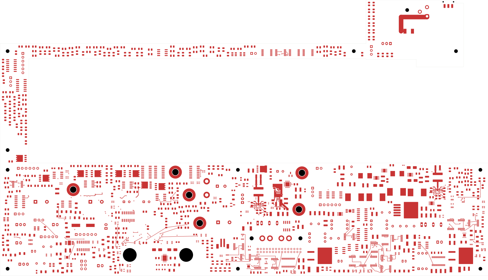
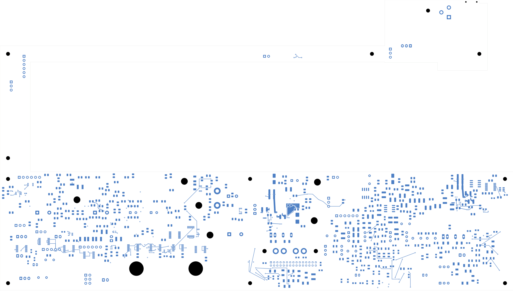

# Power/protection — AUX ground regions and thermal stitching

The AUX cell now has separate front input/output returns, back-side ground
copper around its feedback network, and an In1 thermal/reference region.
Four conventional vias connect the exposed-pad copper to those layers.
**2,447 opens remain. This board is not ready for fabrication.**
Open [power_protection.kicad_pro](power_protection.kicad_pro) in KiCad.

The layout follows the separate-return and feedback-ground guidance in
[TI's TPS7A16 datasheet, sections 10.1–10.4](https://www.ti.com/lit/ds/symlink/tps7a16.pdf).
The independent multilayer check removes only the GND-pin land, with a 2 µm
numerical margin, and proves that the output-capacitor returns then separate
from the input, exposed-pad and feedback-ground network. No other circuit's
ground pad joins this local group. This verifies topology, not impedance or
noise performance.

| Native check | Result |
| --- | --- |
| Geometry / schematic parity / ERC errors | 0 / 0 / 0 |
| Retained isolated-reference warnings | 2 |
| Open connections / newly closed | 2,447 / 0 |
| Tracks / through vias / filled zones | 2,293 / 190 / 8 |
| Added tracks / vias / zones | 4 / 4 / 4 |
| Electrical parts / footprints | 1,085 / 1,100 |
| Earlier physical groups preserved | All 3,185 |
| All-via minimum drill-to-SMD clearance | 0.165 mm |
| AUX FB trace projection lacking In1 reference | 0 mm², excluding its own via antipads |
| U20 direct ground-via contacts preserved | All 12 |
| U20 sense projection lacking reference | 0 mm², excluding its own via antipads |

| New ground region | Layer | Native copper area |
| --- | --- | --- |
| Input and exposed-pad return | Front | 41.491 mm² |
| Output-capacitor return | Front | 15.637 mm² |
| Feedback ground copper | Back | 28.319 mm² |
| Thermal/reference copper | In1 | 48.380 mm² |

Each region is a single contiguous native polygon. The four 0.60/0.30 mm vias
are outside all SMD lands, avoiding via-in-pad processing. Their front straps
are 0.6 mm wide. All previous tracks, vias, pads, component poses and the full
pin/net map are unchanged.

U20's In1 ground edge has a small recess to let the AUX reference extend under
the short feedback-resistor branch. The authored recess is 1.56 mm²; native
corner rounding removes 1.568 mm². U20 ground area becomes 449.125 mm². Its
plane remains contiguous, all direct ground-via contacts remain, and sense
reference coverage is preserved. The other three earlier zones and fills are
unchanged, including a fresh native-refill comparison.

The first ground trial left 0.168 mm² of feedback-trace projection uncovered
and is not selected. It also exposed an overly restrictive area-only check
in the capture tool. The replacement captures raw and unfractured polygons
and independently checks boundary movement, symmetric copper difference and
native area. Actual movement is below 0.708 nm; no PCB rule was relaxed.
[Diagnostic and verifier evidence](../two-board-aux-unfracture-review-01/README.md)
records the change and focused tests.

[Native checks](review.json) · [Independent audit](aux-ground-audit.json)
· [Construction](aux-ground-routing.json)
· [Native refill](../two-board-power-aux-ground-filled-02/local-plane-fill.json)
· [Complete connectivity](../two-board-power-routing-inputs-2447-aux-ground-02/capture.json)
· [Rejected-source-net status](rejected-source-net-status.json)

## Copper views

| Front | Back, in top-view coordinates |
| --- | --- |
|  |  |

[Local front](plots/local-front.png) · [Local back](plots/local-back.png)
· [AUX reference and U20 recess](plots/local-inner1.png)
· [Six inner layers](plots/inner-contact-sheet.png)
· [Visual review](plots/visual-review.json)

## Remaining work

Connect AUX source/output distribution and power-good, then verify actual
load, effective capacitance, regulator dissipation, startup and shared enable
behavior. The copper added here does not establish an actual thermal resistance
or acceptable junction-temperature margin.

Other critical cells, wider U20/U23 distribution and force returns, signal
routing, the approved ESS codec land pattern, accepted stack/BOM/assembly
process, manufacturing outputs and complete installed housing fit remain.
Signal main has 251 opens. No fabrication release or order is established.
