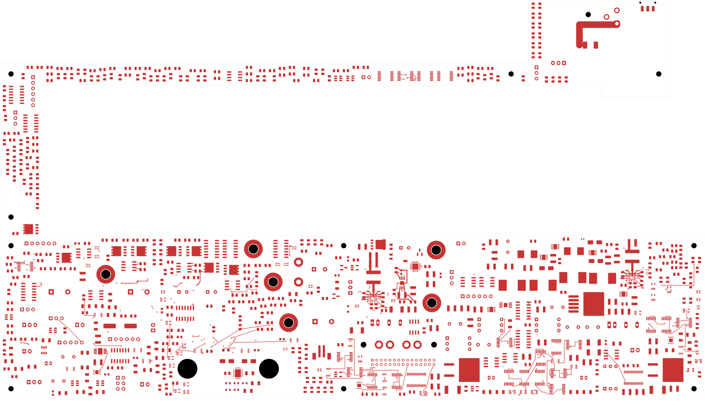
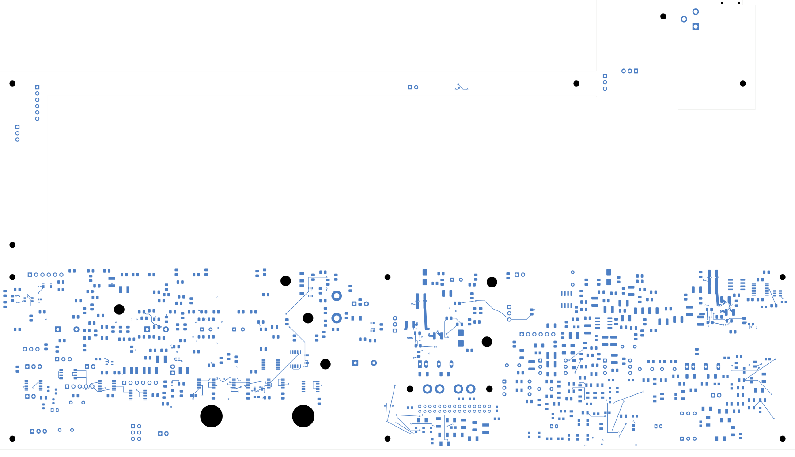

# Power/protection — local auxiliary-supply routing

The TPS7A1601 AUX regulator, its four capacitors and three feedback resistors
are grouped and locally routed. **15 connections close, leaving 2,447 opens.**
This remains a development checkpoint, **not ready for fabrication**.
Open [power_protection.kicad_pro](power_protection.kicad_pro) in KiCad.

The regulator and all four capacitors stay on the front. The main input,
output and delay connections are 3.289, 3.387 and 2.075 mm long respectively.
The output capacitor returns directly to GND pin 4, which connects to the
exposed ground pad. The input/delay and feedback-ground branches also reach
that pad. Ground regions and thermal stitching still need implementation.

R108 moves above the cell on the back and R130 rotates 180 degrees, revising
the earlier screened placement to avoid a feedback/trim crossover. The
output-sense branch uses a 9.194 mm back-side route around the feedback via.
Five conventional 0.60/0.30 mm vias support feedback, sense and the short
In4 VIN-to-EN connection. PG remains unrouted; NC remains unconnected.

| Check | Result |
| --- | --- |
| Geometry / schematic parity / ERC errors | 0 / 0 / 0 |
| Retained isolated-reference warnings | 2 |
| Native opens / connections closed | 2,447 / 15 |
| Tracks / through vias / filled zones | 2,289 / 186 / 4 |
| Added tracks / vias / route sections | 32 / 5 / 20 |
| Electrical components / footprints | 1,085 / 1,100 |
| Schematic pins / mapped pads | 3,418 / 3,479 |
| Moved footprints / moved native pad instances | 8 / 27 |
| Earlier physical connection groups preserved | All 3,200 |
| Minimum all-via drill-to-SMD clearance | 0.165 mm |
| Existing zone outlines and native fills | All four unchanged, including fresh-refill comparison |
| Moved courtyard / body / support / height findings | 0 within the recorded placement model |

The complete pin/net map, values, packages and board sides are unchanged.
All old tracks, vias and unmoved pad geometry are preserved. Independently
transformed moved-pad polygons match native capture within 0.000003 mm.
The capture contains 6,194 ordinary objects, 548 open nets and 2,995 open-net
clusters; its independent gap sum equals the uncapped native open count.
Mechanical checks use the current C204 back-side package geometry, retaining
the actual surrounding obstacles. They do not prove complete installed fit.

[Native checks](review.json) · [Independent audit](aux-local-audit.json)
· [Construction](aux-local-routing.json)
· [Fresh native refill](../two-board-power-aux-local-filled-01/local-plane-fill.json)
· [Full connectivity](../two-board-power-routing-inputs-2447-aux-local/capture.json)
· [Previously rejected source nets](rejected-source-net-status.json)

## Copper views

| Front | Back, in top-view coordinates |
| --- | --- |
|  |  |

[Local front](plots/local-front.png) · [Local back](plots/local-back.png)
· [Existing adjacent ground plane](plots/local-inner1.png)
· [Local enable link](plots/local-inner4.png)
· [Six inner layers](plots/inner-contact-sheet.png)
· [Visual review](plots/visual-review.json)

## Remaining work

Complete AUX input/output ground regions, thermal vias and feedback shielding;
connect the source, output distribution and power-good path. Verify actual AUX
loading, voltage/temperature/aging capacitor derating, regulator dissipation,
startup and shared enable behavior. Local connectivity alone does not establish
those properties.

Wider U20/U23 power distribution and force returns, source/module protection,
remaining critical placement and routing, approved ESS codec footprint,
accepted stack/BOM/assembly process and reviewed manufacturing outputs remain.
Signal main still has 251 opens. Supports, cooling, connector mates, harnesses
and complete installed housing fit remain unverified. No order or fabrication
release is established here.
