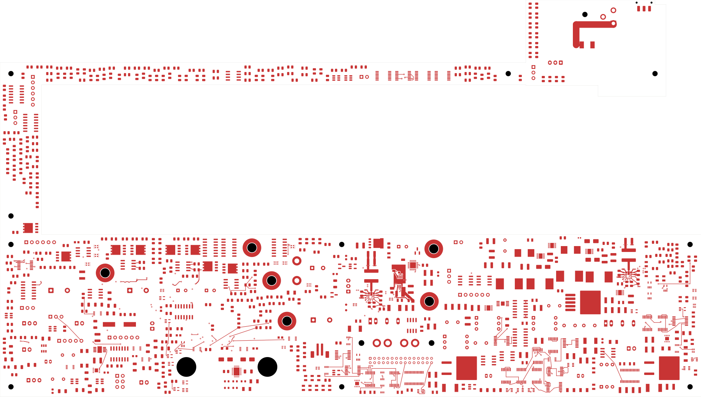
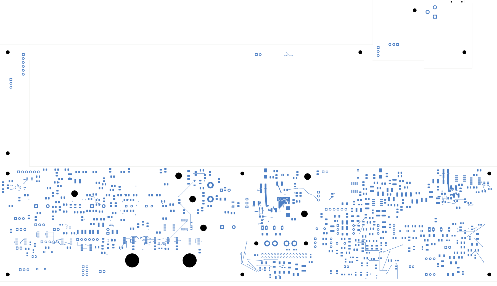

# Power/protection — AUX power-good escape and input-capacitor link

The AUX regulator's PG pin now connects to the input eFuse SHDN pin. A second
route joins input capacitor P_C102 to the regulator's existing VIN capacitor
network. **2,445 opens remain; this is not a fabrication release.**
Open [power_protection.kicad_pro](power_protection.kicad_pro) in KiCad.

| Check | Result |
| --- | --- |
| Native geometry / schematic parity / ERC errors | 0 / 0 / 0 |
| Retained isolated-reference warnings | 2 |
| Open connections / closed this revision | 2,445 / 2 |
| Tracks / through vias / filled zones | 2,300 / 192 / 8 |
| Electrical components / footprints | 1,085 / 1,100 |
| Earlier physical connection groups preserved | All 3,185 |
| All-via minimum drill-to-SMD clearance | 0.165 mm |
| FB projection lacking In1 reference | 0 mm², excluding its own via antipads |

The existing FB via moves from (190.6, 133.6) to (190.3, 133.4) mm to make
room for PG. Three attached FB tracks are replaced, preserving their terminal
connections. Two new 0.60/0.30 mm through vias and 0.2 mm tracks connect PG
to SHDN, using an 11.402 mm In4 segment and short front escapes. The full
path is about 15.09 mm. The 0.4 mm back input-capacitor link is 6.287 mm long.
The upstream VIN source and the complete RUN net still need routing.

Three AUX ground regions are refilled around the changes. All authored zone
outlines and settings remain unchanged, and the other five native fills are
exactly retained. Each AUX region remains contiguous with the same direct
ground-pad and ground-via contacts. A multilayer cut at U102's GND-pin land
still separates input and output returns. The complete FB trace projection
retains its In1 reference except at its own via antipads. U20 and U23 planes,
their contacts and all other retained ordinary copper remain unchanged.

E_U42 remains **SN74LVC3G17DCUR**. Its PCB and schematic datasheet links are
corrected from AUP to LVC, and the correct link is added to its embedded and
local library symbols. All component values, poses, lands and logical
pin/net assignments remain unchanged.

[Native checks](review.json) · [Independent audit](aux-pg-audit.json)
· [Construction](aux-pg-routing.json)
· [Native refill](../two-board-power-aux-pg-filled-01/local-plane-fill.json)
· [Complete connectivity](../two-board-power-routing-inputs-2445-aux-pg/capture.json)
· [Rejected-source-net status](rejected-source-net-status.json)

## Copper views

| Front | Back, in top-view coordinates |
| --- | --- |
|  |  |

[Local front](plots/local-front.png) · [Local back](plots/local-back.png)
· [AUX reference](plots/local-inner1.png) · [PG route](plots/local-inner4.png)
· [Six inner layers](plots/inner-contact-sheet.png)
· [Visual review](plots/visual-review.json)

## Remaining work

The [AUX load review](../two-board-aux-load-review-01/README.md) still applies
to the unchanged circuit, except its stale-datasheet finding is corrected
here. Its conditional current, capacitance and thermal calculations remain
design inputs to resolve; copper continuity does not qualify those limits.

Finish the upstream VIN source, AUX output distribution, complete RUN net
and ground references. Review loaded PG/SHDN behavior and timing, source
protection placement, critical currents, effective capacitance and thermal
paths. Wider U20/U23 distribution and returns, remaining signal routing,
the approved ESS land pattern, accepted stack/BOM/process, manufacturing
outputs and complete installed housing fit remain unfinished. Signal main
still has 251 opens. No fabrication order or release is established.
