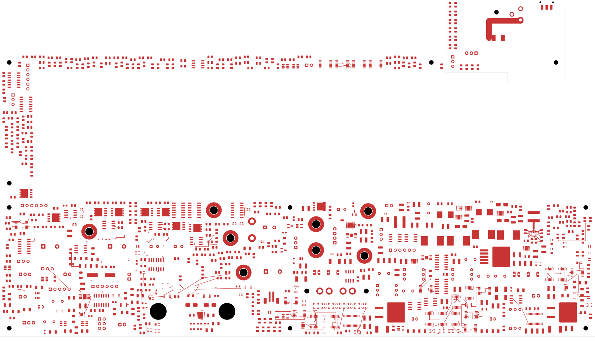
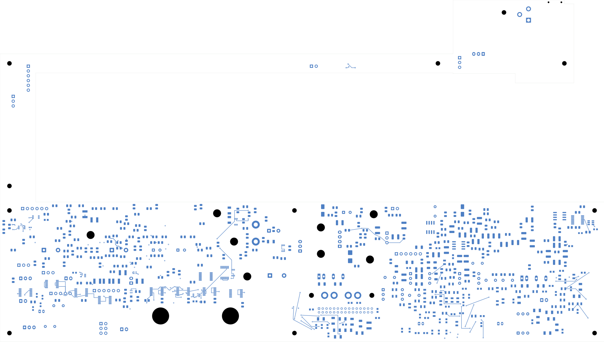

# Power/protection — internal bootstrap-return model

The current power board has **2,533 open connections** and is **not ready for
fabrication**. Open [power_protection.kicad_pro](power_protection.kicad_pro) in KiCad.

## Circuit correction

U20 and U23 are TPS543620 regulators. TI identifies pin 13 as the bootstrap
capacitor return, pin 10 as the inductor drive, and states that the two SW pins
connect internally. See [TI SLUSDR5C, Table 5-1](https://www.ti.com/document-viewer/TPS543620/datasheet/GUID-BAAAA3C0-431A-4B70-AFE1-6FA21FA6A1E5).

Each bootstrap return now has a separate PCB net: U20.13/C201.2 on
`P03_D_BOOT_RETURN`, and U23.13/C221.2 on `P03_A_BOOT_RETURN`. A schematic note
records the internal pin-10/pin-13 bridge in each IC. The force-SW nets still
connect pin 10 to the respective output inductor. The existing two U23 return
tracks change net assignment; no copper or component geometry changes.

This removes two redundant external routing obligations. **It adds no physical
connections.** U20's capacitor-to-pin-13 path remains unrouted; U23's existing
short return path is retained. A bare-board continuity test must treat these as
separate nets; the internal connection exists only with the IC assembled.

## Verification

| Check | Result |
| --- | --- |
| Electrical components / footprints | 1,088 / 1,103 |
| Schematic pins / native pad instances | 3,424 / 3,485 |
| Tracks / through vias | 2,116 / 124; no additions |
| Native opens | 2,533; previous checkpoint 2,535 |
| Geometry / parity / ERC errors | 0 / 0 / 0 |
| Retained isolated-reference ERC warnings | 2 |
| Native copper objects / physical groups preserved | All 5,967 / all 3,271 |

The [independent audit](boot-return-audit.json) checks complete board geometry,
all native objects, every physical connection group and the four declared
schematic pin changes. Collapsing the two return nets through the declared
internal bridges restores the complete previous pin partition exactly. The
constructor remaps all copper net IDs by name before KiCad reassigns pad nets.
The [native review](review.json) and [complete connectivity capture](../two-board-power-routing-inputs-2533-boot-return/capture.json)
agree on the uncapped open count. The DRC output list remains capped at 499.

## Copper views and remaining work

Physical geometry is identical to the [previous local-routing checkpoint](../two-board-power-buck-local-native-01/README.md).
Its reviewed copper previews and clearance evidence therefore remain applicable;
these are reused views, not new renders of this schematic revision.

| Front | Back |
| --- | --- |
|  |  |

[Inner-layer views](../two-board-power-buck-local-native-01/plots/inner-contact-sheet.png)
· [U23 detail](../two-board-power-buck-local-native-01/plots/local-cell.png)
· [Source-net reconciliation](rejected-source-net-status.json)

Complete U23 output capacitors, sensing, mode/frequency/enables and the supply/
return network. Regroup U20/AUX and other critical cells; route the relocated
N_U28 bypass. Remaining routing, approved ESS inputs, effective capacitance,
loaded electrical/thermal checks, final interfaces, stack/BOM/process,
manufacturing outputs and complete installed housing fit remain open. Signal
main still has 251 opens and a missing codec footprint. No fabrication release.
