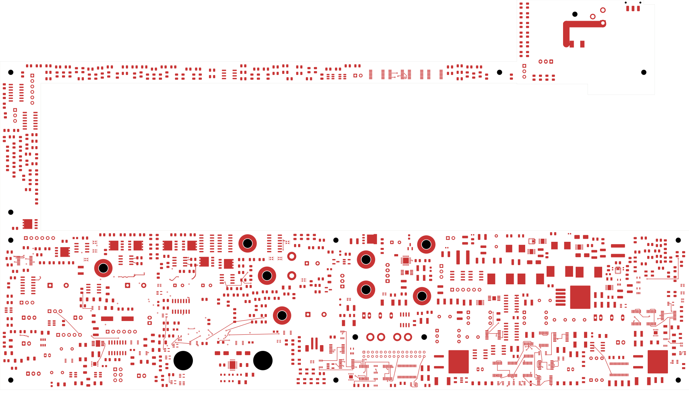
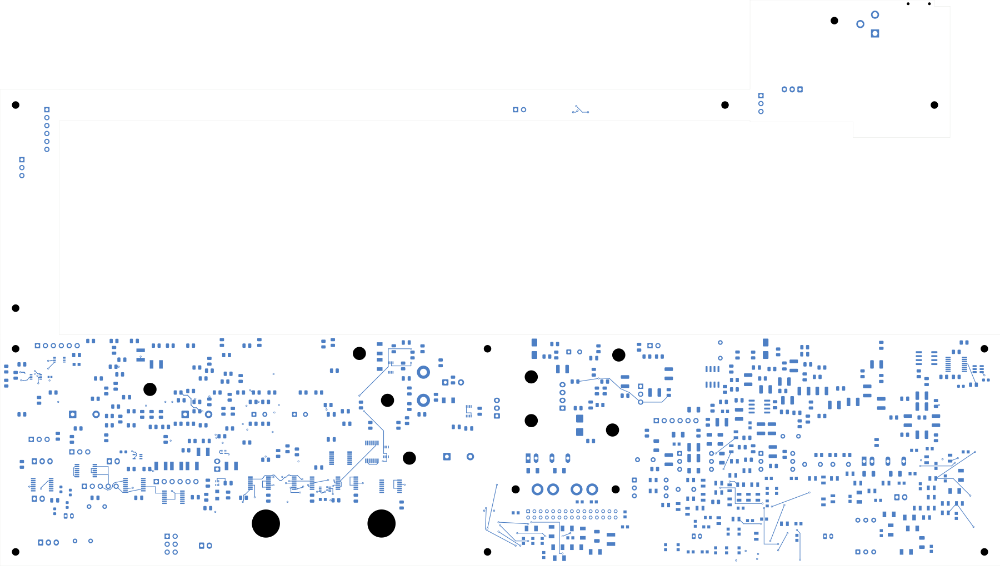
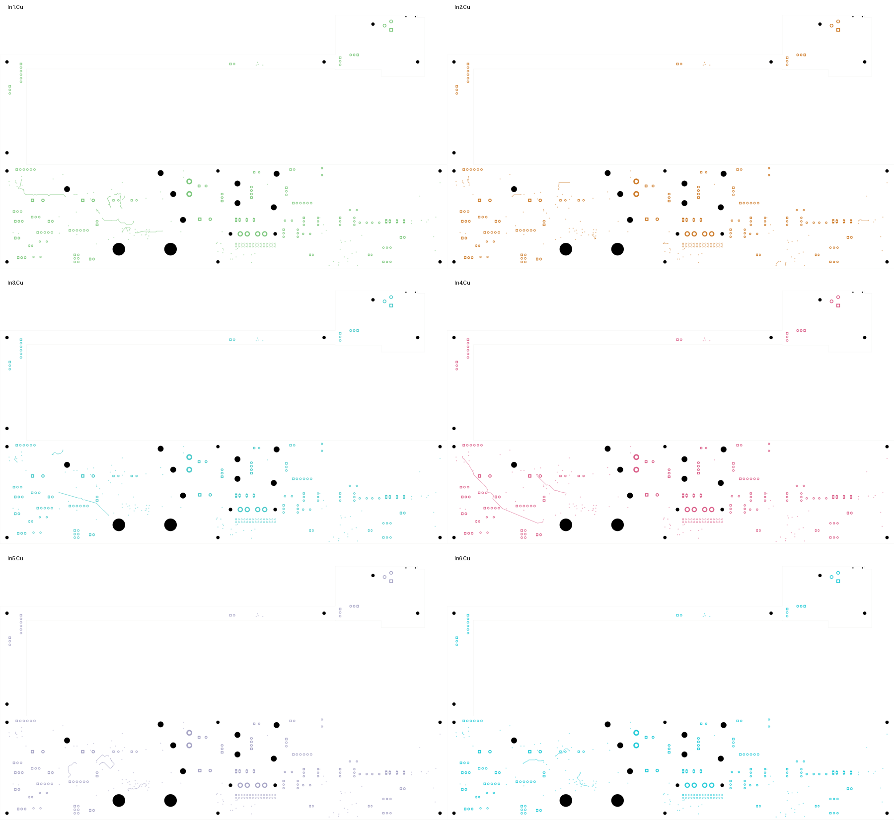

# Power/protection — internal inlet cable retired, U23 regrouped

This checkpoint removes the obsolete inlet-to-supply cable connectors and
regroups ten U23 buck-regulator components on the front of the same PCB.
**It is not fabrication-ready.** Power routing, further critical placement,
electrical verification and the manufacturing/installed-fit work remain open.

Open [power_protection.kicad_pro](power_protection.kicad_pro) in KiCad.

| Checked item | Result |
| --- | --- |
| Electrical components / total footprints | 1,088 / 1,103 |
| Schematic pins / mapped physical pad instances | 3,424 / 3,485 |
| Tracks / through vias | 2,094 / 124 |
| Native open connections | 2,551 |
| Geometry / schematic parity / ERC errors | 0 / 0 / 0 |
| Retained isolated-reference ERC warnings | 2 |
| Retained native connection groups preserved | 3,287 |
| Moved footprints / native pad instances | 10 / 48 |
| Minimum measured via-drill-to-SMD clearance | 0.165 mm, all 124 vias checked |

## Why the layout changed

The old individual size-first packing separated electrically related parts.
The [source-relative survey](../two-board-buck-cell-survey-01/survey.json)
found U20 capacitors up to 66 mm from the regulator. U23 high-frequency bypass
capacitors were 16.9 and 19.7 mm from their IC centre. These distances are a
placement diagnostic, not a measure of finished loop inductance.

TI calls for close same-face high-frequency bypass capacitors, short switching
and boot paths, a nearby BP5 capacitor and a quiet feedback/ground arrangement.
It also requires effective input capacitance after derating. The current nominal
capacitor values alone do not prove that requirement. See sections 9–10 of the
[TPS543620 datasheet](https://www.ti.com/lit/ds/symlink/tps543620.pdf).

The [four-orientation survey](../two-board-buck-cell-survey-02/survey.json)
searched 0.5 mm anchors across the lower board arm. With all other placements
fixed, neither ten-component template had a free location. This is a bounded
search result, not proof that no other placement can work. The former P_J101
connector occupied a usable U23 location.

## Removed internal interface

I_J2 and P_J101 were the two ends of the old inlet-to-supply cable. Their pins
already share PWR_DC_IN and PWR_AGND in the integrated schematic. Both connectors,
their four schematic pins and their isolated label stubs are now removed.
Three copper segments belonging only to the old I_F1.2-to-I_J2.1 leaf are removed.
The upstream inlet, fuse, polarity protection and every remaining pin/net
assignment are preserved. The fused supply path still needs proper PCB routing.

The three fewer opens come entirely from retiring connector terminals. **No
new route was completed in this change.** Removing the cable also removes its
connector/mate allocation; it does not establish complete harness or housing fit.

## Regrouped U23 components

U23, C220/C221/C222/C223/C230/C231, L23 and R220/R221 now form a compact front-side
group around (295, 127) mm, rotated 90 degrees. The capacitor/inductor relationship
comes from the source layout with small declared courtyard-spacing adjustments.
All ten components were previously unconnected to external copper.

| Component relationship | Before centre distance | Current centre distance |
| --- | --- | --- |
| U23–C230 high-frequency bypass | 16.92 mm | 2.61 mm |
| U23–C231 high-frequency bypass | 19.73 mm | 2.61 mm |
| U23–C221 boot capacitor | 18.12 mm | 4.85 mm |
| U23–C222 input capacitor | 9.62 mm | 4.51 mm |
| U23–C223 input capacitor | 10.44 mm | 4.51 mm |

The [construction record](buck-cell-change.json) declares every removal and
pose change. The [independent audit](buck-cell-audit.json) checks the saved native
geometry, all retained electrical connections, remaining pin/net assignments,
and rigid transformations of all 48 moved native pads. The largest polygon
transform discrepancy is below 0.000001 mm. No land, aperture, component value,
board outline, mount, clearance rule or retained copper object changes.

The moved courtyards clear other declared receivers by 0.30 mm and the board
edge by 0.50 mm; provisional height/context reserves also pass. These checks
do not approve supplier heights, complete installed fit or thermal performance.

## Actual copper views

All eight native exports were [visually reviewed](plots/visual-review.json).
Back views use top-view coordinates. Copper is incomplete, with no power planes.

| Front | Back |
| --- | --- |
|  |  |

[In1](plots/inner1.svg) · [In2](plots/inner2.svg) · [In3](plots/inner3.svg) ·
[In4](plots/inner4.svg) · [In5](plots/inner5.svg) · [In6](plots/inner6.svg)

The [full native capture](../two-board-power-routing-inputs-2551-buck-cell/capture.json)
contains 5,945 objects and independently confirms all 2,551 opens. The capped
DRC list of 499 unconnected records is not the full connection count.

## Work still required

Optimize the local feedback/BP5/AGND arrangement and route U23's input, boot,
switching, output and return paths with appropriate copper and thermal access.
Regroup U20, the AUX regulator and other critical power cells; additional
verified internal connectors may be retired to recover useful space.

Both boards still require remaining routing, power/return and fault/startup
verification, approved ESS codec inputs, final inter-board interfaces, accepted
stack/BOM/process, reviewed fabrication outputs, cooling/supports and installed
housing fit. The signal board still has 251 opens and a missing ESS footprint.
No fabrication order or release has been issued.
