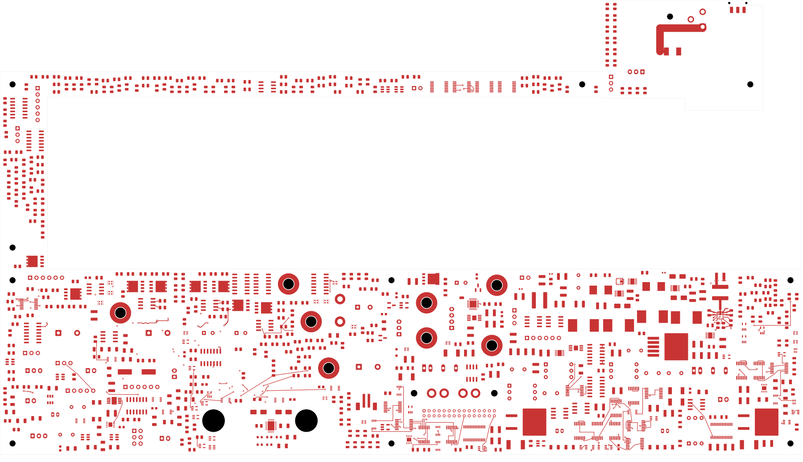
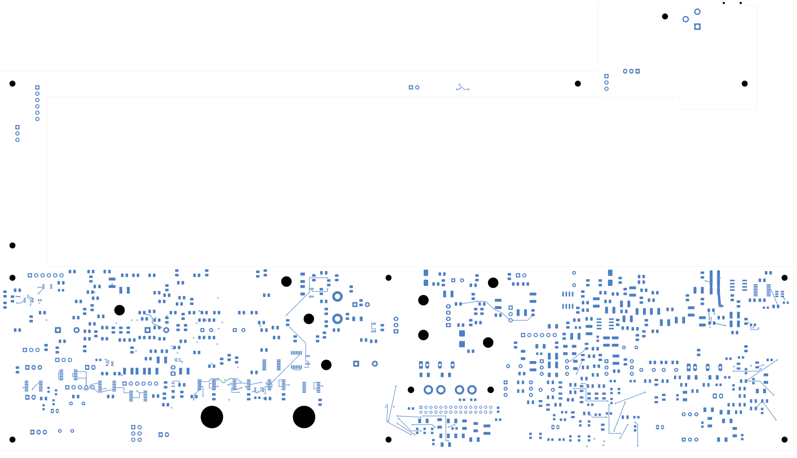

# Power/protection — U23 sense/configuration and buffer bypass

The power board now has **2,518 open connections**, seven fewer than the previous
checkpoint. It is **not ready for fabrication**. Open
[power_protection.kicad_pro](power_protection.kicad_pro) in KiCad.

## Changes

R222 moves to (293.8,131.2) mm and R223 to (293.5,126) mm, both on the back.
Their existing values and footprints remain unchanged. FSEL and MODE now connect
to their resistors through short front/back escapes. Both resistors return to
the existing C220/U23 AGND group, including a short In1 return trace. This group
still needs its deliberate connection to the PGND plane network.

The unchanged 24.3 kΩ / 1% and 18.2 kΩ / 0.1% selections retain nominal 500 kHz,
high current limit, 4 pF ramp setting and 4 ms soft start. These are configuration
choices, not proof of acceptable startup or loop stability. See TI's
[frequency table](https://www.ti.com/document-viewer/TPS543620/datasheet/GUID-C2195E4B-7656-46A2-B2E0-7B5EBE004A14)
and [mode table](https://www.ti.com/document-viewer/TPS543620/datasheet/GUID-0056AA22-455A-4C81-8A02-7C5BFB1B8DBB).

R220's output-sense connection now taps C228. A separate 0.2 mm route travels
around the switching region on In2 and returns to the top of the feedback divider.
The complete tap/inner/front path is approximately 25.63 mm. An independent
cross-layer projection check measures **1.15 mm minimum copper-edge clearance**
from the new sense traces/vias to U23 SW, BOOT and boot-return copper, exceeding
the declared 1 mm layout allocation. This is a geometric screen, not a measured
noise limit; the reference planes and final electrical review remain unfinished.
Keep this sense branch dedicated to the divider when routing the remaining loads.

The first trial had clean native DRC but put the sense route beneath the edge
of the inductor's SW land. It was not adopted. The selected successor takes the
longer inner-layer path above. This illustrates why native DRC alone does not
establish an electrically sound layout. TI's [layout guidance](https://www.ti.com/document-viewer/TPS543620/datasheet/GUID-3391D98E-22B0-43C0-BF8B-846FFDAAA5AB)
also calls for quiet configuration returns and appropriate internal ground paths.

N_U28 now connects to its already relocated N_C67 bypass capacitor on supply and
ground, with two conventional through vias. Their placement is unchanged.
Neither this local bypass nor the regulator configuration routing completes the
wider supply and ground networks.

## Verified results

| Item | Result |
| --- | --- |
| Electrical components / total footprints | 1,088 / 1,103 |
| Schematic pins / mapped native pads | 3,424 / 3,485 |
| Tracks / through vias | 2,154 / 138 |
| Native opens | 2,518, down from 2,525 |
| Added tracks / vias / route sections | 21 / 8 / 15 |
| Geometry / parity / ERC errors | 0 / 0 / 0 |
| Retained isolated-reference warnings | 2 |
| Prior physical groups retained | All 3,263 |
| Moved components / changed native pads | 2 / 4 |
| All-via minimum drill-edge-to-SMD gap | 0.165 mm |

The [independent audit](buck-control-audit.json) checks every declared endpoint,
new copper object, previous connection group and retained track/via. Native pad
polygons match the declared moves within 0.000001 mm. The entire schematic pin/net
map, values and land patterns are unchanged. Courtyard/context, edge and mounting
checks pass. The [full native capture](../two-board-power-routing-inputs-2518-buck-control/capture.json)
contains 6,019 objects, 561 open nets and 3,079 open-net clusters; its independent
gap sum agrees with the uncapped native count. The DRC list is capped at 499.

[Construction record](buck-control-routing.json) · [Native review](review.json)
· [Source-net reconciliation](rejected-source-net-status.json)

## Copper views

| Front | Back, in top-view coordinates |
| --- | --- |
|  |  |

[All inner layers](plots/inner-contact-sheet.png) · [Local front](plots/local-front.png)
· [Local back](plots/local-back.png) · [Local In1 return](plots/local-inner1.png)
· [Local In2 sense](plots/local-inner2.png) · [Visual review](plots/visual-review.json)

## Remaining work

Complete U23 enable, source/input bypass and the PGND/AGND/reference planes;
check the resulting current, return and thermal paths. Regroup U20/AUX and the
other critical power circuits. Remaining routing, effective capacitance and
loaded power/fault/startup checks, approved ESS package inputs, final interfaces,
stack/BOM/process, manufacturing outputs, supports/cooling and complete installed
fit remain open. Signal main remains at 251 opens with its codec footprint absent.
No fabrication release or order has been made.
