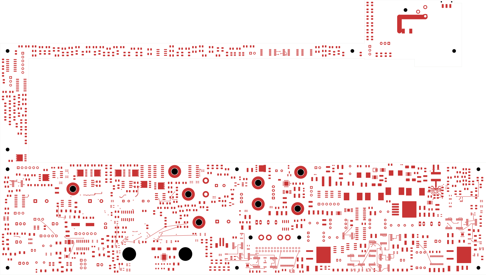
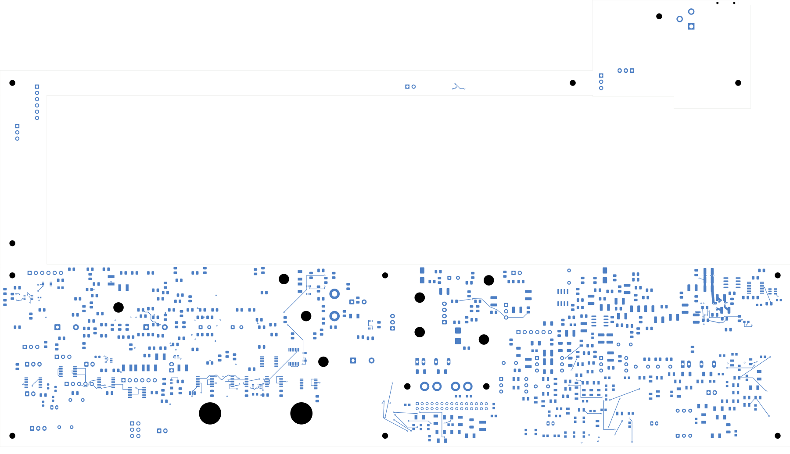

# Power/protection — U23 enable routing

The power board has **2,508 open connections**, three fewer than the preceding
input-plane revision. It remains **not ready for fabrication**. Open
[power_protection.kicad_pro](power_protection.kicad_pro) in KiCad.

## Local changes

R225, the existing 22 kΩ pull-down, moves from (307.5,141.5) to (301.5,130.6) mm
on the back and rotates −90°. Its value and footprint are unchanged. Its ground
end joins the existing quiet AGND via; its signal end joins R224 and U23 EN.

The former MODE via blocked an EN escape. MODE moves from (294.9,127.525) to
(294.5,129.05), below the package, with new front/back routes. EN uses the freed
pad-free package interior at (295.3,127.525), followed by a back-side route below
C58 to R225. Three MODE tracks and one via are replaced; eleven tracks and two
vias are added. All new tracks are 0.2 mm; vias are conventional 0.60/0.30 mm.
No schematic pin/net, component value or footprint assignment changes.

| Item | Checked result |
| --- | --- |
| Electrical components / footprints | 1,088 / 1,103 |
| Schematic pins / native mapped pads | 3,424 / 3,485 |
| Total tracks / through vias | 2,177 / 151 |
| Native opens / connections closed | 2,508 / 3 |
| Geometry / parity / ERC errors | 0 / 0 / 0 |
| Retained isolated-reference warnings | 2 |
| Previous physical connection groups preserved | All 3,249 |
| Minimum drill-to-SMD clearance across all vias | 0.165 mm |
| Filled planes | Two, each one connected polygon |

[Native checks](review.json) · [Independent delta audit](buck-enable-audit.json)
· [Construction](buck-enable-routing.json)
· [Full connection capture](../two-board-power-routing-inputs-2508-buck-enable/capture.json)
· [Source-net reconciliation](rejected-source-net-status.json)

The independent comparison checks the exact three-track/one-via replacement,
all remaining copper, the moved native pad polygons, the entire pin/net map and
every earlier connection group. Placement passes the recorded courtyard/context
screen; native courtyard/clearance checks remain enabled. Complete installed fit
is still unverified. The capture has 6,055 ordinary objects, 560 open nets and
3,068 open-net clusters. Its gap sum agrees with the uncapped native count;
the DRC unconnected list itself remains capped at 499 records.

## Plane refill and reference coverage

Stale filled polygons were removed before the native refill. The
[native fill record](../two-board-power-buck-enable-filled-01/local-plane-fill.json)
binds the saved output. Authored zone settings and boundaries stay unchanged.
In1 AGND is now 351.791 mm²; In3 VIN remains 91.854 mm². All twelve earlier ground
via contacts and all six VIN via contacts remain connected to their planes.

KiCad merges the adjacent FSEL/MODE antipad openings where the remaining copper
would be thinner than the existing 0.25 mm zone minimum. All fill changes stay
within a 0.76 mm envelope around the changed vias: 0.30 mm via radius, 0.20 mm
clearance, 0.25 mm minimum-width cleanup and 0.01 mm polygon allowance. There is
no unexplained change outside that envelope. Neither plane fragments. The In2
sense-trace projection retains its In1 coverage except its own signal-via holes.
This is geometric evidence; return impedance, thermal behavior and noise remain
unqualified.

## Enable electrical screen

The [DC calculation](enable-dc-screen.json) models both U20 and U23 branches
loading the common POWER_READY node. At nominal resistance and 2.5 V AUX, with
EN-source currents omitted, POWER_READY is 2.353 V and each EN is 1.618 V.
The circuit therefore cannot be reviewed as an unloaded 2.5 V logic source.

Across 2,048 declared linear scenarios, EN is at least 1.471 V when released,
at most 0.391 V with PGOOD asserted, and at most 0.669 V with AUX floating.
Those scenarios use a proposed 2.3–2.7 V AUX band, initial 1% resistor tolerances,
0–25 µA per EN source and a ±10.15 µA common-node current allocation.
**These allocations are not full-range guaranteed device limits.** The
[TPS543620 datasheet](https://www.ti.com/lit/ds/symlink/tps543620.pdf), sections
6.5 and 7.3.2, describes the internal EN pull-up and its change above threshold;
the 11.6 µA value is typical. The
[TPS2663 datasheet](https://www.ti.com/lit/ds/symlink/tps2663.pdf), section 6.5,
supplies the PGOOD sink-resistance and leakage bounds used in the screen.
The [logic-gate datasheet](https://www.ti.com/lit/ds/symlink/sn74lvc1g97.pdf),
section 6.5, provides input-current and partial-power data; its actual continuous
voltage envelope and thresholds still need reconciliation.

Guaranteed EN-current bounds, loaded AUX voltage, resistor drift, ground offsets,
external connector loads, partial-power clamps and transition timing remain open.
The calculation supports keeping the existing resistor values for this routing
checkpoint; it does not qualify complete enable behavior.

## Actual copper views

| Front | Back, in top-view coordinates |
| --- | --- |
|  |  |

[All inner layers](plots/inner-contact-sheet.png) · [Local front](plots/local-front.png)
· [Local back](plots/local-back.png) · [Local ground](plots/local-inner1.png)
· [Local sense](plots/local-inner2.png) · [Local VIN](plots/local-inner3.png)
· [Visual review](plots/visual-review.json)

## Remaining work

Connect the wider U23 source feed and complete board-wide power/return
networks. Regroup U20/AUX and other critical cells. Effective capacitance,
loaded power/fault/startup behavior, exact ESS package inputs, final interfaces,
all remaining routing, manufacturing stack/BOM/process, fabrication outputs and
complete housing fit remain unfinished. Signal main stays at 251 opens with
its ESS footprint missing. No fabrication order or release has been made.
