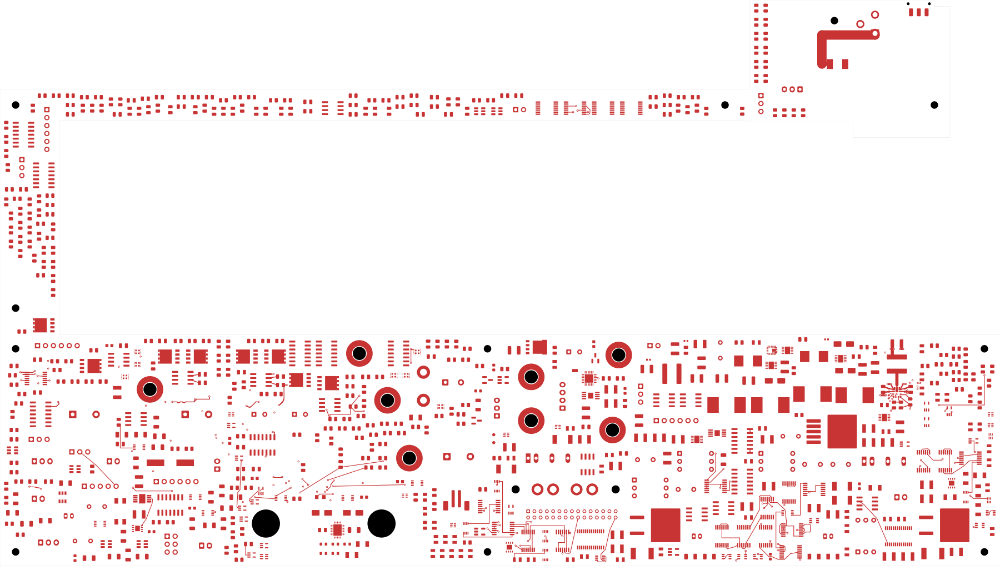
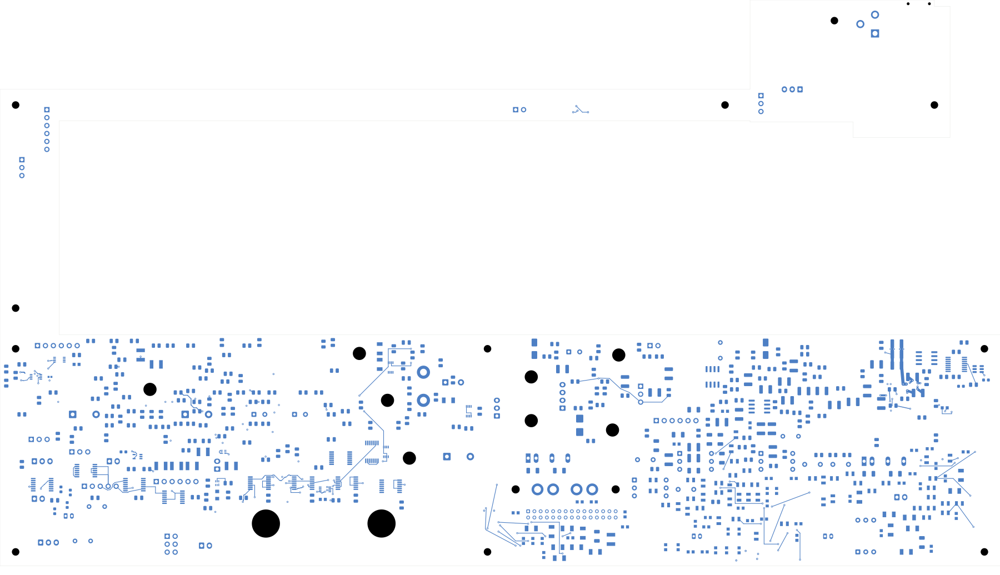

# Power/protection — local U23 input and ground planes

The power board has **2,511 open connections**, seven fewer than the previous
checkpoint. It remains **not ready for fabrication**. Open
[power_protection.kicad_pro](power_protection.kicad_pro) in KiCad.

## Input capacitors and local returns

C224 moves to (301.8,127.15) mm and C225 to (300,122) mm, both on the back.
They retain the existing 22 µF / 50 V X7R components and footprints. R40 moves
from (302,121) to (304.5,120.25) and rotates -90 degrees to clear C225. This also
moves it closer to its U6 amplifier; its full N12 feedback cell remains unrouted
and requires its own electrical placement review. No other component moves.

Paired 0.60/0.30 mm through vias and short front/back routes connect both local
VIN bypass branches, both bulk input capacitors and the left PGND branch. The
existing right PGND and output-bank returns are retained. New local planes are:

| Layer | Net | Authored rectangle | Native filled area |
| --- | --- | --- | --- |
| In1 | PWR_AGND | x=289–303.2, y=109–134.5 mm | 352.609 mm² |
| In3 | PWR_MODULE_FEED_IN | x=289–302.5, y=121–128.3 mm | 91.854 mm² |

The planes join U23's two VIN branches, both PGND sides and the existing AGND
return, including the bulk input capacitors. These are bounded local planes;
the input still needs its wider connection to the source, and other power cells
remain unfinished. The layout follows the local bypass and internal return
principles in [TI's layout guidance](https://www.ti.com/document-viewer/TPS543620/datasheet/GUID-3391D98E-22B0-43C0-BF8B-846FFDAAA5AB).

## Checks and limits

| Item | Result |
| --- | --- |
| Electrical components / total footprints | 1,088 / 1,103 |
| Schematic pins / native mapped pads | 3,424 / 3,485 |
| Tracks / through vias | 2,169 / 150 |
| Native opens | 2,511, down from 2,518 |
| Added tracks / vias / filled zones | 15 / 12 / 2 |
| Geometry / parity / ERC errors | 0 / 0 / 0 |
| Retained isolated-reference warnings | 2 |
| Earlier physical groups retained | All 3,256 |
| Moved components / changed native pad instances | 3 / 6 |
| Minimum drill-edge-to-SMD clearance, all vias | 0.165 mm |

The [independent audit](buck-input-audit.json) checks every new track/via, all
previous copper and connection groups, all six moved native pad shapes and the
unchanged complete schematic pin/net map. Courtyard/context, edge and mounting
screens pass. Each native zone is a single connected polygon and connects all
six intended new vias on its net. Native clearance is 0.2 mm; the expanded
capture polygons measure approximately 0.1997 mm, within their 0.001 mm capture
error allocation.

The new In1 ground covers the actual 0.2 mm-wide In2 sense-trace projection,
except for the two intentional signal-via antipads. This establishes geometric
reference coverage only. Field width, stack impedance, return-current density,
noise, loop stability, thermal limits and effective capacitance remain unqualified.
The existing 1.15 mm sense-to-switching-copper projection clearance is preserved.

The [native fill record](../two-board-power-buck-input-filled-01/local-plane-fill.json)
binds KiCad's saved fill geometry. Only the native filled polygons were copied
back; component and track representations were preserved. The
[full native capture](../two-board-power-routing-inputs-2511-buck-input/capture.json)
now records filled zones and their holes, as well as 6,046 ordinary objects,
561 open nets and 3,072 open-net clusters. Its independent cluster-gap sum agrees
with the uncapped native open count. The DRC list remains capped at 499 records.

[Construction](buck-input-routing.json) · [Native checks](review.json)
· [Source-net reconciliation](rejected-source-net-status.json)

## Actual copper views

| Front | Back, in top-view coordinates |
| --- | --- |
|  |  |

[All inner layers](plots/inner-contact-sheet.png) · [Ground layer](plots/inner1.png)
· [Sense routing layer](plots/inner2.png) · [Input plane layer](plots/inner3.png)
· [Visual review](plots/visual-review.json)

## Remaining work and continuation

Complete U23 enable and the wider source connection; verify the local supply,
return and thermal network under the declared load and fault conditions. Regroup
U20/AUX and other critical circuits. Remaining routing, effective capacitance,
loaded power/fault/startup checks, approved ESS package inputs, final interfaces,
stack/BOM/process, manufacturing outputs and full installed housing fit remain
open. Signal main remains at 251 opens with the codec footprint absent.

Future edits must refill the native zones and capture their actual saved copper.
Use the zone-aware capture successor; the older no-zone capture and via-screen
assumptions no longer apply. No fabrication release or order has been made.
