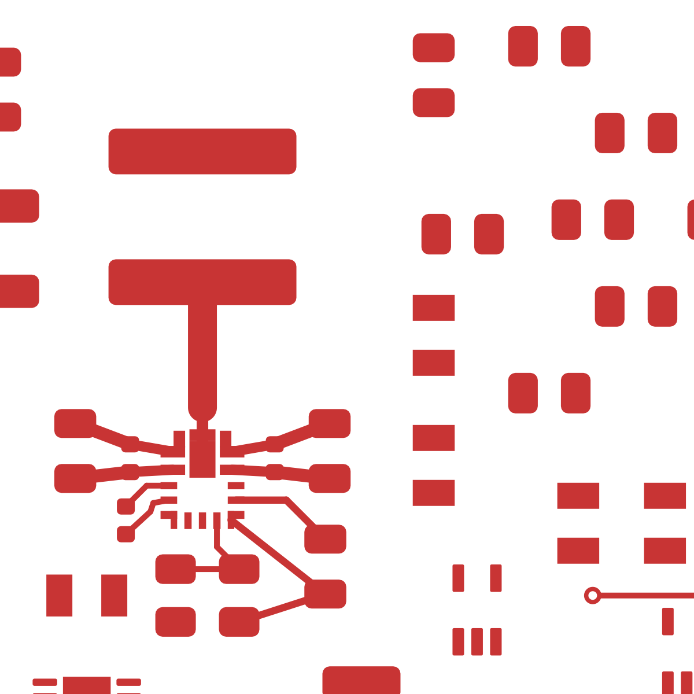
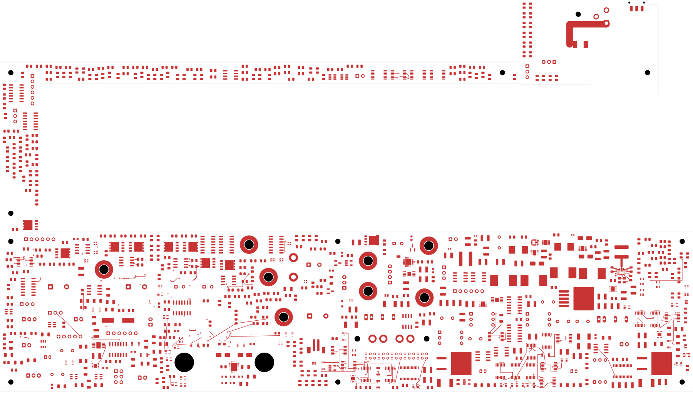
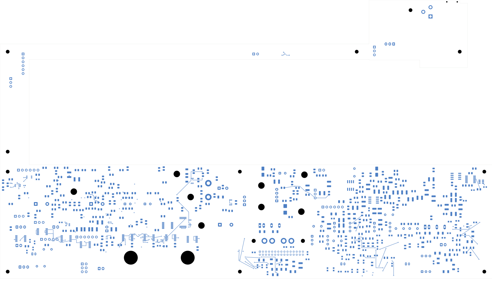
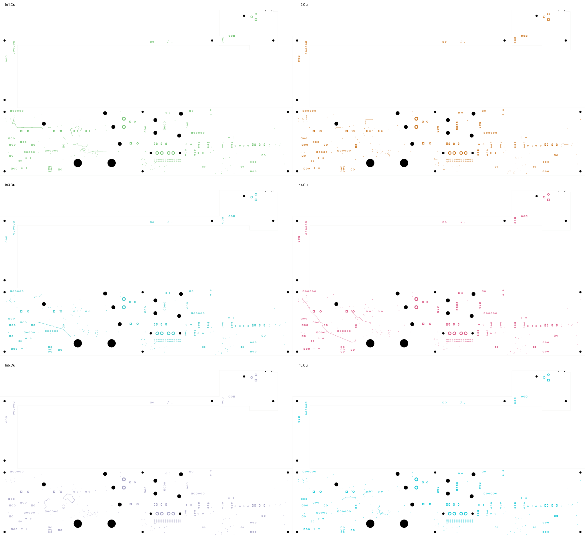

# Power/protection — short U23 local routing

This checkpoint closes **16 connections** after improving U23's feedback and
boot-capacitor placement. The board has **2,535 opens** and remains **not ready
for fabrication**. Output circuitry, supply/return planes, other critical cells
and electrical/manufacturing verification remain unfinished.

Open [power_protection.kicad_pro](power_protection.kicad_pro) in KiCad.

| Checked item | Result |
| --- | --- |
| Electrical components / total footprints | 1,088 / 1,103 |
| Schematic pins / physical pad instances | 3,424 / 3,485 |
| Tracks / through vias | 2,116 / 124 |
| Native opens | 2,535, down from 2,551 |
| Geometry / schematic parity / ERC errors | 0 / 0 / 0 |
| Retained isolated-reference ERC warnings | 2 |
| Prior native connection groups preserved | All 3,287 |
| Added tracks / vias | 22 / 0 |
| Declared local routing sections | 17; two sections form one SW connection |

## Placement and component change

R220/R221 now sit together on U23's feedback side, clear of the switching path
to L23. The unrelated, previously unrouted N_U28 buffer moves to (311.75,133)
mm with its N_C67 bypass capacitor at the source-relative offset of
(-1.45,-1.10) mm. The capacitor remains on the back. Its local power connections
still need routing; moving it with the buffer does not qualify its bypass loop.

C221 changes from the generic 0603 capacitor to the existing **TDK
C1005X7R1H104K050BB, 100 nF ±10%, 50 V, X7R, 0402** selection used by C230.
Its pins and nets are unchanged. The smaller package permits close boot paths.
TI specifies a 0.1 µF ceramic boot capacitor rated at least 10 V in section
8.2.1.2.7 of the [TPS543620 datasheet](https://www.ti.com/lit/ds/symlink/tps543620.pdf).
The [TDK product page](https://product.tdk.com/en/search/capacitor/ceramic/mlcc/info?part_no=C1005X7R1H104K050BB)
provides the selected nominal characteristics. This substitution does not accept
the complete effective-capacitance, land/stencil or assembly process review.

The [construction record](buck-local-routing.json) declares the four moves,
one capacitor substitution and every added track. An initial construction
copied eleven footprint-graphic UUIDs; that trial was superseded before native
validation. The checked successor assigns unique IDs to all 21,166 authored
board UUID nodes and retains C221's original footprint/pad identities.

## Actual local copper

This is a magnified viewport of the native front-copper SVG. No copper geometry
or style was changed to produce the detail. The inductor output and the
remaining return/supply network are visibly unfinished.

| Local path | Width | Measured length |
| --- | --- | --- |
| C230/C231 to the two VIN/PGND pairs | 0.35 mm | 1.48–1.50 mm each |
| C222/C223 to the nearby HF capacitors | 0.45 mm | 1.91–2.03 mm each |
| C221 BOOT / SW return | 0.20 mm | 2.02 / 1.79 mm |
| BP5 capacitor supply / AGND | 0.25 mm | 3.65 / 4.15 mm |
| Feedback connections | 0.20–0.25 mm | 1.99–3.13 mm |
| SW package neck / widened inductor path | 0.40 / 1.00 mm | 1.79 / 4.34 mm |

The widths are recorded construction dimensions, not a claim that current,
thermal or switching-noise requirements have been fully qualified. BOOT's
return connects to the designated IC pin 13. The relationship between that
internally connected return and the external force-SW net still needs final
schematic/layout reconciliation; no extra external short was added merely to
silence an open-connection report.

## Verification

The [independent audit](buck-local-audit.json) checks the actual saved native
pad polygons, all old copper, all previous connection groups, every new segment
and its intended endpoints. The complete schematic pin/net map is unchanged;
C221 is the only part/footprint substitution. All 13 affected native pad
instances match the declared transforms or the existing 0402 template within
0.000001 mm. Native geometry, parity and ERC errors remain zero.

Moved courtyards, board-edge gaps and the provisional body/tail/context
allocations pass. Every via is rechecked against SMD copper; all 124 retain at
least 0.165 mm measured drill-edge clearance. These checks do not establish
complete installed fit or manufacturing-process acceptance.

The [complete native capture](../two-board-power-routing-inputs-2535-buck-local/capture.json)
contains 5,967 objects and 563 open nets. Its independent cluster-gap sum agrees
with the 2,535 uncapped native opens; the DRC list is capped at 499 records.
The [source-net reconciliation](rejected-source-net-status.json) still finds
eight of the 52 formerly rejected nets complete, with 44 incomplete.

## Whole-board views and remaining work

All eight layers and the local detail were [visually reviewed](plots/visual-review.json).
Back views use top-view coordinates. No power plane was added.

| Front | Back |
| --- | --- |
|  |  |

Complete U23's output capacitors, output sensing, FSEL/MODE, enables and the
input/AGND/PGND network with appropriate plane access. Route the moved buffer's
local bypass connections. Regroup U20, AUX and other critical cells before
routing them. The existing I_J3/P_J104 switch-cable pair and other internal
ports are candidates for a separate terminal-by-terminal retirement audit;
they remain present in this checkpoint.

Both boards still require remaining routing, effective-capacitance and loaded
power/fault/startup checks, approved ESS codec inputs, final board interfaces,
accepted stack/BOM/process, reviewed manufacturing outputs, cooling/supports
and installed housing-fit verification. The signal board remains at 251 opens
with a missing codec footprint. No fabrication release or order has been made.
