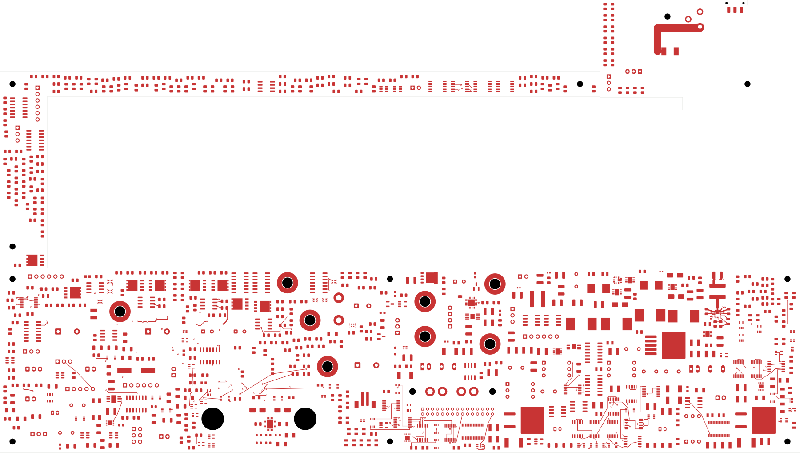
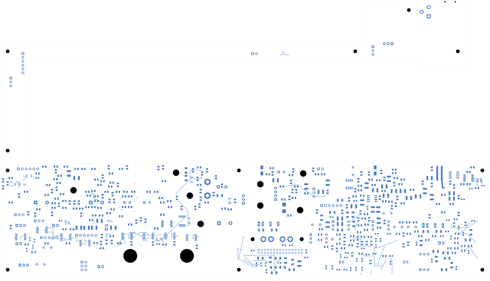

# Power/protection — local U23 output-capacitor bank

This checkpoint closes **eight physical connections**, bringing the power board
to **2,525 opens**. It remains **not ready for fabrication**. Open
[power_protection.kicad_pro](power_protection.kicad_pro) in KiCad.

## Placement and copper

C226–C229 retain their existing 47 µF / 25 V X7S components and footprints.
C227 moves to the front at (295,111.35) mm; C226, C228 and C229 form a back-side
bank at x=295 mm and y=111.35, 114.85 and 118.35 mm. This puts their connections
next to the inductor output, instead of beyond the regulator's feedback region.
No other component moves and no schematic pin/net assignment changes.

The front capacitor connects to L23's output with a 1 mm-wide, 5.765 mm path.
The back bank uses 1 mm-wide output and ground buses with 3.5 mm between adjacent
lands. Paired conventional 0.60/0.30 mm vias join the front and back output and
ground copper. A further pair brings the bank return to U23's PGND pin 9.
The return uses a 1 mm back-side path and a short 0.4 mm package approach.
Six vias and 17 tracks are added in 16 declared route sections.

These dimensions describe the actual construction. Effective capacitance,
loop stability, loss/temperature, switching noise and final copper-stack
capacity remain to be qualified. The output sense route and wider power/ground
planes remain unfinished. Completing this local return does not qualify the
whole power stage.

## Checks

| Item | Result |
| --- | --- |
| Electrical parts / total footprints | 1,088 / 1,103 |
| Schematic pins / mapped native pads | 3,424 / 3,485 |
| Tracks / through vias | 2,133 / 130 |
| Uncapped native opens | 2,525, down from 2,533 |
| Geometry / schematic parity / ERC errors | 0 / 0 / 0 |
| Retained isolated-reference warnings | 2 |
| Prior physical connection groups retained | All 3,271 |
| Moved footprints / changed native pads | 4 / 8 |
| Minimum drill-edge-to-SMD clearance, all vias | 0.165 mm |

The [independent audit](buck-output-audit.json) checks the saved native pad
polygons, every added track/via, the full unchanged schematic pin/net map,
unchanged earlier copper and all previous connection groups. It confirms all
four output capacitor pins connect to L23 and all four return pins connect to
U23 PGND. The eight moved pad polygons match the declared transforms within
0.000001 mm. Courtyard, board edge, mount and provisional receiving/context
checks pass; complete installed fit remains open.

The first native trial reported a copper-sliver warning. The selected successor
replaces acute and overlapping joins with shared trunks and has zero geometry
findings, with no rules suppressed. The [construction record](buck-output-routing.json)
and [native review](review.json) identify the selected source.
The [full native capture](../two-board-power-routing-inputs-2525-buck-output/capture.json)
contains 5,990 objects; its independent cluster-gap sum agrees with 2,525 opens.
The DRC output list remains capped at 499 records and is not the full open count.

## Actual copper views

| Front | Back, in top-view coordinates |
| --- | --- |
|  |  |

[Inner layers](plots/inner-contact-sheet.png) · [Local front detail](plots/local-front.png)
· [Local back detail](plots/local-back.png) · [Visual review](plots/visual-review.json)

## Remaining work

Route the output sense, configuration and enables, and complete input/ground
planes. Regroup U20/AUX and other critical circuits; route the relocated buffer's
bypass. The [source-net reconciliation](rejected-source-net-status.json) retains
eight complete and 44 incomplete formerly rejected nets. Signal main remains
at 251 opens and a missing ESS codec footprint. Remaining electrical checks,
accepted ESS package inputs, interfaces, effective capacitance, stack/BOM/process,
manufacturing outputs, cooling/supports and installed housing fit remain required.
No fabrication release or order has been made.
