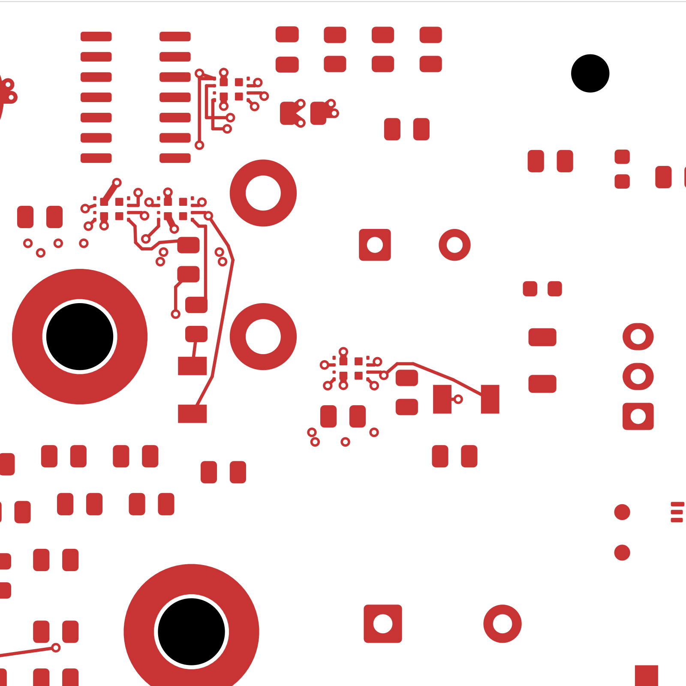

# Power/protection — digital eFuse support cells (TBP38)

The four digital eFuses now have connected current-limit and slew-rate support
networks and eight local quiet returns. This closes 20 connections relative to
TBP37: **2,320 power-board connections remain open**. Signal main still has
251 opens and a missing ESS codec footprint. **This is not a fabrication release.**
Open [power_protection.kicad_pro](power_protection.kicad_pro) in KiCad.

## Changes and checks

Fifteen passive components were repositioned, including five side changes, to
make room for the four devices' support networks. Three input capacitors have
replacement source/return escapes; their values and the circuit are unchanged.
The four quiet-ground islands retain one plane connection each through their
own device GND-pin via. Input and protected-output nets remain separate.

The revision replaces 19 tracks and 16 vias with 95 tracks and 24 vias. Six
existing zone outlines change, ten fills change and twenty fills remain exact.
All 3,078 earlier native connection groups survive; the declared joins account
for the 20 fewer opens. The remaining 1,086 complete footprints are unchanged.
The independent audit verifies transformed pads, exact circuit assignments,
quiet-return contacts and retained copper. The moved-component mechanical
screen passes; complete installed housing fit remains unverified.

| Item | Result |
| --- | --- |
| Electrical components / footprints | 1,086 / 1,101 |
| Schematic pin entries / mapped pads | 3,420 / 3,481 |
| Tracks / vias / filled zones | 2,567 / 308 / 30 |
| Native opens / closed this pass | 2,320 / 20 |
| Geometry / schematic parity / ERC errors | 0 / 0 / 0 |
| Retained isolated-reference ERC warnings | 2 |
| Earlier complete adjacent-ground track projections preserved | 233 |
| Minimum all-via drill-to-SMD gap | 0.163872 mm |
| Separate AUX return / isolated G_NT1 pads | Preserved |

The first candidate failed native clearance and dangling-via checks. The second
passed native checks but lost a small portion of an existing input trace's
ground reference. This selected third candidate restores that coverage; no
finding was waived. Status-38 also rechecks all 33 retained fast-OV sections.

[Native checks](review.json) · [Independent review](digital-cell-review.json)
· [Construction](digital-cell-routing.json)
· [Connectivity capture](../two-board-power-routing-inputs-2320-digital-cells-03/capture.json)
· [Earlier rejected-net subset](rejected-source-net-status.json)
· [Fabrication status](../two-board-fabrication-status-38/status.json)

## Remaining electrical and fabrication work

New support-route adjacent-ground coverage is incomplete. Quiet-return paths
reach 13.258 mm and need shortening or electrical qualification, including
parasitic review. Connected input capacitors still require exact MPN/effective
capacitance and bypass-loop review. No current, thermal, transient or noise
rating is established by these connectivity checks.

The updated source-plane reference screen leaves 0.351827 mm² of 828.869102 mm²
uncovered after source-contact exclusions. This geometric screen is not full
reference coverage or an impedance/current rating. The earlier TBP35 inlet
resistance calculation does not model these newer copper changes.

Complete digital protected-output copper, thermal spreading, PG/follower startup
controls and remaining source loads; then remaining analog/module distribution,
force/quiet returns and signal routes. Resolve accepted stack/plating, actual
load/startup states, fault coordination, approved ESS package inputs, exact BOM,
assembly/manufacturing outputs, full housing/fastener/cooling/harness fit and
prototype bring-up planning. No order or fabrication release has been made.

## Native copper views

[Front](plots/front.png) · [Back](plots/back.png)
· [Six inner layers](plots/inner-contact-sheet.png)
· [Cell front](plots/cells-front.png) · [Cell back](plots/cells-back.png)
· [Quiet islands](plots/cells-inner1.png) · [Force return](plots/cells-inner5.png)
· [Source plane](plots/cells-inner6.png) · [Visual review](plots/visual-review.json)
