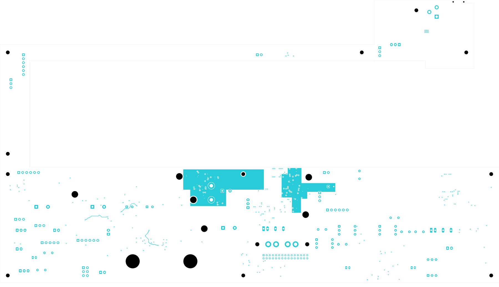

# Power/protection — digital source distribution (TBP37)

U20's output bank now connects to the four digital eFuse input pairs, the
E_J11 source terminal and four existing input capacitors. **2,340 power-board
connections remain open**, 29 fewer than TBP36. Signal main remains at 251 opens
with its ESS codec footprint missing. **This is not a fabrication release.**
Open [power_protection.kicad_pro](power_protection.kicad_pro) in KiCad.

## Routing and return paths

The In6 source plane connects PWR_5V_DIG_SRC from U20's retained output-via pair
to E_U15/E_U16/E_U17/E_U33 pins 5 and 12, E_J11.1, and E_C44/E_C46/E_C48/E_C52.
Each capacitor terminal has two new conventional 0.60/0.30 mm vias. Forty-seven
new track segments and 38 vias connect the source, capacitor returns, device
GND pins and existing ground-tied control inputs. The source and protected
PWR_5V_DIG output nets remain separate; neither protection bypass nor circuit
change is introduced. P_J23 and the remaining source-rail loads still need
routing, so the entire source net is not complete.

An In5 force-return extension accompanies the source plane. Each eFuse has its
own separate In1 quiet-ground island. Its OVLO and RCBCTRL ground-tie vias are
excluded from the other ground planes. The device GND-pin via is the island's
single plane connection to the main return. Independent native geometry checks
verify all three island contacts and the intended single connection. The
remaining ILM/DVDT support networks must return to these islands when routed.
Pin 2 is OVLO and pin 4 is RCBCTRL; only pin 8 is the device GND terminal.
The retained RCBCTRL-low circuit disables steady-state reverse-current blocking;
this revision does not claim reverse blocking in that mode.

The first candidate passed native checks but used a shared local ground field.
The selected second candidate replaces that field with four separate islands.
Twenty old zone fills remain exact. Four inlet planes refill; the two old ground
outlines gain exclusions for the quiet control vias. Every old footprint,
track, via, component value/package and schematic pin/net entry is preserved.

## Checked results

| Item | Result |
| --- | --- |
| Electrical components / footprints | 1,086 / 1,101 |
| Schematic pin entries / mapped pads | 3,420 / 3,481 |
| Tracks / vias / filled zones | 2,491 / 300 / 30 |
| Native opens / closed this pass | 2,340 / 29 |
| Geometry / schematic parity / ERC errors | 0 / 0 / 0 |
| Retained isolated-reference ERC warnings | 2 |
| Earlier native connection groups preserved | All 3,107 |
| Earlier physical objects preserved | All 6,427 |
| Previous complete adjacent-ground track projections preserved | 229 |
| Minimum all-via drill-to-SMD gap | 0.163872 mm |
| Separate AUX return / isolated G_NT1 pads | Preserved |

The source plane is one connected 828.0306 mm² piece. Against its actual In5
main-ground reference, 0.331629 mm² of an 811.9720 mm² screen remains uncovered
(about 99.9592% coverage after source-contact antipad exclusions). The 17 small
regions occur at via-bank, quiet-via reserve and hole-clearance boundaries.
This is a geometric screen, not full reference coverage or an impedance rating.
All 33 retained fast-overvoltage route sections are checked again by Status-37.

[Native checks](review.json) · [Independent review](digital-distribution-review.json)
· [Construction](digital-distribution-routing.json)
· [Connectivity capture](../two-board-power-routing-inputs-2340-digital-distribution-02/capture.json)
· [Earlier rejected-net subset](rejected-source-net-status.json)
· [Fabrication status](../two-board-fabrication-status-37/status.json)

## Electrical scope and remaining work

The [TI TPS25948 datasheet, Rev. D](https://www.ti.com/lit/gpn/tps25948),
sections 5 and 8.9, informed the pin-function and quiet-island review. It calls
for nearby input bypassing, short support-component traces, and power paths
sized for twice full-load current. It also recommends a local quiet island
with a star connection to power ground. The four retained 1 µF/50 V capacitors
are now connected, but their exact MPN/effective capacitance and placement
relative to each eFuse still need review. Connectivity does not prove an
adequately small bypass loop. Complete the output copper, support networks,
per-device current sharing, thermal spreading and transient protection before
qualifying these cells.

The provisional copper stack, U20 output-via pair, new input escapes and
transition vias have no accepted current/temperature rating. Recompute the
input/distribution network using actual copper, plating and load/startup states;
the TBP35 inlet resistance study is historical. Finish analog regulator/output
routing, module supplies, remaining force/quiet returns, signal routing, approved
ESS package inputs, exact BOM/assembly outputs, complete installed housing fit
and prototype bring-up planning. No order or fabrication release has been made.

## Native copper views

[Front](plots/front.png) · [Back](plots/back.png)
· [Six inner layers](plots/inner-contact-sheet.png)
· [eFuse front](plots/digital-front.png) · [eFuse back](plots/digital-back.png)
· [Quiet islands](plots/digital-inner1.png) · [Force return](plots/digital-inner5.png)
· [Source plane](plots/digital-inner6.png)
· [U20 source front](plots/digital-source-front.png)
· [U20 source back](plots/digital-source-back.png)
· [U20 source return](plots/digital-source-inner5.png)
· [U20 source plane](plots/digital-source-inner6.png)
· [Visual review](plots/visual-review.json)
