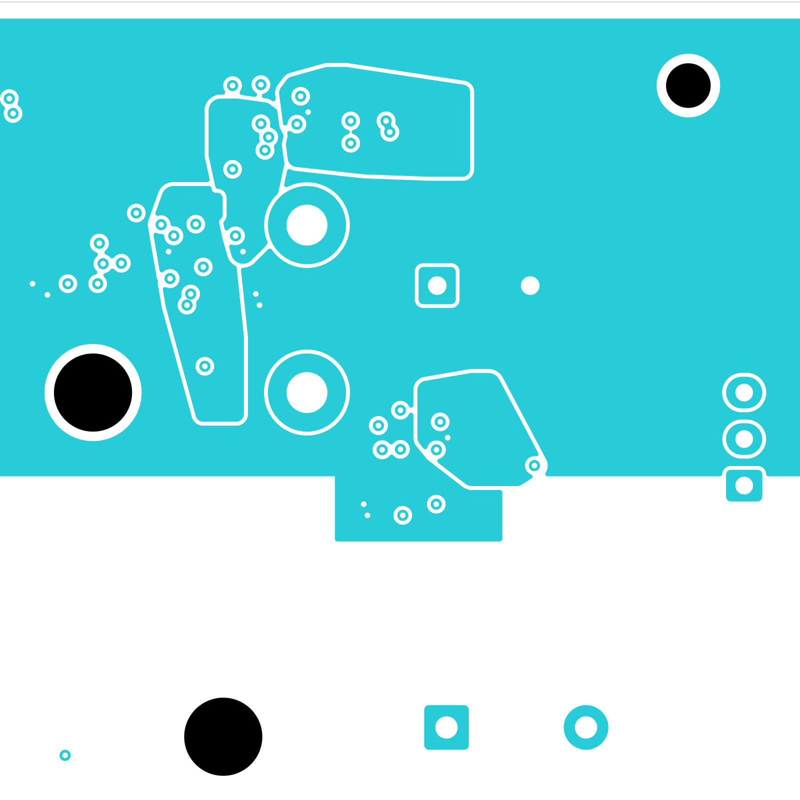

# Power/protection — digital quiet-ground references (TBP39)

The four digital eFuse support cells now have dedicated ground reference copper
on both adjacent inner layers. The digital source plane moves from In6 to In4,
retaining all 20 physical contacts and its In5 return reference. **2,320 power
connections remain open**; signal main retains 251 opens and a missing ESS
codec footprint. **This is not a fabrication release.**
Open [power_protection.kicad_pro](power_protection.kicad_pro) in KiCad.

## Layout changes

Four existing In1 quiet islands expand under front-side controls. Four new In6
quiet islands reference bottom-side controls; two separate In6 main-ground
regions connect through existing return vias. Each device's quiet fields retain
a single connection to system ground through its own GND-pin via. The In4
main-ground outline reserves space for the relocated source plane.

The E_U17 DVDT route to E_R114 now stays over its own quiet field. Its six track
segments replace six earlier segments; length increases from 4.700 to 6.146 mm
to avoid the gap between islands. All components, vias, values and circuit
assignments are unchanged. Twenty-four previous zone records remain exact;
five ground outlines change, one source zone changes layer and six zones are
added. A second native fill verifies all 36 fills remain unchanged by the
surface-track reroute.

The [TI TPS25948 Rev. D layout guidance](https://www.ti.com/lit/gpn/tps25948)
recommends a quiet island with a star connection, short support paths and less
than 50 pF parasitic loading on ILM. This checkpoint improves ground references;
it does not establish that capacitance limit or complete electrical qualification.

## Verified results

| Item | Result |
| --- | --- |
| Electrical components / footprints | 1,086 / 1,101 |
| Schematic pin entries / mapped pads | 3,420 / 3,481 |
| Tracks / vias / filled zones | 2,567 / 308 / 36 |
| Power opens / closed this pass | 2,320 / 0 |
| Geometry / schematic parity / ERC errors | 0 / 0 / 0 |
| Retained isolated-reference warnings | 2 |
| Prior connected groups preserved | All 3,058 |
| Unchanged physical objects | 6,590; six tracks replaced |
| Earlier complete adjacent-ground projections preserved | 234 |
| Source-plane contacts preserved | All 20 |

The independent audit checks actual filled copper, unchanged parts and circuits,
exact connected groups, quiet-island contacts, source contacts and ground
reference identity. The 55 generated identities on older embedded pads are
matched by complete physical/net data. Status-39 rechecks all 33 fast-OV routes.

Ground coverage improves from **2/28 to 24/28** complete route-section screens.
The sum of uncovered areas falls from 10.661113 to **0.001294 mm²**. The four
remaining screen residuals lie within 0.25 mm of their own signal-via copper;
these are still reported, with full coverage marked false. The two E_C48
screens overlap, so this sum is not a unique physical area. Of 22 critical
support-route sections, 20 have complete coverage by their own device's quiet
field; the other two retain small via-edge residuals. The replacement DVDT
route has complete coverage by its own quiet field.

The relocated source is one 845.055569 mm² filled piece. Its In5 reference
screen remains 828.869102 mm², with 0.351827 mm² uncovered after contact
exclusions. The existing long quiet-return tracks, up to 13.258 mm, remain;
reference copper does not prove acceptable parasitics, noise or transient behavior.

[Native checks](review.json) · [Independent review](digital-reference-review.json)
· [Plane construction](digital-reference-routing.json)
· [DVDT reroute](digital-reference-track-routing.json)
· [Connectivity capture](../two-board-power-routing-inputs-2320-digital-reference-02/capture.json)
· [Rejected-net subset](rejected-source-net-status.json)
· [Fabrication status](../two-board-fabrication-status-39/status.json)

## Remaining work

Shorten or qualify quiet returns, establish support-node parasitics and review
input bypass loops/effective capacitance. Route digital protected outputs,
thermal spreading, PG/follower startup controls and remaining source loads.
Complete analog/module distribution, force/quiet returns and signal routing.
Resolve accepted stack/plating, actual load/startup/fault/thermal limits, approved
ESS package inputs, exact BOM, full housing/fastener/cooling/harness fit and
manufacturing outputs. The earlier inlet resistance model does not represent
the current layer changes. No order or fabrication release has been made.

## Current native copper

[Front](plots/front.png) · [Back](plots/back.png)
· [Six inner layers](plots/inner-contact-sheet.png)
· [Cell front](plots/reference-front.png) · [Cell back](plots/reference-back.png)
· [Front quiet fields](plots/reference-inner1.png)
· [In4 source](plots/reference-inner4.png) · [In5 return](plots/reference-inner5.png)
· [Back quiet fields](plots/reference-inner6.png) · [Visual review](plots/visual-review.json)
