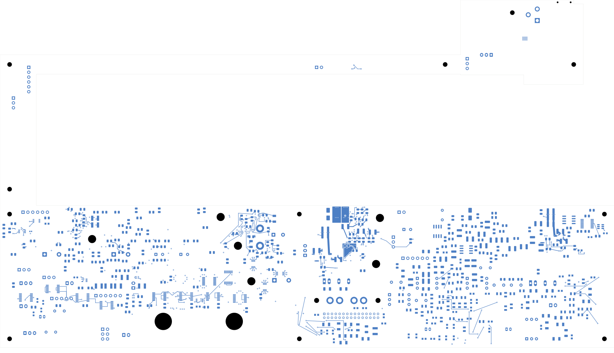

# TBP46 digital pulldown and reference repair

This checked development revision is selected by [status 46](../two-board-fabrication-status-46/status.json).
It is **not ready for fabrication**. The schematic retains its candidate title.

R104, the 47 kΩ master-enable pulldown, moves beside U15 on the back face. Its
1.482 mm ground trace joins U15's existing surface quiet return without a new
via; its enable trace is 2.010 mm. A direct replacement for the existing
master-enable dogleg avoids crossing the boundary of the extended In6 quiet
field. The remote R104 leaf branch and its via retire; R28's other connection
is retained. No values, packages, pin nets or board outlines change.

This closes one native connection from [TBP45](../two-board-power-analog-cells-native-03/README.md),
leaving **2,210 power opens**. The signal board still has 251 opens and the
missing approved ESS codec footprint. Native geometry/parity/ERC errors are
zero, with two retained isolated-reference warnings. Every other native
connection group and all seven quiet-ground networks are preserved; each
quiet network still joins main ground only at its original pin-8 star.

The board contains 1,101 footprints, 1,086 electrical components, 3,420 schematic
pin entries, 3,028 tracks, 453 vias, 47 zones and 2,948 connection groups.
This change adds three tracks, retires four tracks and one via, moves two pads
on one footprint, edits two zone outlines and refills five zones. Forty-two
existing fills remain exact. All eleven supply planes remain unchanged.

Both new non-ground paths and all 1,610 retained complete reference cases have
adjacent ground coverage. The earlier candidate's two master-enable reference
gaps are resolved. Twelve earlier incomplete support/startup reference cases
remain unchanged and require correction. The 22 digital ILM/DVDT own-field
cases show no regression, including their recorded preexisting small gaps.
Projection checks explicitly exclude recorded same-net via/plated-pad clearance
areas; they do not qualify transient behavior, parasitics, noise or current.

The [startup connectivity survey](../two-board-startup-connectivity-survey-01/README.md)
checks 91 named startup/control nets: 32 remain open, requiring at least 60
joins. The master-enable net itself still has five disconnected groups.
Completing its local pulldown does not complete the startup circuit.

Evidence: [native checks](review.json), [connectivity and quiet ownership](digital-return-review.json),
[ground references](digital-return-reference-review.json), [routing manifest](digital-return-routing.json),
[visual review](plots/visual-review.json). Fourteen views were directly inspected:
five local copper views, six former-location views, both surface overviews and
the six-inner-layer contact sheet.

[Front](plots/front.png) · [Inner layers](plots/inner-contact-sheet.png) ·
[Local back](plots/r104-local-back.png) · [Local In6](plots/r104-local-inner6.png) ·
[Former location](plots/r104-former-front.png)

Next: correct earlier reference gaps and finish startup routing/verification,
protected outputs, source/input loops, analog/module distribution, force/quiet
returns and signal routing. Load/startup/fault/thermal limits, effective
capacitance, accepted stack/plating, approved ESS package inputs, exact BOM,
complete housing/support/cooling/harness fit, reviewed manufacturing outputs
and a whole-unit prototype bring-up plan remain required.
