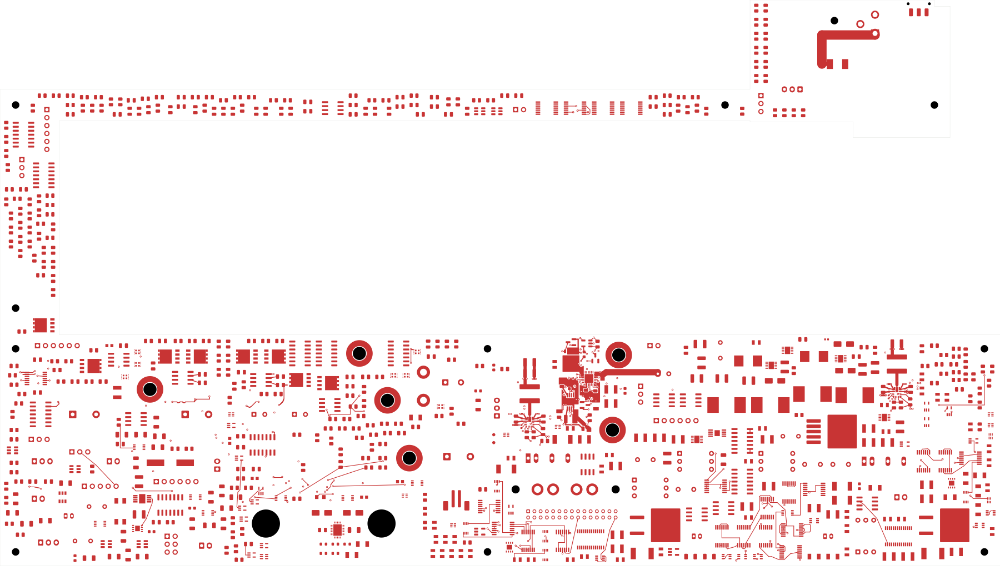
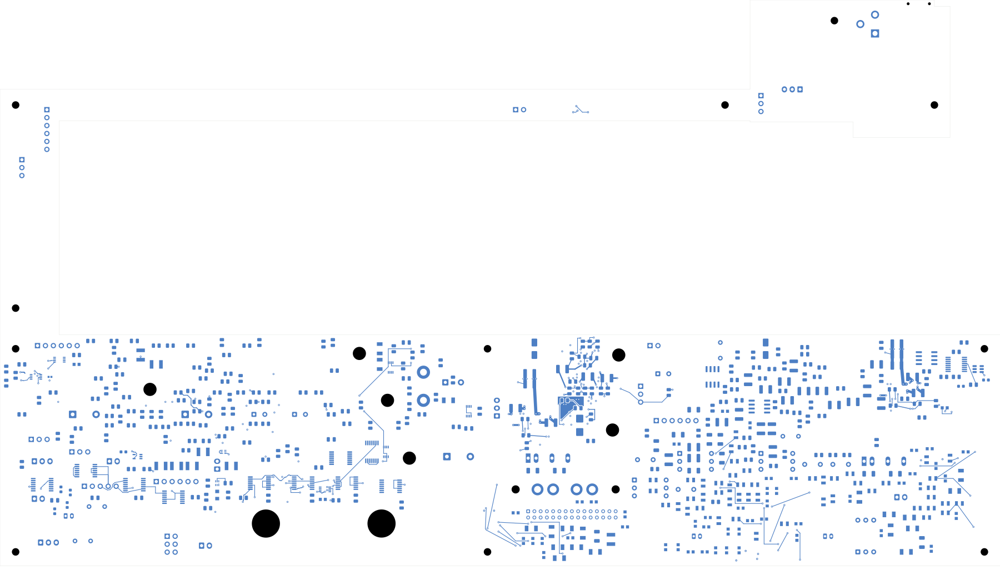

# Power/protection — fast overvoltage circuit and AUX input feed

This revision closes **22 connections**, leaving **2,383 power-board opens**.
Native and independent checks pass. **This is not a fabrication release.**
Open [power_protection.kicad_pro](power_protection.kicad_pro).

| Check | Result |
| --- | --- |
| Native geometry / schematic parity / ERC errors | 0 / 0 / 0 |
| Retained isolated-reference warnings | 2 |
| Open connections / closed this revision | 2,383 / 22 |
| Tracks / through vias / filled regions | 2,448 / 234 / 14 |
| Electrical components / footprints | 1,086 / 1,101 |
| Previous connection groups preserved | All 3,143 |
| Contiguous native regions / unchanged earlier regions | 14 / 8 |

U103, Q103 and eight passives move into the input-protection area. The fast
OV sense/reference dividers, feedback, output resistor, gate pull-down and
shutdown connection are now locally connected. A 0.4 mm In4 branch joins
Q101's drain/U101 input region to the AUX input-capacitor/regulator group;
C102's ground now joins the U101 return. The external cable feed and full
system return remain unfinished.

New C114 is a dedicated 100 nF/50 V X7R C0603C104K5RACTU bypass for U103,
using the existing C401 package and part number. It sits on the same face
as the comparator, with a 1.791 mm supply connection and 1.800 mm ground
connection to a via. The complete loop remains subject to electrical review.
This follows the comparator's [bypass guidance, section 10.1](https://www.ti.com/lit/ds/symlink/tlv7011.pdf).
Existing values, package identifiers and pin/net assignments remain unchanged.
The AUX census becomes 230 rail terminals and 28.5 µF direct nominal
capacitance, still with 81 IC supply pins. This is not an effective-capacitance
or current limit; the earlier load-budget issues remain open.

The construction adds 58 tracks and 15 conventional 0.60/0.30 mm through
vias, with no retired copper. All retained tracks/vias and unmoved pads
remain exact. Independent checks verify all 24 moved pad instances, both
new capacitor pads, its donor package, placement envelopes and all 234
via drills. Minimum drill-to-SMD clearance remains 0.165067 mm.

Six existing regions refill; eight remain exact. U101's In1 and In6 ground
outlines expand. All 14 native regions remain contiguous, and AUX's separate
return group and single GND-land joining topology remain intact. The first
candidate passed net-based checks but accidentally merged those return
groups; it is [rejected](../two-board-power-fast-ov-native-01/rejection-review.json).

The existing 16 back-route reference checks pass. Twenty-two new surface
routes and the inner reference route have checked adjacent ground coverage,
excluding their own signal-via antipads. The [full remaining-route screen](fast-ov-return-load-review.json)
records gaps around the output, gate, RUN and supply paths. Coverage alone
does not qualify impedance, noise, inductance, current capacity or cutoff time.
The plane report predates the completed independent delta audit; its pending
audit flag is superseded by the completed audit below. All eight local copper
views, full front/back and the six-inner sheet have been inspected.

[Native checks](review.json) · [Independent audit](fast-ov-audit.json)
· [Plane/connectivity review](fast-ov-plane-review.json)
· [Return and AUX load review](fast-ov-return-load-review.json)
· [Construction](fast-ov-routing.json)
· [Native fill](../two-board-power-fast-ov-filled-03/local-plane-fill.json)
· [Uncapped capture](../two-board-power-routing-inputs-2383-fast-ov/capture.json)
· [Visual review](plots/visual-review.json)

| Front | Back in top-view coordinates |
| --- | --- |
|  |  |

[Local front](plots/local-front.png) · [Local back](plots/local-back.png)
· [In1 ground](plots/local-inner1.png) · [In6 ground](plots/local-inner6.png)
· [Six inner layers](plots/inner-contact-sheet.png)

## Remaining work

Resolve the source/return paths and recorded reference gaps. Qualify exact
passive MPNs/derating, thresholds and hysteresis, loaded fast-OV response,
AUX startup and installed thermal limits. The 2 mm output bus has no
established 8 A rating; G_NT1 remains isolated. Complete remaining routing,
approved ESS package inputs, inter-board interfaces, the accepted fabrication
stack, manufacturing outputs and installed housing fit. Signal main still
has 251 opens. No order, commit, push or fabrication release is claimed.
