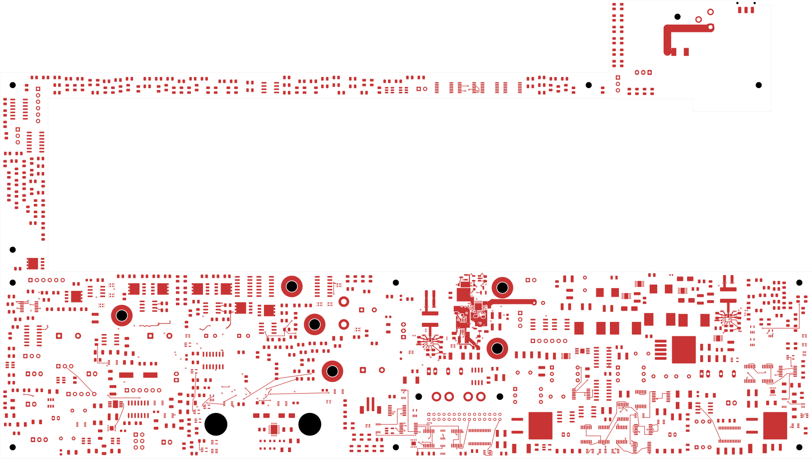
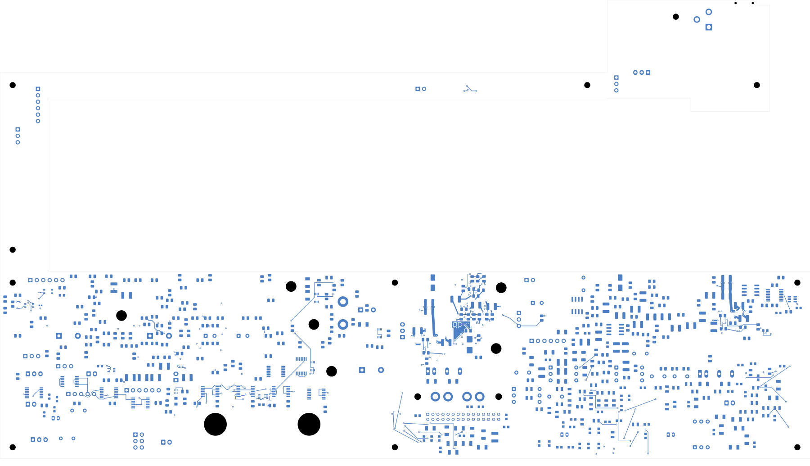

# Power/protection — fast overvoltage return references

TBP32 corrects the recorded fast-OV reference gaps and shortens the shutdown
gate path. **2,383 power-board connections remain open. This is not a
fabrication release.** Open [power_protection.kicad_pro](power_protection.kicad_pro).

| Check | Result |
| --- | --- |
| Native geometry / schematic parity / ERC errors | 0 / 0 / 0 |
| Retained isolated-reference warnings | 2 |
| Open connections / closed this revision | 2,383 / 0 |
| Tracks / through vias / filled regions | 2,444 / 234 / 14 |
| Electrical components / footprints | 1,086 / 1,101 |
| Previous connection groups preserved | All 3,121 |
| Contiguous regions / unchanged earlier fills | 14 / 9 |
| Fast-OV route sections with adjacent ground coverage | All 33 |

Q103 rotates and moves to face its gate resistor, replacing an inner-layer
loop with a 2.133 mm front-side gate connection. Its source reaches a ground
via through a 1.463 mm trace; its drain uses a 1.331 mm front-side escape
and an 8.451 mm In2 branch to the SHDN connection. G_NT1 moves to maintain
component spacing; both of its pads remain isolated.

The comparator AUX feed moves from In3 to In2. The VIN sense and AUX input
branches move from In4 to In5. U101's In1/In6 references extend around these
paths and the shutdown area; two AUX reference outlines gain a small notch.
All 33 retained/replacement fast-OV route sections now project onto an
adjacent, U101-connected ground region, excluding their own signal-via
antipads. The prior 16 back-side control/bypass paths and the complete AUX
feedback/trim paths retain reference coverage. These checks establish copper
coverage, not impedance, loop inductance, cutoff time or current capacity.

All earlier connections, pin/net assignments, values and packages are
preserved. The AUX return group stays separate from U101's return, and the
AUX input/output returns still separate when its single GND land is cut in
the topology check. Five regions refill; nine remain exact. All 14 native
filled regions remain contiguous.

The complete independent audit verifies five moved pads, 20 retired tracks,
three retired vias, 16 replacement tracks and three replacement vias. All
retained ordinary copper is unchanged. Placement checks cover courtyard,
body, height and declared assembly obstacles for the two moved footprints;
full installed fit remains unverified. All 234 via drills pass the SMD
clearance check, with minimum clearance 0.165067 mm.

The first return-reference candidate retained a 0.020168 mm² uncovered drain
projection and is not selected. This second candidate corrects it. The
plane review's pending independent-audit flag is superseded by the completed
audit linked below. All eight local copper views, full front/back and the
six-inner contact sheet have been inspected.

[Native checks](review.json) · [Independent audit](fast-ov-return-audit.json)
· [Plane/connectivity review](fast-ov-return-plane-review.json)
· [Construction](fast-ov-return-routing.json)
· [Native fill](../two-board-power-fast-ov-return-filled-02/local-plane-fill.json)
· [Uncapped capture](../two-board-power-routing-inputs-2383-fast-ov-return-02/capture.json)
· [Visual review](plots/visual-review.json)
· [Previous circuit and AUX load review](../two-board-power-fast-ov-native-03/README.md)

| Front | Back in top-view coordinates |
| --- | --- |
|  |  |

[Local front](plots/local-front.png) · [Local back](plots/local-back.png)
· [In1 ground](plots/local-inner1.png) · [In6 ground](plots/local-inner6.png)
· [Six inner layers](plots/inner-contact-sheet.png)

## Remaining work

Complete the external inlet feed, full system current returns and remaining
routing. Qualify exact passive MPNs/derating, thresholds/hysteresis, fast-OV
loaded response and AUX startup/thermal limits. The AUX census remains 230
terminals, 81 IC supply pins and 28.5 µF direct nominal capacitance; effective
capacitance and actual state loads remain unresolved. The 2 mm output bus
has no established 8 A rating. Approved ESS package inputs, final inter-board
interfaces, accepted fabrication stack, manufacturing outputs, bring-up plan
and complete installed housing fit remain required. Signal main retains
251 opens. No order, commit, push or fabrication release is claimed.
