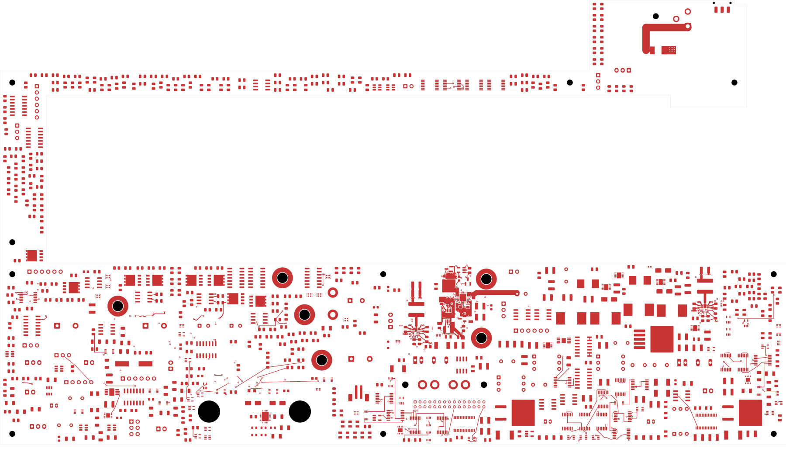
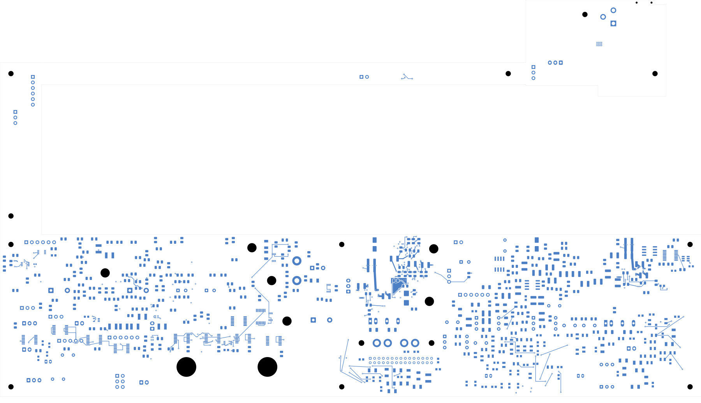

# Power/protection — paired inlet feed and return

TBP33 connects the fused inlet to the input-protection cell and provides
paired internal return planes. **2,374 power-board connections remain
open, nine fewer than TBP32. This is not a fabrication release.** Open
[power_protection.kicad_pro](power_protection.kicad_pro).

| Check | Result |
| --- | --- |
| Native geometry / schematic parity / ERC errors | 0 / 0 / 0 |
| Retained isolated-reference warnings | 2 |
| Open connections / closed this revision | 2,374 / 9 |
| Tracks / through vias / zones | 2,444 / 250 / 19 |
| Electrical components / unchanged footprints | 1,086 / 1,101 |
| Previous connection groups preserved | All 3,121 |
| Earlier fills preserved exactly | 11 |
| Fast-OV sections with adjacent ground coverage | All 33 |

In2 and In3 carry the fused DC input along the C-shaped board from I_F1.2
to Q101. Twelve new vias attach to the fuse-output front plane. Four new
source vias and one retained via connect both internal feed planes directly
to the expanded front plane and all three Q101 source lands. In4 and In5
carry AGND from I_J1.2 to the protection-cell return. The ground planes also
join U20 and six previously isolated ground terminals; the independent
review enumerates all nine previous ground groups that now connect.

No component, value, package, pad assignment, earlier track or earlier via
changes. Sixteen vias and five zones are added; three earlier zones refill,
including the expanded source zone. Every new filled piece contacts its
intended native group. In5 has a separate 26.73 mm² piece attached through
a ground via; nineteen zones therefore do not mean nineteen contiguous
regions. The AUX return group and local copper remain unchanged and separate
from U101's return. All 250 via drills pass the SMD-land check, with minimum
gap 0.165067 mm.

The [first corridor candidate](../two-board-power-inlet-corridor-native-01/README.md)
used the full surface screw-head reserve on internal layers, leaving two
0.58 mm strips at H_NEW2. This revision retains surface fastener reserves
and all hole positions, while the four new internal planes use a nominal
0.51 mm hole-edge exclusion. The minimum captured gap is 0.50987 mm after
polygon approximation. Each layer now has two 2.78 mm strips at H_NEW2,
5.56 mm total. See the [manufacturer-reference rationale](../../parts/inlet-jumper-01/INTERNAL-MOUNT-COPPER.md).
This improves copper width without assigning a current rating.

Native checks, independent geometry/connectivity checks and 20 visual
views are complete. Construction reports' pending-validation flags are
superseded by the checks linked below. Current sharing, voltage drop,
transient behavior, temperature rise and the manufacturing stack are still
unqualified. In particular, the via bank and the whole power path have no
established 8 A rating.

[Native checks](review.json) · [Independent review](inlet-corridor-review.json)
· [Construction](inlet-corridor-routing.json)
· [Native capture](../two-board-power-routing-inputs-2374-inlet-corridor-02/capture.json)
· [Filled-zone provenance](../two-board-power-inlet-corridor-filled-02/local-plane-fill.json)
· [Visual review](plots/visual-review.json)

| Front | Back in top-view coordinates |
| --- | --- |
|  |  |

[Six inner layers](plots/inner-contact-sheet.png) · [Fuse transition](plots/entry-front.png)
· [Mounting-hole feed](plots/mount-inner2.png) · [Mounting-hole return](plots/mount-inner4.png)
· [Protection-cell front](plots/local-front.png) · [Protection-cell In5](plots/local-inner5.png)

## Remaining work

Both input TVS pads and both G_NT1 pads remain isolated. Complete those
connections, the wider distribution and return paths, and all remaining
routing. Qualify the full inlet path, fuse and connector limits, exact
passives, fast-OV response, AUX startup and thermal limits. The 1.2 mm
jack-to-fuse neck and the 2 mm output bus also require current review.
Approved ESS package inputs, inter-board interfaces, an accepted stack/BOM,
manufacturing outputs, whole-unit bring-up plan and full installed housing
fit remain required. Signal main retains 251 opens. No order or fabrication
release is claimed.
