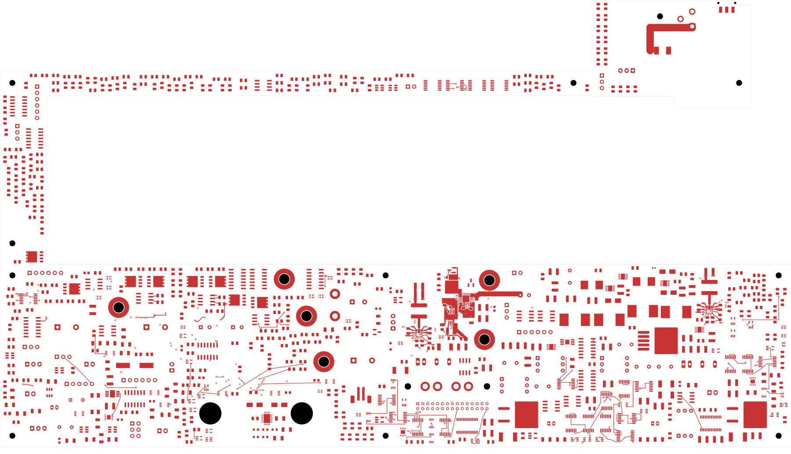
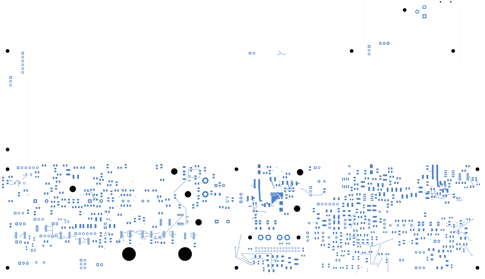

# Power/protection — input bypass and power-good divider

This revision closes seven connections, leaving **2,420 power-board opens**.
Native and independent checks pass. **This is not a fabrication release.**
Open [power_protection.kicad_pro](power_protection.kicad_pro).

| Check | Result |
| --- | --- |
| Native geometry / schematic parity / ERC errors | 0 / 0 / 0 |
| Retained isolated-reference warnings | 2 |
| Open connections / closed this revision | 2,420 / 7 |
| Tracks / through vias / filled regions | 2,354 / 207 / 13 |
| Electrical components / footprints | 1,085 / 1,100 |
| Previous connection groups preserved | All 3,165 |
| Contiguous native regions / unchanged earlier regions | 13 / 7 |

C101 moves from the front at (195.5,133.5), angle 90°, to the back at
(196.1,121.9), angle 0°, directly behind U101. It retains the 2.2 µF/100 V
value and C1210 package, using C102's identical native back-side package.
R110 moves to B(191.3,123.5), R111 to B(196,118.3), and R106 to
B(196.1,126.5), angle 270°. All values, package identifiers and pin/net
assignments stay unchanged. All eight changed pad instances match their
declared poses; both-side courtyard, body, height and context checks pass.

The IN_SYS pin escape is 1.338 mm, followed by a 1.997 mm back trace to
C101. Its ground terminal reaches a local ground via in 2.833 mm. A separate
0.35 mm sense branch connects the Q101 source bank to IN_SYS through In3;
it is not the main load-current feed. The PGTH pin escape is 1.288 mm,
with a 2.384 mm back receiver path, 3.428 mm divider join, 1.197 mm ground
link and 6.361 mm output-sense branch. R105/R106 now form the connected local
power-good threshold divider. UV/OV and their clamp remain unfinished.

The PG source via moves from (199.5,122.5) to (199.6,122.2) to clear the
PGTH escape. Two short In3 branches replace the back paths to R110 and
the retained distribution branch. Five tracks and one via are explicitly
retired; 25 tracks and eight conventional 0.60/0.30 mm vias are added.
All retained tracks/vias and unmoved pads remain exact. No rule is relaxed.

Six existing regions refill without outline or setting changes: the source
bank, output front region, U101 front/In1 ground, and AUX front input/output
returns. The original C101 pad had constrained the AUX output fill, so its
removal requires that refill as well. All 13 resulting regions are contiguous.
All earlier connection groups and AUX's single GND-land return topology
remain intact. The existing ILIM/dVdT reference coverage and bulk-output
reference coverage, excluding its own antipads, remain intact.

The full board and local front/back/In1/In3 exports were inspected. These
geometry and connectivity checks do not qualify the complete bypass-loop
inductance, final adjacent-layer reference, threshold tolerances or transient
response. Exact capacitor/resistor parts, derating and the accepted stack
remain required. The first fill trial stopped on an undeclared AUX output
fill change; the final construction explicitly includes it. The intermediate
construction's capacitor rotation metadata was corrected before validation.

[Native checks](review.json) · [Independent audit](input-bypass-audit.json)
· [Plane/connectivity review](input-bypass-plane-review.json)
· [Construction](input-bypass-routing.json)
· [Native fill](../two-board-power-input-bypass-filled-03/local-plane-fill.json)
· [Uncapped capture](../two-board-power-routing-inputs-2420-input-bypass/capture.json)
· [Visual review](plots/visual-review.json)

| Front | Back in top-view coordinates |
| --- | --- |
|  |  |

[Local front](plots/local-front.png) · [Local back](plots/local-back.png)
· [In1 ground](plots/local-inner1.png) · [In3 sense and PG](plots/local-inner3.png)
· [Six inner layers](plots/inner-contact-sheet.png)

## Remaining work

Complete UV/OV divider and clamp placement/routing, input-cable feed, the
VIN connection to AUX, full system return and remaining source references.
The return net tie remains isolated. Qualify the final bypass and gate/driver
return environment, effective capacitance, actual current capacity, source
transients, AUX loads/startup and installed thermal limits. The retained
2 mm output bus does not establish an 8 A rating.

All remaining routing, approved ESS footprint inputs, exact BOM, accepted
fabrication stack/process, manufacturing outputs and complete installed
housing fit remain unfinished. Signal main still has 251 opens. No order,
commit, push or fabrication release is claimed.
