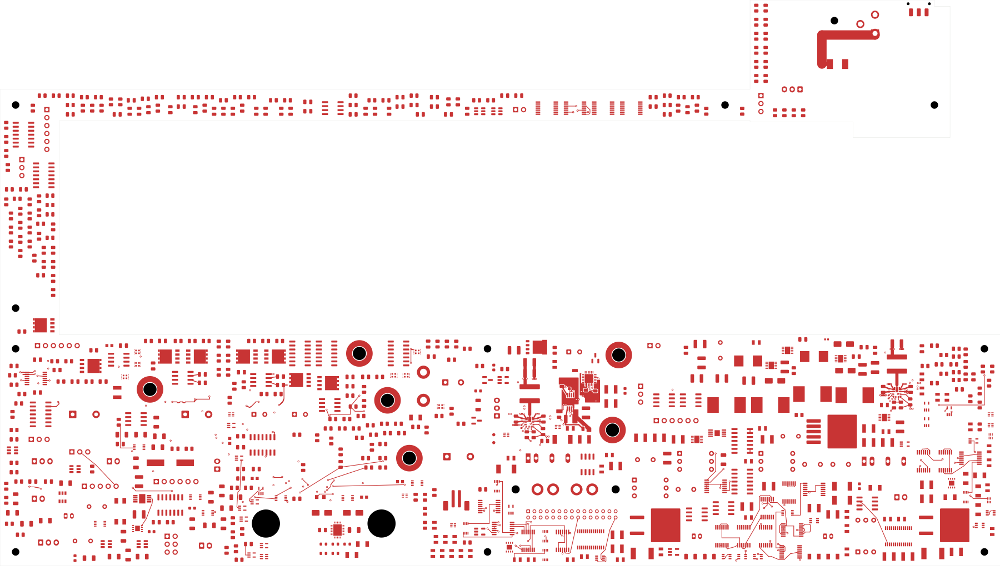
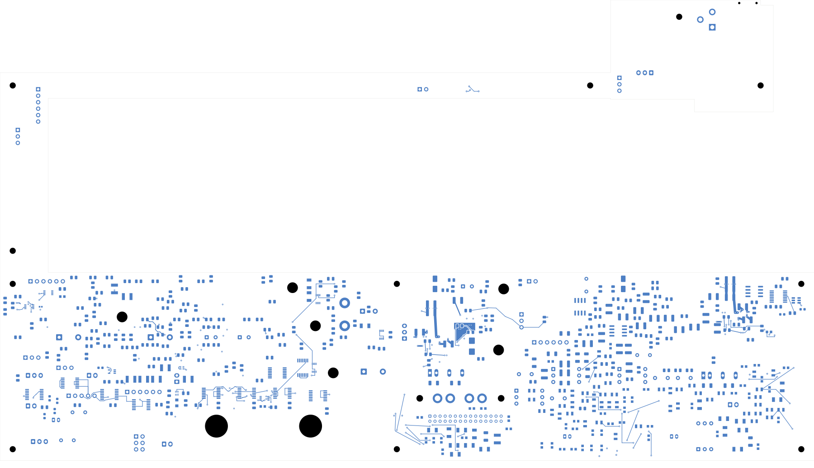

# Power/protection — input eFuse current-limit and startup controls

P_C105 and P_R107 now sit beside P_U101, with short dVdT and ILIM routes,
local ground returns and continuous In1 reference copper. **2,440 opens
remain; this is not a fabrication release.** Open
[power_protection.kicad_pro](power_protection.kicad_pro) in KiCad.

| Check | Result |
| --- | --- |
| Native geometry / schematic parity / ERC errors | 0 / 0 / 0 |
| Retained isolated-reference warnings | 2 |
| Open connections / closed this revision | 2,440 / 5 |
| Tracks / through vias / filled zones | 2,313 / 194 / 10 |
| Electrical components / footprints | 1,085 / 1,100 |
| Earlier physical connection groups preserved | All 3,183 |
| Moved footprints / changed pad instances | 2 / 4 |
| All-via minimum drill-to-SMD clearance | 0.165 mm |
| Control trace projection lacking In1 reference | 0 mm² |

The 1 µF C105 moves to (195.5,127.2) mm and the 4.02 kΩ R107 to
(198.5,127.4) mm, both on the front at 270°. Values, packages, sides and
all logical pin/net assignments are preserved. Their previously isolated
lands had no retained routing to remove. The dVdT path is 2.098 mm; ILIM
is 3.511 mm. Thirteen front tracks and two 0.60/0.30 mm through vias join
the controls, GND pin, exposed pad and passive returns.

Two solid ground regions on F.Cu and In1.Cu provide local return/reference
copper. Each is a single contiguous native polygon; both touch the two new
vias. The front region contacts only U101 GND/EP, C105 ground and R107
ground. The entire width of both control traces projects onto In1 ground.
The new regions remain at least 0.35 mm from existing front planes and
0.40 mm from existing In1 planes. All eight earlier zone outlines and
fills, all previous tracks/vias and all unmoved pads remain unchanged.
The AUX ground group and its checked return topology are preserved.

This placement follows the short support-component paths and local ground
layout guidance in the [TI TPS2663 datasheet, section 9.6](https://www.ti.com/lit/ds/symlink/tps2663.pdf).
It does not establish a complete input-power or thermal layout. The first
trial's two dangling-via warnings were resolved with the local reference
regions; that trial was not adopted and no rule was waived.

[Native checks](review.json) · [Independent audit](input-controls-audit.json)
· [Construction](input-controls-routing.json)
· [Native refill](../two-board-power-input-controls-filled-02/local-plane-fill.json)
· [Complete connectivity](../two-board-power-routing-inputs-2440-input-controls/capture.json)
· [Rejected-source-net status](rejected-source-net-status.json)

## Copper views

| Front | Back, in top-view coordinates |
| --- | --- |
|  |  |

[Local front](plots/local-front.png) · [Local back](plots/local-back.png)
· [Control reference](plots/local-inner1.png) · [Retained PG route](plots/local-inner4.png)
· [Six inner layers](plots/inner-contact-sheet.png)
· [Visual review](plots/visual-review.json)

## Remaining work

Complete the upstream source, blocking-FET loop, input bypass placement,
voltage-threshold dividers and high-current input/output paths. Select
exact passive parts and resolve capacitance, startup, current-limit and
installed thermal tolerances. The local GND region still needs its final
system return connection.

The [AUX load review](../two-board-aux-load-review-01/README.md) still applies
to the retained circuit; its stale E_U42 datasheet finding was corrected in
the prior revision. AUX output distribution, full RUN references and loaded
timing, other converter cells, all remaining routing, the approved ESS land
pattern, accepted stack/BOM/process, manufacturing outputs and complete
installed housing fit remain unfinished. Signal main still has 251 opens.
No fabrication order or release is established.
