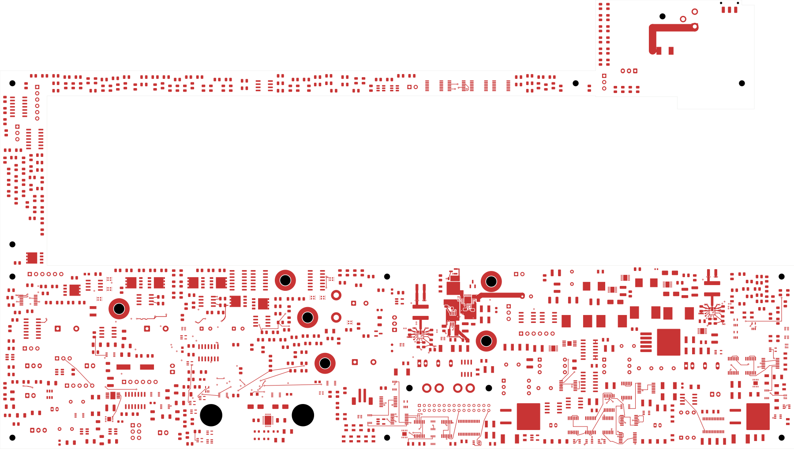
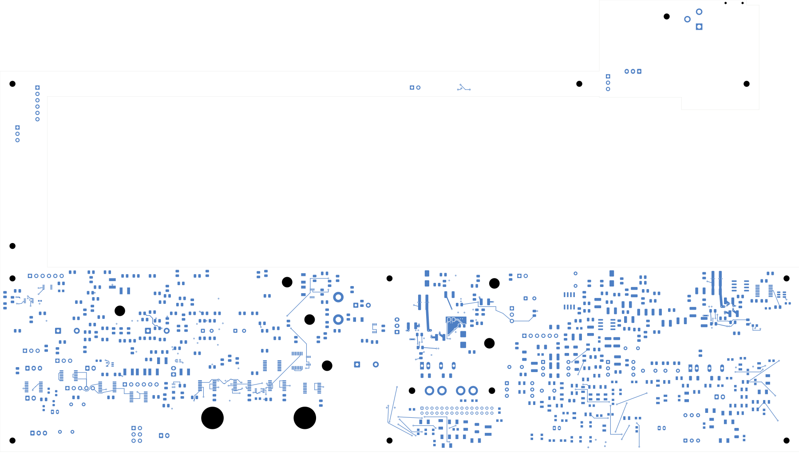

# Power/protection — blocking FET, gate drive and output capacitor paths

This candidate closes 13 connections, leaving **2,427 power-board opens**.
Native checks and the complete independent footprint/copper comparison pass.
This is not a fabrication release. Open [power_protection.kicad_pro](power_protection.kicad_pro).

| Check | Result |
| --- | --- |
| Native geometry / schematic parity / ERC errors | 0 / 0 / 0 |
| Retained isolated-reference warnings | 2 |
| Open connections / closed this trial | 2,427 / 13 |
| Tracks / through vias / filled regions | 2,334 / 200 / 13 |
| Electrical components / footprints | 1,085 / 1,100 |
| Previous connection groups preserved | All 3,178 |
| Native regions contiguous | All 13 |
| Unchanged earlier zone outlines and fills | 7 |

Q101 moves to F(190.7,116.5), angle 270°, and Q102 to F(190.7,110.9),
angle 180°. C103 moves to F(218.5,121); G_NT1 to F(198.7,132.2).
C104 moves to B(202.2,122.4), angle 0°, using the identical retained C102
package as its back-side template. Values, package identifiers and pin/net
assignments stay unchanged. Constructor and independent checks screen both sides, including C103
lead-tail reserves and C104's back-side height. All 27 changed native pad
instances match the declared moves and back-side template.

Twenty-four new tracks and six conventional 0.60/0.30 mm vias connect the
pulldown circuit, gate/driver paths and output capacitors. Three old PG
tracks are replaced by a 10.4 mm back detour. Front pulldown gate and
source paths are 3.087 and 5.404 mm; the two In2 portions are 8.741 and
11.478 mm. Three new front regions join the source-pin bank, Q101 drain
to both IN pins, and both OUT pins to the local capacitor feed. A 2 mm
front bus runs 18.221 mm to the bulk capacitor. C104's back feed/return
paths are 2.034 and 1.825 mm.

Three existing regions refill: the AUX front input return, the recessed
U101 front ground and its expanded In1 reference. Independent checks
preserve AUX's single GND-land joining topology and every earlier connection
group. Both control traces retain full reference coverage; so does the
output bus apart from its own output pad/via antipads. Seven original
regions remain exact. The first trial's narrow plane entry split the
input copper into two pieces; trial 03 widens the connection and closes
that missing join. No checks were waived.

The revised native exporter replaces repeated identical symbol paths with
one canonical path per footprint. The independent comparison verifies
that removal of 24,955 duplicate paths is the only filled-board/native-board
change. It does not change circuit mapping or copper.

[Native checks](review.json) · [Complete independent audit](input-source-audit.json)
· [Plane/connectivity review](input-source-plane-review.json)
· [Construction](input-source-routing.json)
· [Native fill](../two-board-power-input-source-filled-03/local-plane-fill.json)
· [Uncapped capture](../two-board-power-routing-inputs-2427-input-source/capture.json)
· [Visual review](plots/visual-review.json)

| Front | Back in top-view coordinates |
| --- | --- |
|  |  |

[Local front](plots/local-front.png) · [Local back](plots/local-back.png)
· [Reference plane](plots/local-inner1.png) · [Gate/driver routes](plots/local-inner2.png)
· [Six inner layers](plots/inner-contact-sheet.png)

## Remaining work

Resolve the IN_SYS bypass loop, input-voltage dividers, input-cable
feed, VIN link to AUX and system return. The local return net tie remains
unconnected. The main copper widths are provisional until accepted stack,
current capacity, heat spreading and transient analysis support them; the
2 mm bus does not establish an 8 A rating. The relocated bulk capacitor's
loop and the gate/driver environment need electrical review.

Exact parts and capacitor derating, source and AUX loads/startup/thermal
limits, all remaining signal/power routing, approved ESS package inputs,
stack/BOM/process and manufacturing outputs, and full installed housing
fit remain unfinished. Signal main still has 251 opens. No fabrication
order, commit, push or release is claimed.
