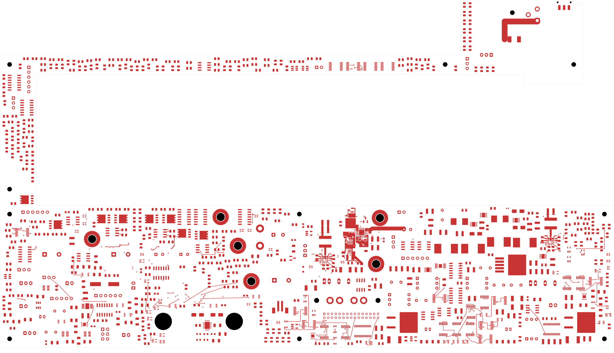
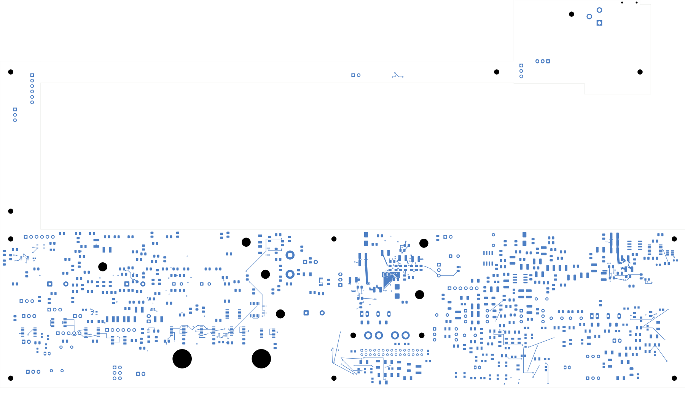

# Power/protection — input voltage thresholds and clamp

This revision closes **15 connections**, leaving **2,405 power-board opens**.
Native and independent checks pass. **This is not a fabrication release.**
Open [power_protection.kicad_pro](power_protection.kicad_pro).

| Check | Result |
| --- | --- |
| Native geometry / schematic parity / ERC errors | 0 / 0 / 0 |
| Retained isolated-reference warnings | 2 |
| Open connections / closed this revision | 2,405 / 15 |
| Tracks / through vias / filled regions | 2,390 / 219 / 14 |
| Electrical components / footprints | 1,085 / 1,100 |
| Previous connection groups preserved | All 3,158 |
| Contiguous native regions / unchanged earlier regions | 14 / 6 |

The local undervoltage and overvoltage dividers now connect to U101, the
source bank and ground. The overvoltage clamp, AUX bypass/bleed and
power-good pull-up supply are connected. Seven resistor footprints move;
R101/R103/R104 move to the back using R102's identical native package.
All values, packages and logical pin/net assignments remain unchanged.
R115 moves to clear the dividers; its fast overvoltage network remains unrouted.

Fourteen tracks and two vias are explicitly retired, with 50 tracks and
14 conventional 0.60/0.30 mm vias added. All retained tracks/vias and
unmoved pads remain exact. Independent courtyard, body, height and context
checks pass. All 219 via drills clear SMD lands, with a minimum 0.165067 mm
clearance. Native export introduces no physical change or duplicate paths.

A new In6 ground region provides adjacent reference beneath 16 checked
back-side bypass, divider and clamp routes. Their full-width projections
are covered except for their own signal-via antipads. The U101 In1 ground
outline expands; seven existing regions refill and six retain exact geometry.
All 14 regions are contiguous. Prior connections, AUX split-return topology,
and existing control/output reference projections remain intact. AUX bias
loads join the retained supply bus, not the feedback sense spur.

The first fill trial stopped on a changed VIN fill. The final construction
explicitly declares that refill; its measured boundary displacement is
0.434 micrometres. No clearance rule was relaxed. The plane review predates
the complete delta audit; its pending-audit field is superseded by the
completed independent audit linked below. Full front/back, six-inner sheet
and all eight local copper views were inspected.

These checks establish geometry and connectivity. They do not qualify
bypass-loop inductance, noise, threshold tolerances, transient response or
current/thermal capacity. Exact passive MPNs, effective capacitance and the
accepted stack remain required. The retained 2 mm output bus has no
established 8 A rating.

[Native checks](review.json) · [Independent audit](input-thresholds-audit.json)
· [Plane/connectivity review](input-thresholds-plane-review.json)
· [Construction](input-thresholds-routing.json)
· [Native fill](../two-board-power-input-thresholds-filled-03/local-plane-fill.json)
· [Uncapped capture](../two-board-power-routing-inputs-2405-input-thresholds/capture.json)
· [Visual review](plots/visual-review.json)

| Front | Back in top-view coordinates |
| --- | --- |
|  |  |

[Local front](plots/local-front.png) · [Local back](plots/local-back.png)
· [In1 ground](plots/local-inner1.png) · [In6 adjacent ground](plots/local-inner6.png)
· [Six inner layers](plots/inner-contact-sheet.png)

## Remaining work

Complete input-cable feed, the VIN link to AUX, full system return and fast
overvoltage monitoring. The return net tie remains isolated. Qualify exact
parts and thresholds, source/reference paths, current/thermal/transient
limits and loaded AUX startup. Complete remaining power/signal routing,
approved ESS package inputs, inter-board interfaces, manufacturing outputs
and installed housing fit. Signal main still has 251 opens. No order,
commit, push or fabrication release is claimed.
