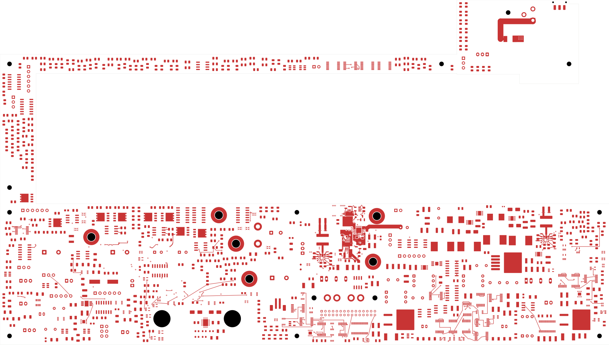
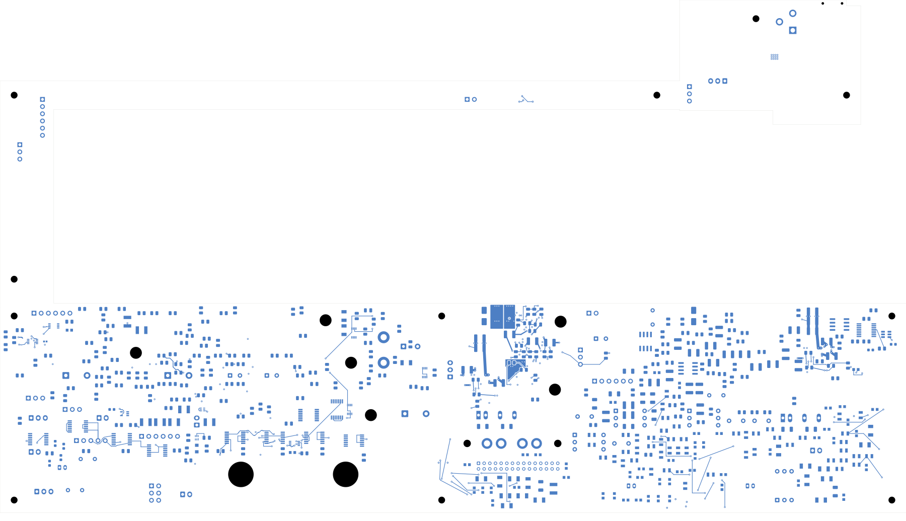

# Power/protection — local input TVS

TBP34 moves D101 beside the input MOSFET and connects its two terminals to
the fused DC feed and return. **2,372 power-board connections remain open,
two fewer than TBP33. This is not a fabrication release.** Open
[power_protection.kicad_pro](power_protection.kicad_pro).

| Check | Result |
| --- | --- |
| Native geometry / schematic parity / ERC errors | 0 / 0 / 0 |
| Retained isolated-reference warnings | 2 |
| Open connections / closed this revision | 2,372 / 2 |
| Tracks / through vias / zones | 2,444 / 262 / 21 |
| Electrical components / footprints | 1,086 / 1,101 |
| Previous connection groups preserved | All 3,112 |
| Earlier fills preserved exactly | 13 |
| Previous full-width adjacent-ground projection cases preserved | 228 |

D101 moves on the back from (193.5, 137.5) mm, angle 90°, to (186, 112) mm,
angle 180°. Its SMBJ33CA-E3/52 part, package and pin assignments are unchanged.
Two broad back copper regions join its terminals to six new vias each.
The source region also contacts two existing source-bank vias. Every new
source via directly reaches both In2/In3 DC planes, and every new return
via directly reaches both In4/In5 return planes. The fused `PWR_DC_IN` net
now has all ten physical pads in one native connection group.

The two new contiguous back regions measure 32.15 mm² and 38.01 mm². These
irregular regions and via-connected planes do not establish equivalence to
the TVS datasheet's thermal test arrangement. See the [manufacturer source
review](../../parts/input-tvs-01/README.md) for voltage limits and the
unqualified surge/temperature/fuse-coordination envelope.

The independent audit verifies both moved pad polygons and all 1,100
unchanged footprints. Earlier tracks and vias remain unchanged. Six earlier
zones refill, without changing their authored outlines. All filled pieces
contact their intended native group. All previous electrical connections
are preserved, including the separate AUX return. Both G_NT1 pads remain
isolated. Every previously complete full-width track projection onto an
adjacent AGND region was rechecked against the corresponding electrical
ground group: all 228 cases pass. This preserves the earlier fast-OV
reference coverage; it does not establish reference impedance or noise.

The moved-package screen covers courtyard, body, declared component tails,
mounting reserves, board edge, height and assembly context. All 262 via
drills pass the SMD-land clearance check, minimum 0.165067 mm. Full installed
housing fit remains unverified. Eleven visual views have been inspected.
The construction report's pending checks are superseded by the evidence
below; its electrical qualification hold remains applicable.

[Native checks](review.json) · [Independent review](input-tvs-review.json)
· [Construction](input-tvs-routing.json)
· [Native capture](../two-board-power-routing-inputs-2372-input-tvs-01/capture.json)
· [Filled-zone provenance](../two-board-power-input-tvs-filled-01/local-plane-fill.json)
· [Visual review](plots/visual-review.json)
· [Previous inlet routing](../two-board-power-inlet-corridor-native-02/README.md)

| Front | Back in top-view coordinates |
| --- | --- |
|  |  |

[TVS back copper](plots/tvs-back.png) · [Input-cell front](plots/tvs-front.png)
· [In2 feed](plots/tvs-inner2.png) · [In4 return](plots/tvs-inner4.png)
· [Six inner layers](plots/inner-contact-sheet.png)

## Remaining work

Qualify the complete inlet path for actual current, voltage drop, transient
and temperature limits, including the jack/fuse neck, TVS, source and return
transitions, output bus and fuse/adapter fault-energy coordination. Complete
the wider distribution and return network, G_NT1 and remaining routing.
Exact passive limits, fast-OV response, AUX startup/thermal limits, approved
ESS inputs, inter-board interfaces, accepted stack/BOM, manufacturing outputs,
bring-up plan and complete installed fit remain required. Signal main still
has 251 opens. No order or fabrication release is claimed.
