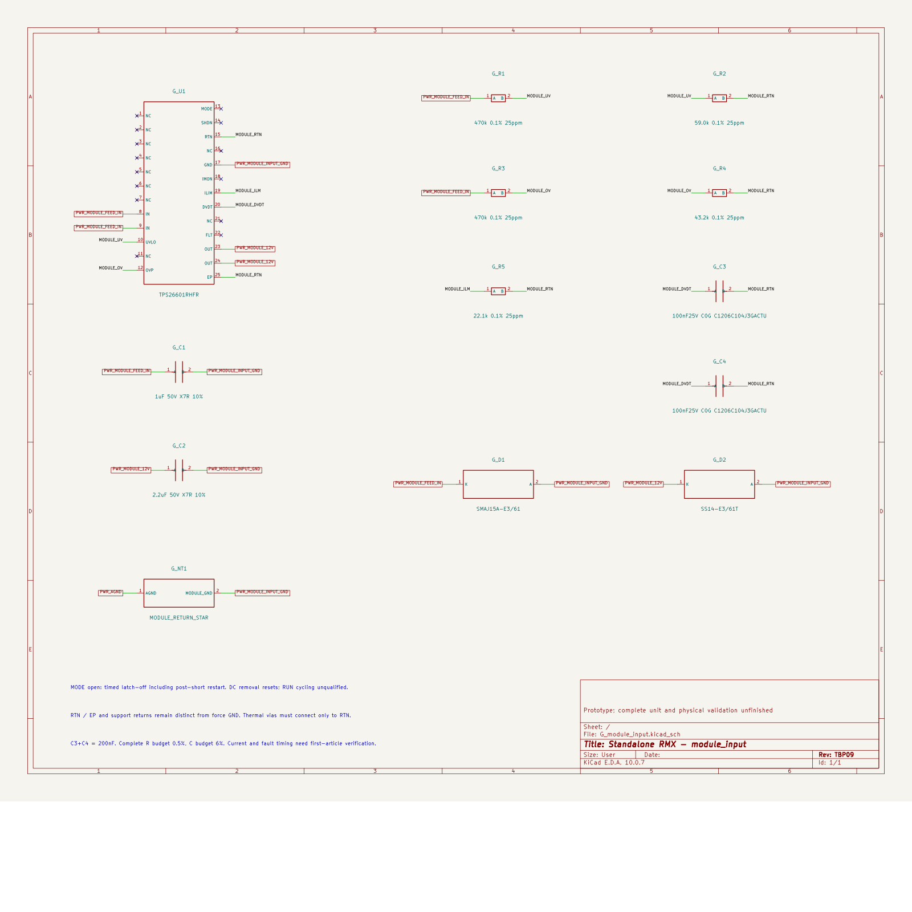

# TBP10 — timer-operated module protection

The common module-input branch now uses **TPS26601RHFR with MODE open**, so an
overcurrent fault invokes its timer and latch-off sequence. The previous
TPS259474 branch could remain in current limit without reaching thermal trip.
This revision implements the replacement identified in the
[fault review](../two-board-module-cutoff-review-01/README.md).

This is the current power-circuit checkpoint, not a fabrication release.

| Native check | Result |
| --- | --- |
| Electrical components / schematic terminals | 1,090 / 3,428 |
| Mapped physical pad instances | 3,489 |
| Placed footprints, including 15 mechanical | 1,105 |
| Open connections | 2,709 |
| Geometry / schematic parity / ERC errors | 0 / 0 / 0 |
| ERC warnings | 2 retained isolated-reference warnings |
| Original components / original footprint geometries retained | 1,077 / 1,092 |

The [native report](review.json), [complete circuit check](circuit-audit.json)
and [independent module audit](module-cutoff-audit.json) cover actual exported
schematic and PCB data. All native check categories remain enabled. The audit
also rechecks the earlier 32 fault/reset combinations, two source-sense channels
and 64 UV-recovery combinations. Sixteen deliberate wiring, part-selection and
land-pattern faults are rejected. None of these checks establishes installed
electrical performance.

## Circuit and footprint

Both IN pins 8/9 take the protected P03 module feed. Both OUT pins 23/24 feed
N_U17/N_U22. GND 17 uses the separate module force return through G_NT1.
RTN 15, exposed pad 25 and all control-network returns use their own local
reference; they must not be shorted to GND or the quiet system return.

G_R5 is 22.1k, giving nominal current limit 0.543 A and circuit-breaker threshold
0.513 A. G_C3/G_C4 are parallel 100nF C0G capacitors, total 200nF. Their specified
charging-current/gain limits and allocated complete capacitance tolerance give
448–746 V/s, or an ideal 12 V ramp of 16.1–26.8 ms. MODE and SHDN are intentionally
open. Reset requires removal of DC input; RUN-only reset is not qualified.

The custom RHF0024A land has 24 perimeter terminals, one exposed copper pad and
six exposed-pad stencil apertures. The manufacturer's actual pin, land and
stencil pages were rendered and checked; numeric dimensions and pin orientation
are independently audited. Thermal RTN vias/plane and final process acceptance
are still needed. The retained TVS, output diode and return star have not been
routed or physically qualified.

TBP09 exposed an ERC conflict from declaring both internally joined OUT pins
as independent power outputs. TBP10 declares pin 23 as power output and pin 24
as its passive parallel terminal. Both physical connections remain present;
the native connectivity partition is unchanged. The failed TBP09 report remains
available. The module-sheet title retains its TBP09 circuit revision; the
project root records TBP10's symbol correction.

The actual native schematic was visually reviewed: references, intentional
open-pin markers, RTN/GND separation, two ramp capacitors and shortened return
star pin labels are visible. The PNG is a square-canvas preview of the exported
SVG; it does not replace native source evidence.

## Limits and remaining work

The [independent corner calculation](module-cutoff-audit.json) gives UV turn-on
10.395–11.129 V, UV turn-off 9.551–10.224 V and OV turn-off 13.726–14.734 V under
the stated complete resistor/leakage budgets. Allocated switch, board and
reference drops leave a 9.354 V steady input floor. That is a design allocation;
the finished routes and actual parts must meet it.

The 0.35 A total load and 60uF output capacitance are receiving requirements,
not measured module properties. Their modeled startup current is 394.8 mA,
only 9.5 mA below the engineering lower circuit-breaker envelope. The datasheet
does not guarantee that envelope at 22.1k. Do not count this small modeled margin
as complete startup qualification.

The fault delay is **4 ms nominal, with no published maximum in the cited
table**. The [first-article plan](MODULE-FIRST-ARTICLE.md) defines the 10 ms abort
criterion and separates prototype measurements from design evidence. It makes
no claim of tests on unbuilt hardware.

Per-module fault containment, complete passive MPNs/effective capacitance,
critical placement and return routing remain unfinished. The cell was packed
at (116,171) mm while preserving the original placements; its long distance from
the upstream source is not accepted as final electrical placement. No ordinary
tracks, vias or zones have been added to the power board. The two isolated
negative-domain warnings remain deliberate and distinct from the new RTN net.

The wider work still includes full loaded AUX/reference/enable checks, deep-UV
and timing behavior, final signal/power interfaces, both boards' remaining
routing, the ESS codec package, manufacturing BOM/stack/process and complete
installed housing fit. See the current fabrication status rather than treating
zero local errors as a complete-board release.

Primary source: [TI TPS2660 datasheet](https://www.ti.com/lit/ds/symlink/tps2660.pdf),
SLVSDG2G, including mode table, electrical limits and RHF0024A drawing; the
[archived copy](../two-board-module-cutoff-review-01/sources/tps2660.pdf) is hash-bound
by the independent audit.
