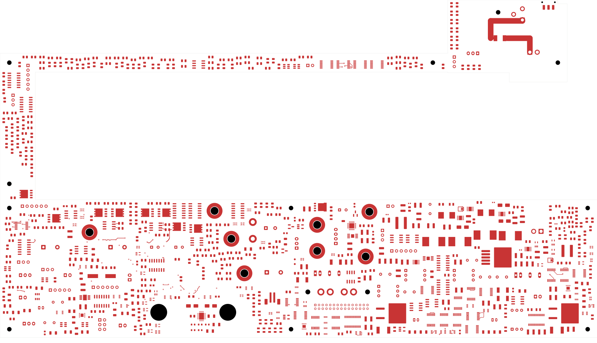
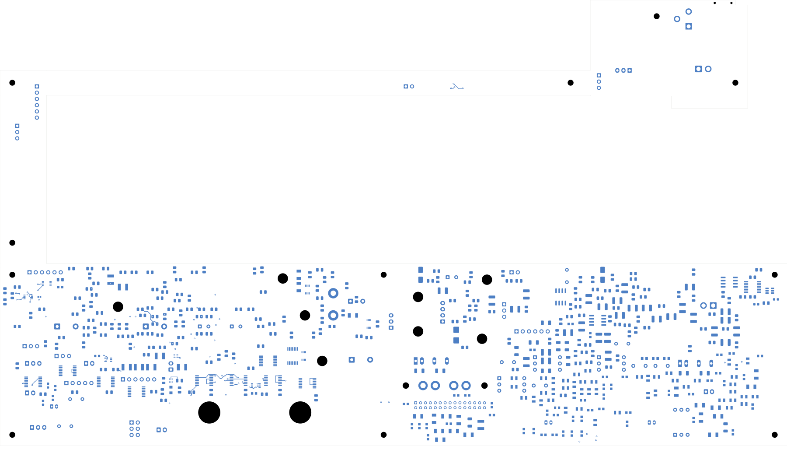
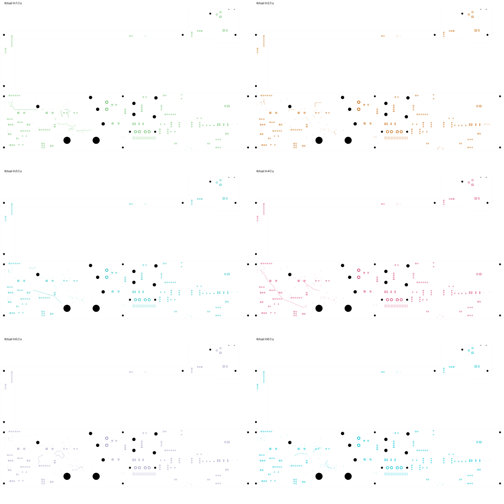

# Power board — first clean copper restoration

This checkpoint restores 50 source nets while keeping all 1,090 component
values, the TBP10 schematic and all 1,105 footprint placements unchanged.
It closes **56 connections**, reducing power-board opens from **2,709 to 2,653**.
It is the current power-board development checkpoint, not a fabrication release.

| Check | Result |
| --- | --- |
| Restored tracks / through vias | 1,689 / 68 |
| Restored source terminal groups | 50, all native-connected |
| Power-board opens | 2,653 |
| Geometry / schematic parity / ERC errors | 0 / 0 / 0 |
| Retained isolated-reference ERC warnings | 2 |
| Component or placement changes | None |
| Source zones/planes imported | None |

The [native check](review.json) enables every rule category. The
[independent copper audit](copper-audit.json) compares actual source and target
track geometry, layer, width, via drill/span, net identity and native physical
pad connections. It verifies every restored connection group, all footprint
geometries and the unchanged schematic partition. It also rechecks the module
branch, 32 fault/reset cases, two source-sense channels and 64 UV cases.

## Selection and rejected trial

The source boards remain useful where every terminal of a net retains the same
translation, orientation and land shape. Nets split by the new protection
logic are excluded. Moving a single terminal excludes its old net copper from
automatic restoration; plane nets are also excluded.

The [first trial](../two-board-power-routed-native-01/review.json) restored 102
candidate nets but failed 1,046 native geometry checks. These included copper
and hole clearances, shorts, mask bridges, old track widths and old drill sizes.
All findings touched 52 candidate nets. This checkpoint excludes those complete
nets instead of weakening current rules. Their routes still require deliberate
repair or replacement. The failed trial is retained for diagnosis.

The 50 accepted nets come from supply (2), inlet (2), disconnect/protection (29),
monitor (3) and negative-startup (14) sources. The
[restoration ledger](copper-restoration.json) identifies every terminal and copper
object. Every accepted terminal set is fully connected in the native board;
that is verified separately from the constructor's selection logic.

Through vias retain their physical front/back endpoints and drill dimensions
on the provisional eight-layer board. Extra enabled inner layers change their
native layer bitmask; the audit compares the actual through-via span rather
than requiring an old six-layer bitmask. This does not qualify the physical
stack, copper weights, return paths or electrical behavior of the converted
layer arrangement. Native schematic-path annotations are excluded from the
geometry comparison; component positions, pad shapes and board setup are not.

## Actual native copper views

All eight native exports were visually inspected. The bottom view uses the
same top-view coordinates, not a mirrored assembly view. Copper-only plots
show the remaining routing clearly; they are not assembly drawings.

| Front copper | Back copper |
| --- | --- |
|  |  |

Native inner exports: [In1](plots/inner1.svg), [In2](plots/inner2.svg),
[In3](plots/inner3.svg), [In4](plots/inner4.svg), [In5](plots/inner5.svg),
[In6](plots/inner6.svg).

## Remaining fabrication work

The [TBP10 module circuit](../two-board-power-native-10/README.md) and its
[first-article procedure](../two-board-power-native-10/MODULE-FIRST-ARTICLE.md)
remain applicable. Its protection cell and return star are still unrouted.
Individual module containment, supported startup/current bounds, passive BOM,
critical placement and thermal RTN vias remain unfinished.

The [fuse voltage-budget screen](../two-board-module-protection-followup-01/review.json)
finds only 0.354 V of remaining steady-state series-drop allocation. Two reviewed
250 mA candidate fuse families exceed that at rated current; neither has been
inserted into the PCB. Actual lower-current behavior, temperature derating and
startup coordination must be supported before choosing a part or revising the
UV window. This is a design decision still to make, not an adopted fuse circuit.

The signal board remains at 251 opens with its missing ESS codec footprint.
The power board still needs 2,653 connections, final interfaces, loaded supply/
reference/enable checks and fault timing work. Manufacturing stack/BOM/process,
complete fabrication outputs, cooling/supports and full installed housing fit
also remain unfinished. No board order or fabrication release was issued.
