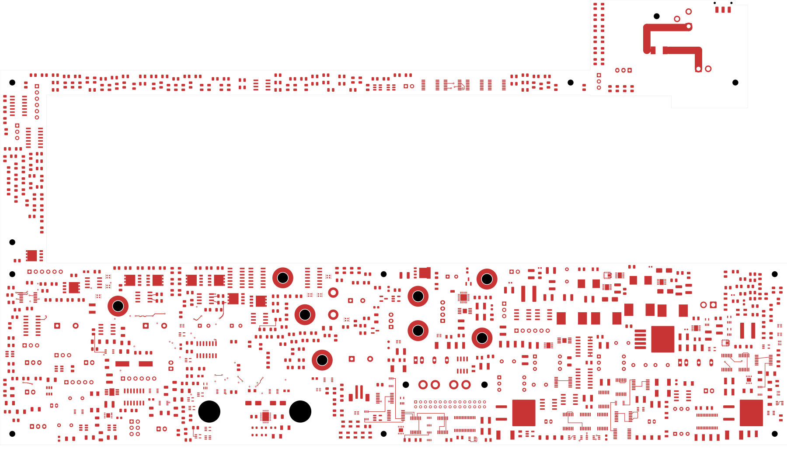
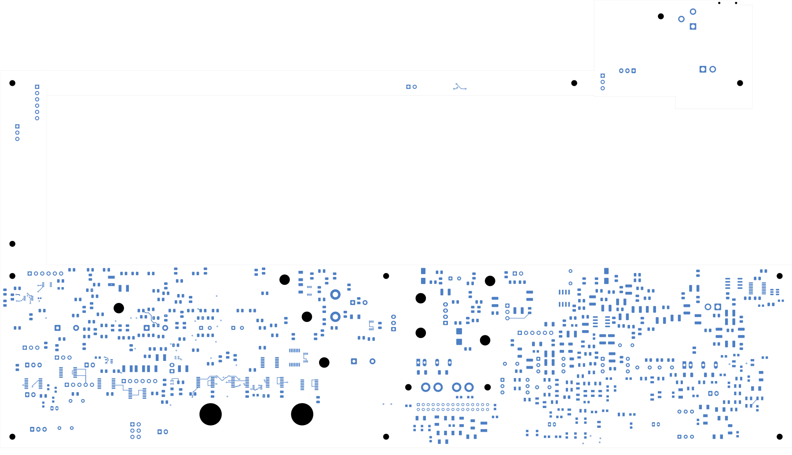
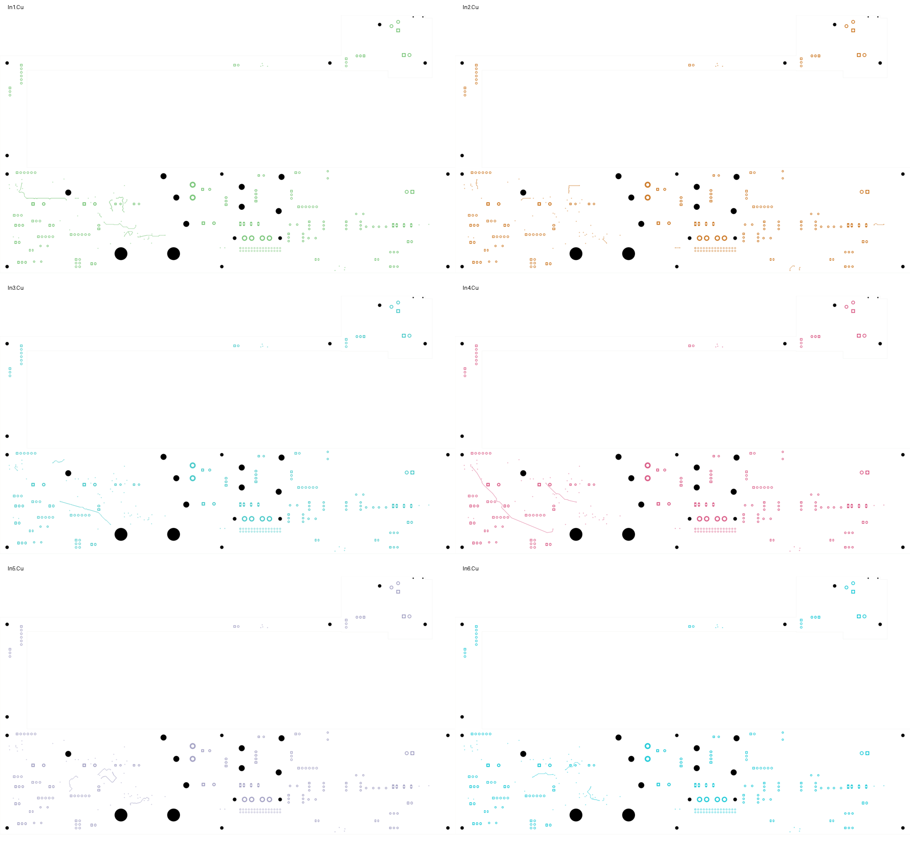

# Power/protection — mounting-aware local routing

The current 320 × 181.1 mm power PCB adds **34 control connections** across
26 nets. It now has **2,619 open connections**, down from 2,653. All 1,090
component values, 1,105 footprint geometries and previous copper connections
are preserved. **This is a development checkpoint, not a fabrication release.**

Open [power_protection.kicad_pro](power_protection.kicad_pro) in KiCad for the
integrated schematic, PCB, custom rules and bundled libraries.

| Check | Result |
| --- | --- |
| Total tracks / through vias | 1,765 / 68 |
| Added tracks / vias | 76 / 0 |
| Added control routes | 34 across 26 nets; 289.044 mm total |
| Native opens | 2,619 |
| Native geometry / parity / ERC errors | 0 / 0 / 0 |
| Retained isolated-reference ERC warnings | 2 |
| Preserved physical connection groups | 3,389 |
| Provisional mounting reserves checked for new copper | 15 |

The [native review](review.json) enables all rule categories. The independent
[additive audit](additive-audit.json) compares the complete schematic partition,
values, footprints, old copper geometry and native physical connection groups.
It also checks every new segment's layer, width, endpoints and net, all 34
physical endpoint joins, and the new copper's clearance from mounting reserves.
The previous [50-net restoration audit](../two-board-power-routed-native-02/copper-audit.json)
remains applicable to the preserved copper.

Some module pads have no authored UUID and receive transient IDs when KiCad
loads the file. The audit maps 55 such pads only by unique, identical native
geometry after confirming complete authored footprint equality. No actual pad
geometry or circuit identity is changed.

The first local trial passed electrical DRC but crossed the provisional N_H101
fastener/tool reserve. This successor reroutes N12_PERMIT around that reserve.
The reserve is the larger of 3.6 mm or hole radius plus 0.5 mm, with an additional
0.01 mm copper margin. These provisional bounds do not establish actual installed
fastener clearance, and this new-route check does not qualify older copper.

The [complete native capture](../two-board-power-routing-inputs-2619/capture.json)
contains 5,564 objects and 584 open nets. Independently summing its native pad
cluster gaps gives 2,619, matching the uncapped ratsnest count. The DRC report's
499 listed unconnected records are not the complete open-connection count.

## Actual copper views

The front/back views and six inner layers were [visually inspected](plots/visual-review.json).
The back uses top-view coordinates. These are actual copper plots, not assembly
renders; no power planes have been added.

| Front copper | Back copper |
| --- | --- |
|  |  |

[In1](plots/inner1.svg) · [In2](plots/inner2.svg) · [In3](plots/inner3.svg) ·
[In4](plots/inner4.svg) · [In5](plots/inner5.svg) · [In6](plots/inner6.svg)

## Remaining fabrication work

The module protection circuit, source and return star still require critical
placement and routing. Supported module startup/current bounds, individual
fault containment, loaded AUX/reference/enable behavior and the exact passive
BOM remain unresolved. The [module first-article procedure](../two-board-power-native-10/MODULE-FIRST-ARTICLE.md)
records proposed future physical tests; it is not a completed qualification.

The signal PCB remains at 251 opens with an unplaced ESS codec. Both boards
still require final interfaces, routing and return-path review, accepted stack
and assembly process, reviewed manufacturing outputs, supports/cooling, real
connector mates and harnesses, and complete installed housing-fit verification.
No fabrication release or board order has been issued.
