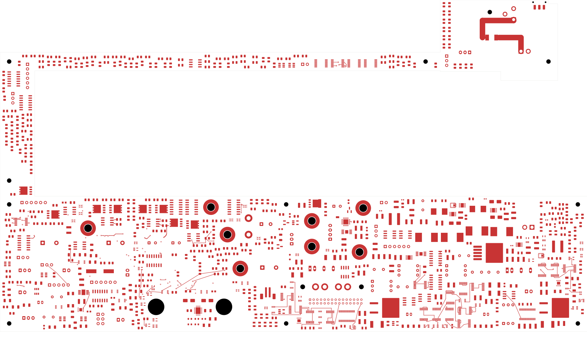
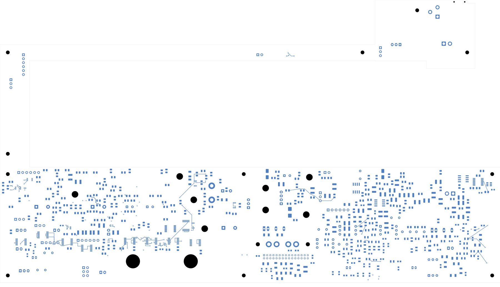
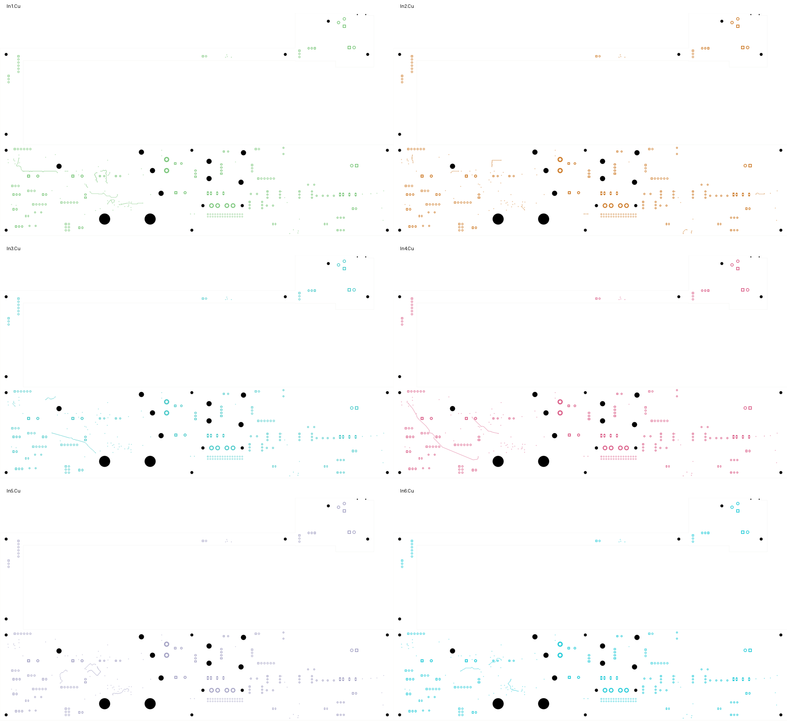

# Power/protection — opposite-face links and surface branches

The current 320 × 181.1 mm power PCB closes **47 more control connections**:
20 opposite-face links followed by 27 surface branches. Native opens fall from
2,619 to **2,572**. All 1,090 component values, 1,105 footprint geometries,
schematic nets and prior physical connections are preserved. **The board is
still in development and is not released for fabrication.**

Open [power_protection.kicad_pro](power_protection.kicad_pro) in KiCad for the
integrated schematic, PCB, custom rules and bundled libraries.

| Check | Result |
| --- | --- |
| Total tracks / through vias | 1,971 / 88 |
| Added tracks / vias over the 2,619-open checkpoint | 206 / 20 |
| Opposite-face links | 20 on 12 nets; 259.601 mm total track length |
| Surface branches | 27 on 23 nets; 264.301 mm total track length |
| Maximum new route track length | 21.011 mm |
| Native opens | 2,572 |
| Native geometry / parity / ERC errors | 0 / 0 / 0 |
| Retained isolated-reference ERC warnings | 2 |
| Provisional mounting reserves checked for new copper | 15 |

## Circuit, copper and connection evidence

The [opposite-face checkpoint](../two-board-power-routed-native-05/README.md)
uses conventional 0.60 mm diameter / 0.30 mm drill through vias and 0.20 mm
outer-layer tracks. Its [independent audit](../two-board-power-routed-native-05/additive-audit.json)
verifies all 20 joins and preserves all 3,355 previous native connection groups.
It measures the vias against every captured copper layer, SMD land and drill,
including same-net SMD lands and holes.

The next surface pass attaches to native pad, track or via contacts. It first
tries short direct and dogleg paths, then a bounded grid search screened against
the actual native obstacles and provisional mounting reserves. Its 27 selected
branches add 143 tracks and no further vias. Its [independent audit](additive-audit.json)
verifies all physical witness-pad joins, all new segment geometry and all 3,335
connection groups from the opposite-face checkpoint. The schematic, every
footprint, existing copper and board setup remain unchanged. Twenty-nine nearby
group-pair attempts remain deferred; this bounded search does not prove that
those connections cannot be routed.

A further [retained-via clearance audit](retained-via-clearance.json) measures
all 20 new vias against the complete successor geometry, including the later
surface branches. It retains the minimum 0.21 mm via-to-foreign-copper screen,
0.26 mm hole-to-hole screen and separation from every SMD land. This extends
ordinary native DRC to the same-net drill/land receiving policy; it does not
qualify the actual stack or assembly process.

The [complete native capture](../two-board-power-routing-inputs-2572/capture.json)
contains 5,790 objects and 574 open nets. Its independent sum of native pad
cluster gaps and the uncapped ratsnest count both equal 2,572. The DRC report's
499 listed unconnected records are not the complete open count.

## Actual copper views

The front/back views and six inner layers were [visually inspected](plots/visual-review.json).
The back uses top-view coordinates. These are actual copper plots; power planes
and complete return paths remain unfinished.

| Front copper | Back copper |
| --- | --- |
|  |  |

[In1](plots/inner1.svg) · [In2](plots/inner2.svg) · [In3](plots/inner3.svg) ·
[In4](plots/inner4.svg) · [In5](plots/inner5.svg) · [In6](plots/inner6.svg)

## Remaining fabrication work

The module protection circuit, source and return star still require critical
placement and routing. Supported module startup/current bounds, individual
fault containment, loaded AUX/reference/enable behavior and the exact passive
BOM remain unresolved. The [module first-article procedure](../two-board-power-native-10/MODULE-FIRST-ARTICLE.md)
records proposed future physical tests, not completed qualification.

The signal PCB remains at 251 opens with an unplaced ESS codec. Both boards
still require final interfaces, routing and return-path review, accepted stack
and assembly process, reviewed manufacturing outputs, supports/cooling, actual
connector mates and harnesses, and complete installed housing-fit verification.
Provisional mounting reserves do not qualify the final fasteners or old copper.
No fabrication release or board order has been issued.
