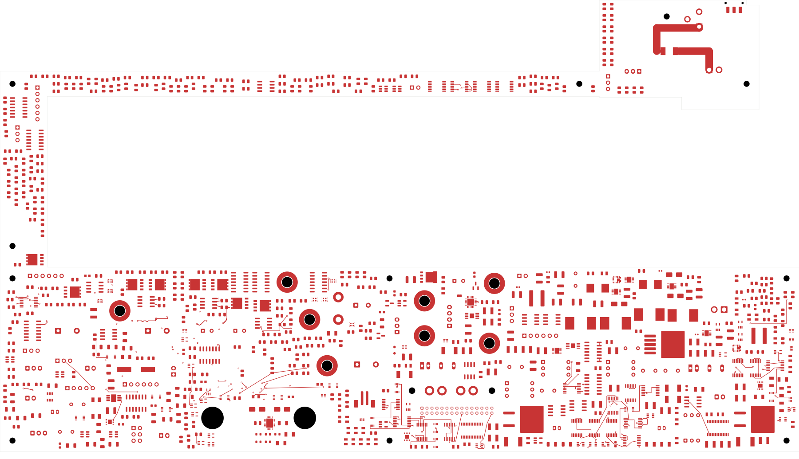
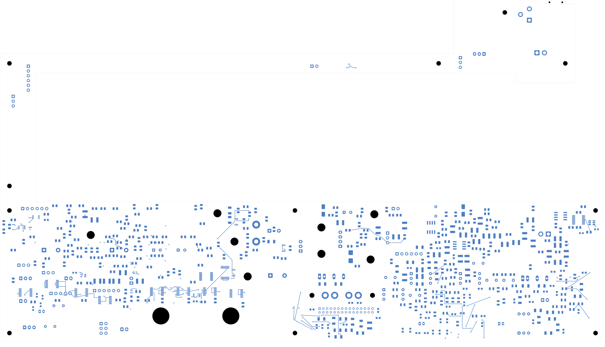
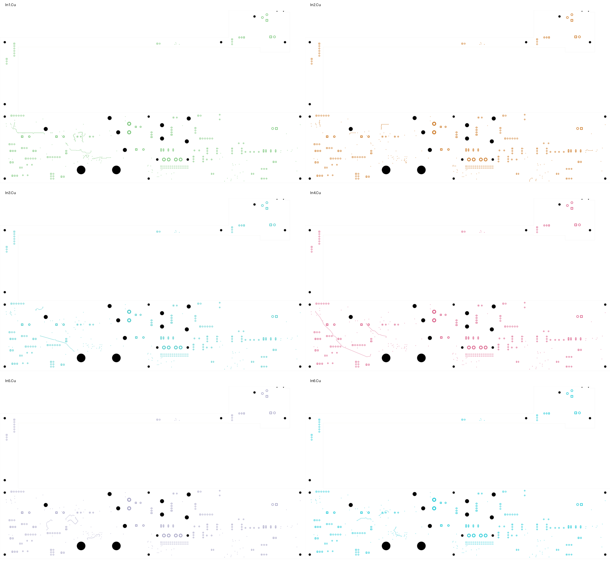

# Power/protection — control detours and inherited via repairs

The current 320 × 181.1 mm power PCB has **2,554 open connections**, 18 fewer
than the preceding selected checkpoint. It also repairs ten inherited vias
whose drills touched SMD lands. All 1,090 component values, 1,105 footprint
geometries, schematic nets and previous physical connections are preserved.
**The board remains in development and is not released for fabrication.**

Open [power_protection.kicad_pro](power_protection.kicad_pro) in KiCad for the
integrated schematic, PCB, custom rules and bundled libraries.

| Check | Result |
| --- | --- |
| Total tracks / through vias | 2,097 / 124 |
| New control detours | 18 on 14 nets, using 85 tracks and 36 vias |
| Inherited vias relocated out of SMD lands | 10; no additional vias |
| Local reconnection tracks | 41, on the original contacted layers |
| Maximum via displacement / reconnection path | 1.304 / 1.304 mm |
| Native opens | 2,554 |
| Native geometry / parity / ERC errors | 0 / 0 / 0 |
| Retained isolated-reference ERC warnings | 2 |
| Vias checked against every SMD land | All 124 |
| Minimum measured drill-edge-to-SMD gap | 0.165 mm |
| Minimum measured hole-edge-to-hole-edge gap | 0.520 mm |
| Minimum via-copper-to-foreign-polygon gap | 0.204 mm |

## What changed and how it was checked

The [control-detour checkpoint](../two-board-power-routed-native-07/README.md)
closes 18 nearby control connections with short access tracks, two conventional
0.60/0.30 mm through vias per route, and an opposite-face link. Its longest
route is 26.441 mm. Nine bounded local group-pair attempts remain deferred.
Its native checks and independent delta audit preserve the earlier circuit,
placement, copper and every previous physical connection group.

A broader assembly screen then found ten **inherited** source vias with drills
intersecting SMD lands. These were not introduced by the new detours. Same-net
electrical DRC allows that arrangement, but it would need a specifically
accepted assembly process. The [repair construction](via-repair.json) instead
moves those vias by 0.313–1.303 mm and reconnects every original copper contact
on its existing layer. No via size, drill, component pose, existing track,
schematic net or board rule is changed. The general clearance stays 0.20 mm.

The [independent repair audit](via-repair-audit.json) checks the actual native
geometry, every new segment, each declared via translation, all footprint and
component values, and all 3,290 previous native connection groups. The open
count stays at 2,554. It also exhaustively measures **all 124 vias**, including
same-net SMD lands and holes. No via drill intersects an SMD land; the minimum
measured separation is 0.165 mm. This geometric result does not accept the final
stack, drill tolerances, solder-mask process or assembly supplier.

The [complete current capture](../two-board-power-routing-inputs-2554-via-repair/capture.json)
contains 5,952 objects and 566 open nets. The independent sum of native pad
cluster gaps and uncapped ratsnest count both equal 2,554. The DRC report's
499 listed unconnected records are not the complete open count.

The [rejected-source reconciliation](../two-board-power-routed-native-07/rejected-source-net-status.json)
shows that eight of the 52 originally rejected source nets are now fully
connected through later routing. Forty-four still have gaps, totaling 82 opens.
The via repair preserves that connectivity. Earlier status records carried the
original 52-net count forward; this current count distinguishes finished work
from the remaining routes. It is not electrical qualification of those nets.

## Actual copper views

The front/back views and six inner layers were [visually inspected](plots/visual-review.json).
The back uses top-view coordinates. These are actual copper plots; power planes
and complete return paths remain unfinished.

| Front copper | Back copper |
| --- | --- |
|  |  |

[In1](plots/inner1.svg) · [In2](plots/inner2.svg) · [In3](plots/inner3.svg) ·
[In4](plots/inner4.svg) · [In5](plots/inner5.svg) · [In6](plots/inner6.svg)

## Remaining fabrication work

The module protection circuit, source and return star still require critical
placement and routing. Supported module startup/current bounds, individual
fault containment, loaded AUX/reference/enable behavior and the exact passive
BOM remain unresolved. The [module first-article procedure](../two-board-power-native-10/MODULE-FIRST-ARTICLE.md)
records proposed future physical tests, not completed qualification.

The signal PCB remains at 251 opens with an unplaced ESS codec. Both boards
still require final interfaces, routing and return-path review, accepted stack
and assembly process, reviewed manufacturing outputs, supports/cooling, actual
connector mates and harnesses, and complete installed housing-fit verification.
Provisional mounting reserves do not qualify the final fasteners or all older
copper. No fabrication release or board order has been issued.
