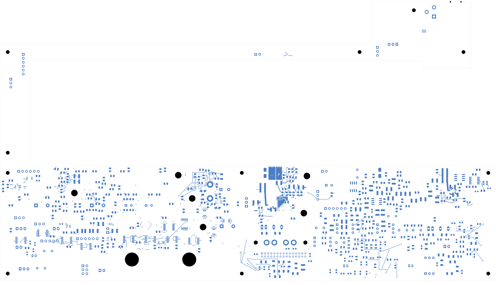

# Power/protection startup-cell checkpoint

This candidate closes **11 connections**, reducing power-board opens from
2,210 to **2,199**. It is not ready for fabrication.

U21/C66, U25/C70 and U28/C73 now have short local bypass connections and both
IC and capacitor ground returns. Their bypass traces are approximately 2.30,
3.30 and 2.30 mm. U21 and U22 also gain adjacent feedback-pin connections.
**These ICs are not yet connected to the auxiliary regulator's output.**
Startup operation remains unverified.

C66 and C73 move; no ICs, component values or schematic pin nets change.
Four U21 FAULT tracks are replaced with a back-layer fanout, a new via and a
front-layer continuation to J9.4. The pass adds 20 tracks and seven vias,
including six ground vias, and retires four tracks. Four main-ground zones
are refilled; all other 43 zone fills and every authored outline remain exact.

## Checks and evidence

- [Native review](review.json): zero geometry/parity errors; the independent
  [connectivity review](startup-cell-review.json) confirms zero ERC errors,
  two retained isolated-reference warnings, all 11 intended merges and every
  other native connection group and physical object preserved.
- [Reference review](startup-cell-reference-review.json): all 1,637 retained
  reference cases, eight new non-ground paths and nine previous startup-repair
  paths pass. All eleven supply-plane fields and seven quiet-ground fields
  remain exact. All seven quiet networks retain their connected ownership
  graphs and pin-8-only main returns. Existing unanchored ground fragments are
  excluded from usable reference copper and checked for exact preservation.
- [Routing manifest](startup-cell-routing.json) and
  [plan](../two-board-startup-cells-plan-05/plan.json) record exact changes.
  Pending flags in earlier stage reports describe that stage; the later
  native, connectivity and reference reports above record completed checks.
- [Visual review](plots/visual-review.json): 13 directly inspected views,
  with no additional visual findings. This is copper inspection, not
  electrical or manufacturing qualification.

Current counts: 1,101 footprints, 1,086 electrical parts, 3,420 schematic pin
entries, 3,481 mapped pads, 3,055 tracks, 462 vias, 47 zones, 7,238 captured
objects and 2,937 native connection groups. Open the
[KiCad project](power_protection.kicad_pro) to inspect the editable candidate.

## Current copper

[Front copper](plots/front.png) · [Six inner layers](plots/inner-contact-sheet.png)
· [U21 back detail](plots/u21-cell-back.png) · [U21 front detail](plots/u21-cell-front.png)
· [U25 back detail](plots/u25-cell-back.png) · [U28 back detail](plots/u28-cell-back.png)
· [U22 feedback detail](plots/u22-feedback-back.png)

## Remaining work

The [startup-net survey](../two-board-startup-connectivity-survey-03/README.md)
records **58 missing joins across 32 of 91 surveyed nets**. The separate
[startup-cell survey](../two-board-startup-cell-survey-01/README.md) records
unfinished bypass/ground work for U18/U19/U20/U22/U23/U24/U26/U27 and missing
auxiliary source distribution. Critical sense and timing placement also needs
review. A local bypass does not establish a powered or functional cell.

Protected outputs, analog/module distribution, source/input loops, force/quiet
returns and signal-board routing remain unfinished. The signal board still
has 251 opens and lacks an approved ESS codec footprint. Current/thermal,
startup/fault, timing/noise and complete installed-fit checks, accepted
stack/plating, exact BOM, manufacturing outputs and prototype bring-up work
are still required. Historical TBP35 inlet resistance results do not qualify
the current fills. No fabrication release or order is made by this checkpoint.
