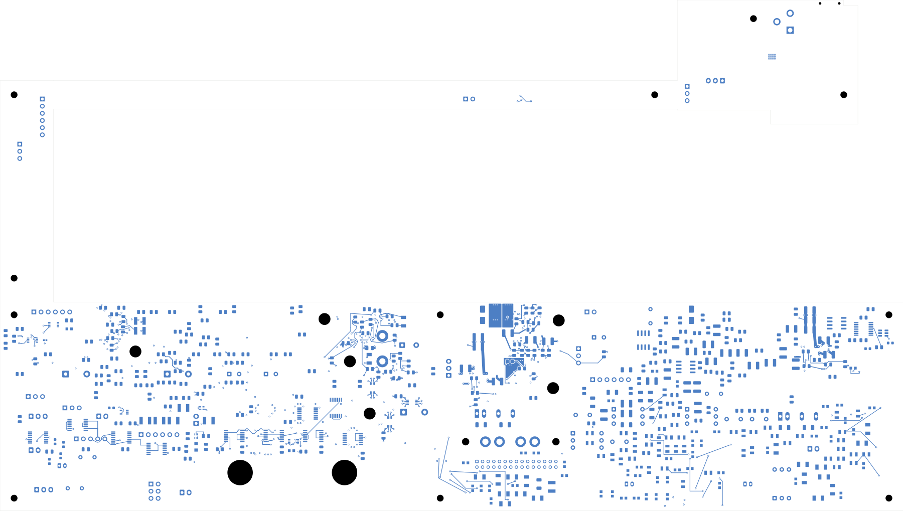

# TBP47 support-reference repairs

This checked development revision is selected by [status 47](../two-board-fabrication-status-47/status.json).
It is **not ready for fabrication**. The schematic retains its candidate title.

Four support routes now avoid the small ground-reference gaps beside their
existing vias: U17's ILM escape, the R114–C47 DVDT capacitor link and both C48
supply-via approaches. Six surface segments are replaced by nine. Trace widths,
all component positions, all vias, every zone outline and all 47 fills remain
unchanged. No component values, packages, pin nets or board outlines change.

The independent native audit preserves every connection group and every other
copper object. **2,210 power opens remain**, with zero geometry/parity/ERC
errors and two retained isolated-reference warnings. The signal board remains
at 251 opens and lacks the approved ESS codec footprint. The board contains
1,101 footprints, 1,086 electrical components, 3,420 schematic pin entries,
3,031 tracks, 453 vias, 47 zones and 2,948 native connection groups.

All four replacement paths and all 1,610 retained complete reference cases
have adjacent ground coverage. All 22 digital ILM/DVDT paths now have their
own quiet-field coverage. This fixes four of the twelve previously recorded
incomplete reference cases; the remaining eight startup paths are unchanged.
All seven quiet networks, their pin-8-only stars and all eleven supply planes
remain exactly as in [TBP46](../two-board-power-digital-return-native-03/README.md).
That revision's R104 quiet-return connection and master-enable repair are retained.

The [remaining-reference plan](../two-board-startup-reference-plan-01/README.md)
records the eight gaps and competing quiet fields. The
[startup connectivity survey](../two-board-startup-connectivity-survey-01/README.md)
remains applicable because all native groups and pad positions are preserved:
32 of 91 surveyed nets still require 60 joins. This does not count every
supply/ground connection or establish complete startup function.

Evidence: [native checks](review.json), [topology and unchanged planes](support-reference-review.json),
[reference coverage](support-reference-coverage.json), [routing manifest](support-reference-routing.json),
[visual review](plots/visual-review.json). Eight views were directly inspected:
five detailed layers covering all replacements, both surface overviews and
the six-inner-layer contact sheet. Reference checks exclude recorded same-net
via/plated-pad clearances; parasitics, current, timing and noise remain unqualified.

[Front](plots/front.png) · [Inner layers](plots/inner-contact-sheet.png) ·
[Support front](plots/support-local-front.png) · [Support back](plots/support-local-back.png) ·
[Support In1](plots/support-local-inner1.png) · [Support In6](plots/support-local-inner6.png)

Next: correct the eight startup reference gaps and finish startup routing and
verification, protected outputs, source/input loops, analog/module distribution,
force/quiet returns and signal routing. Load/startup/fault/thermal limits,
effective capacitance, accepted stack/plating, approved ESS package inputs,
exact BOM, complete housing/support/cooling/harness fit, reviewed manufacturing
outputs and a whole-unit prototype bring-up plan remain required.
